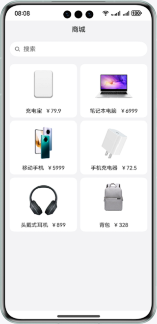

# 基于ArkWeb实现系统原生组件渲染至H5页面上

### 介绍

该方案展示了采用ArkWeb进行同层渲染的示例，可以将系统原生组件的内容直接渲染到前端H5页面上，原生组件不仅提供了H5组件无法实现的一些功能，还能提升流畅度，并增强用户的体验感。

### 效果图预览



**使用说明**

进入页面即可看到同层渲染效果，点击打开应用页面显示两列卡片，卡片内容包括图片文字，卡片及其包含的图片文字正常显示。

### 高性能知识点

ArkWeb同层渲染原生组件，原生组件不仅可以提供H5组件无法实现的一些功能，还能提升用户体验的流畅度；同层渲染节点上下树，实现节点复用，节省节点重复开销。

### 工程结构&模块类型
```
├──entry/src/main/ets/
│  ├──entryability
│  │  └──EntryAbility.ets                    // 配置类
│  ├──model
│  │  └──GoodsModel.ets                      // 类型声明
│  ├──pages
│  │  └──Index.ets                           // 程序入口类
│  └──viewmodel
│     └──GoodsViewModel.ets                  // 模拟数据类
└──entry/src/main/resource                   // 应用静态资源目录
```
### 具体实现

同层渲染简单来说就是，底层使用空白的H5页面，用Embed标签进行占位，ArkTS使用NodeContainer来占位，最后将Web侧的surfaceId和原生组件绑定，渲染在NodeContainer上。这里给出一些大致步骤，文件地址详见[Index.ets](entry/src/main/ets/pages/Index.ets)：

1. 用Stack组件层叠NodeContainer和Web组件，并开启enableNativeEmbedMode模式，代码详见[Index.ets](entry/src/main/ets/pages/Index.ets)。

```javascript
build() {
  Stack() {
    ForEach(this.componentIdArr, (componentId: string) => {
      NodeContainer(this.nodeControllerMap.get(componentId));
    }, (embedId: string) => embedId)
    Web({ src: $rawfile("embed_view.html"), controller: this.browserTabController })
      .backgroundColor($r('app.color.ohos_id_color_sub_background'))
      .zoomAccess(false)
      .enableNativeEmbedMode(true)
      .onNativeEmbedLifecycleChange((embed) => {
        const componentId = embed.info?.id?.toString() as string
        if (embed.status === NativeEmbedStatus.CREATE) {
          let nodeController = new SearchNodeController();
          nodeController.setRenderOption({
            surfaceId: embed.surfaceId as string,
            type: embed.info?.type as string,
            renderType: NodeRenderType.RENDER_TYPE_TEXTURE,
            embedId: embed.embedId as string,
            width: this.getUIContext().px2vp(embed.info?.width),
            height: this.getUIContext().px2vp(embed.info?.height)
          });
          nodeController.rebuild();
          this.nodeControllerMap.set(componentId, nodeController);
          this.componentIdArr.push(componentId);
        } else if (embed.status === NativeEmbedStatus.UPDATE) {
          let nodeController = this.nodeControllerMap.get(componentId);
          nodeController?.updateNode({
            text: 'update',
            width: this.getUIContext().px2vp(embed.info?.width),
            height: this.getUIContext().px2vp(embed.info?.height)
          } as ESObject);
          nodeController?.rebuild();
        } else {
          let nodeController = this.nodeControllerMap.get(componentId);
          nodeController?.setBuilderNode(null);
          nodeController?.rebuild();
          }
      })
      .onNativeEmbedGestureEvent((touch) => {
        this.componentIdArr.forEach((componentId: string) => {
          let nodeController = this.nodeControllerMap.get(componentId);
          if (nodeController?.getEmbedId() === touch.embedId) {
            nodeController?.postEvent(touch.touchEvent);
          }
        })
      })
  }
}
```
2. 因为要使用NodeContainer，所以封装一个继承自NodeController的类SearchNodeController，代码详见[Index.ets](entry/src/main/ets/pages/Index.ets)。

```javascript
class SearchNodeController extends NodeController {
  private rootNode: BuilderNode<[Params]> | undefined | null = null;
  private embedId: string = "";
  private surfaceId: string = "";
  private renderType: NodeRenderType = NodeRenderType.RENDER_TYPE_DISPLAY;
  private componentWidth: number = 0;
  private componentHeight: number = 0;
  private componentType: string = "";

  /**
   * 设置渲染参数
   * 
   * @param params 渲染参数
   */
  setRenderOption(params: NodeControllerParams): void {
    this.surfaceId = params.surfaceId;
    this.renderType = params.renderType;
    this.embedId = params.embedId;
    this.componentWidth = params.width;
    this.componentHeight = params.height;
    this.componentType = params.type;
  }

  /**
   * 创建节点
   *
   * @param uiContext UIContext
   * @returns 节点
   */
  makeNode(uiContext: UIContext): FrameNode | null {
    this.rootNode = new BuilderNode(uiContext, { surfaceId: this.surfaceId, type: this.renderType });
    if (this.componentType === 'native/component') {
      this.rootNode.build(wrapBuilder(searchBuilder), { width: this.componentWidth, height: this.componentHeight });
    }
    return this.rootNode.getFrameNode();
  }

  setBuilderNode(rootNode: BuilderNode<Params[]> | null): void {
    this.rootNode = rootNode;
  }

  getBuilderNode(): BuilderNode<[Params]> | undefined | null {
    return this.rootNode;
  }

  updateNode(arg: Object): void {
    this.rootNode?.update(arg);
  }

  getEmbedId(): string {
    return this.embedId;
  }

  postEvent(event: TouchEvent | undefined): boolean {
    return this.rootNode?.postTouchEvent(event) as boolean;
  }
}
```
3. 使用Web组件加载embed_view.html文件，Web组件解析到Embed标签后，通过onNativeEmbedLifecycleChange()接口上报Embed标签创建消息通知到应用侧，代码详见[Index.ets](entry/src/main/ets/pages/Index.ets)。

```javascript
Web({ src: $rawfile("embed_view.html"), controller: this.browserTabController })
  .backgroundColor($r('app.color.ohos_id_color_sub_background'))
  .zoomAccess(false)
  .enableNativeEmbedMode(true)
  .onNativeEmbedLifecycleChange((embed) => {
    const componentId = embed.info?.id?.toString() as string
    if (embed.status === NativeEmbedStatus.CREATE) {
      let nodeController = new SearchNodeController();
      nodeController.setRenderOption({
        surfaceId: embed.surfaceId as string,
        type: embed.info?.type as string,
        renderType: NodeRenderType.RENDER_TYPE_TEXTURE,
        embedId: embed.embedId as string,
        width: this.getUIContext().px2vp(embed.info?.width),
        height: this.getUIContext().px2vp(embed.info?.height)
      });
      nodeController.rebuild();
      this.nodeControllerMap.set(componentId, nodeController);
      this.componentIdArr.push(componentId);
    } else if (embed.status === NativeEmbedStatus.UPDATE) {
      let nodeController = this.nodeControllerMap.get(componentId);
      nodeController?.updateNode({
        text: 'update',
        width: this.getUIContext().px2vp(embed.info?.width),
        height: this.getUIContext().px2vp(embed.info?.height)
      } as ESObject);
      nodeController?.rebuild();
    } else {
      let nodeController = this.nodeControllerMap.get(componentId);
      nodeController?.setBuilderNode(null);
      nodeController?.rebuild();
    }
  })
```
4. 在步骤3的回调内，根据embed.status，将配置传入searchNodeController后，执行rebuild()方法重新触发其makeNode()方法，代码详见[Index.ets](entry/src/main/ets/pages/Index.ets)。

```javascript
Web({ src: $rawfile("embed_view.html"), controller: this.browserTabController })
  .backgroundColor($r('app.color.ohos_id_color_sub_background'))
  .zoomAccess(false)
  .enableNativeEmbedMode(true)
  .onNativeEmbedLifecycleChange((embed) => {
    const componentId = embed.info?.id?.toString() as string
    if (embed.status === NativeEmbedStatus.CREATE) {
      let nodeController = new SearchNodeController();
      nodeController.setRenderOption({
        surfaceId: embed.surfaceId as string,
        type: embed.info?.type as string,
        renderType: NodeRenderType.RENDER_TYPE_TEXTURE,
        embedId: embed.embedId as string,
        width: this.getUIContext().px2vp(embed.info?.width),
        height: this.getUIContext().px2vp(embed.info?.height)
      });
      nodeController.rebuild();
      this.nodeControllerMap.set(componentId, nodeController);
      this.componentIdArr.push(componentId);
    } else if (embed.status === NativeEmbedStatus.UPDATE) {
      let nodeController = this.nodeControllerMap.get(componentId);
      nodeController?.updateNode({
        text: 'update',
        width: this.getUIContext().px2vp(embed.info?.width),
        height: this.getUIContext().px2vp(embed.info?.height)
      } as ESObject);
      nodeController?.rebuild();
    } else {
      let nodeController = this.nodeControllerMap.get(componentId);
      nodeController?.setBuilderNode(null);
      nodeController?.rebuild();
    }
  })
```

### 相关权限

- 允许应用使用Internet网络权限：ohos.permission.INTERNET。

### 约束与限制

1.本示例仅支持标准系统上运行。

2.本示例为Stage模型，最低兼容API 20版本，使用API 26版本SDK编译。

3.本示例需要使用DevEco Studio 6.1.1 Release 及以上版本才可编译运行。

### 测试

`entry/src/ohosTest` 下共 30 个测试套件、2985 条自动化测试用例，覆盖 BundleInfo、HapModuleInfo 与 ApplicationInfo、字符串/颜色/整数/媒体资源、商品数据模型、rawfile 页面结构、文件与首选项、显示信息与 Want 参数、EntryAbility 上下文等场景。全量执行 2985 条用例，全部通过，失败 0 条，错误 0 条。用例设计与执行方式见 [ohosTest.md](ohosTest.md)。

执行方式：

1. 使用 DevEco Studio 自动签名，编译并安装主应用包与测试包。
2. 在 DevEco Studio 中选择 entry 模块的 ohosTest 执行全量用例。
3. 如需命令行执行，使用 OpenHarmony Ability Assistant 测试命令，参数为 `-b com.example.nativeembed -m entry_test -s unittest OpenHarmonyTestRunner -s timeout 600000`。

### 下载

如需单独下载本工程，执行如下命令：

```
git init
git config core.sparsecheckout true
echo code/Performance/ArkWebSameLevelRendering > .git/info/sparse-checkout
git remote add origin https://gitcode.com/openharmony/applications_app_samples.git
git pull origin master
```