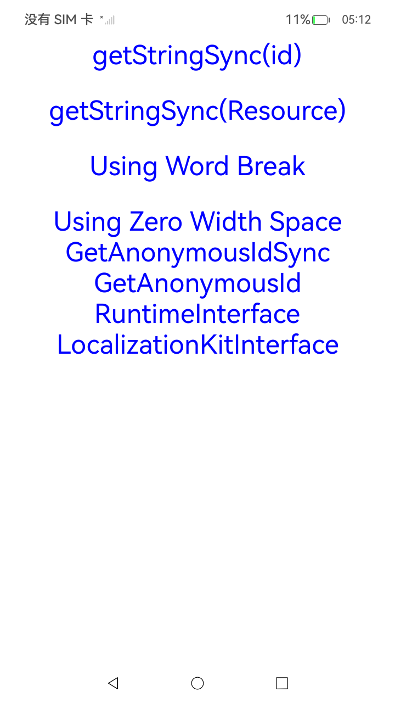
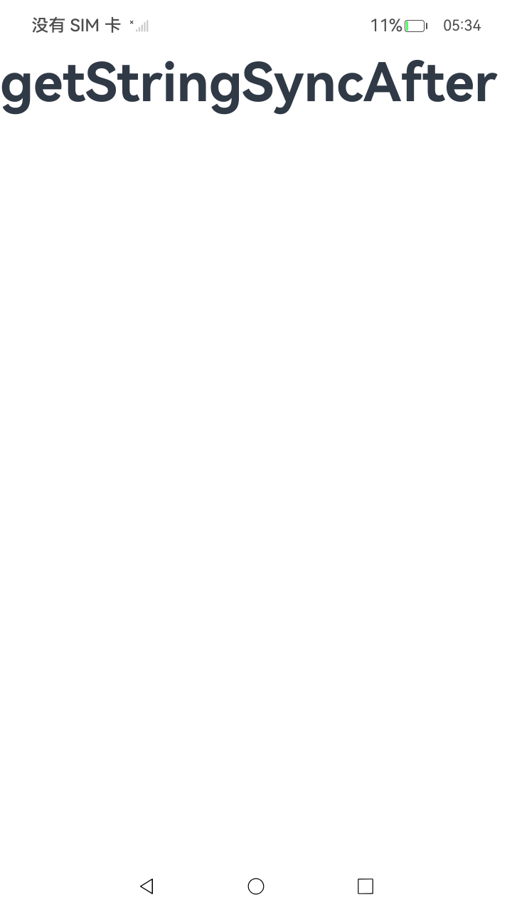
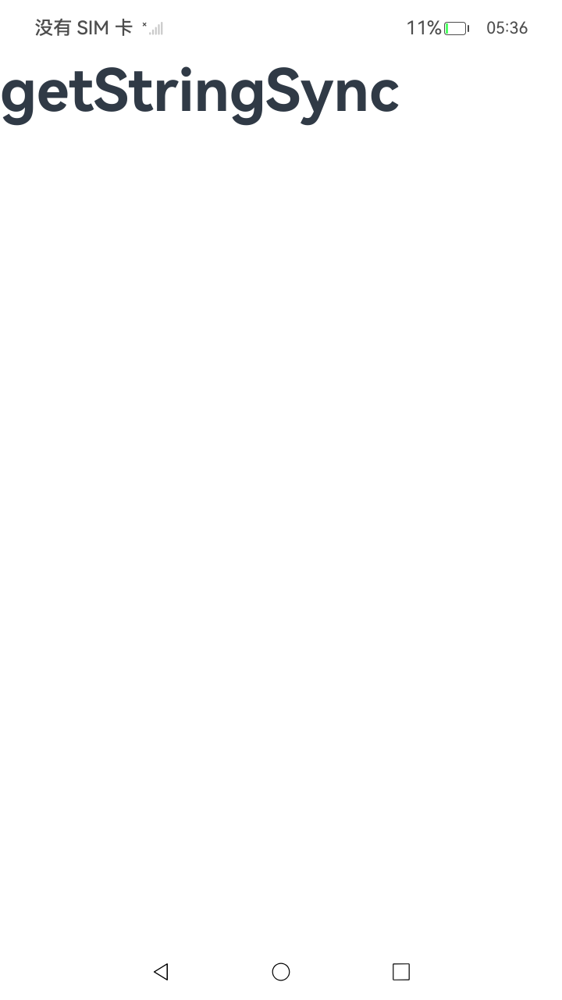
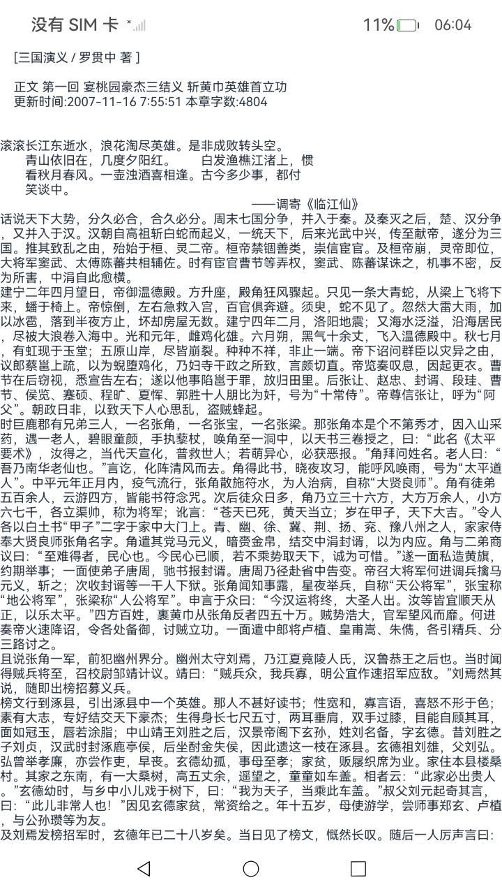
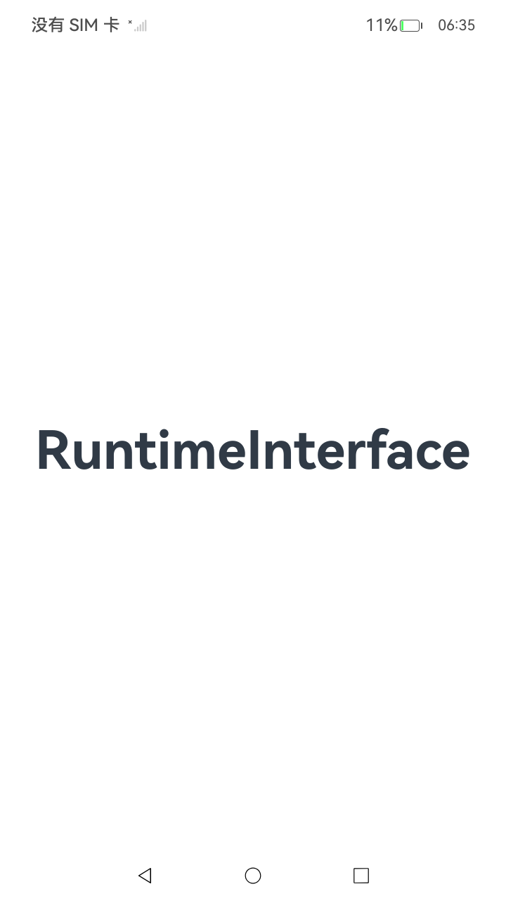

# 合理使用系统提供的接口
## 简介
在应用开发中，经常会调用系统提供的接口，比如读取本地文件、处理服务端数据等等。若对接口使用不合理，可能引起延迟、卡顿、丢帧等性能问题。本文以如下系统提供的接口为例，总结了使用中的注意事项。

- [ResourceManager](https://developer.huawei.com/consumer/cn/doc/harmonyos-references-V5/js-apis-resource-manager-V5#resourcemanager)的getXXXSync接口
- [wordBreak](https://developer.huawei.com/consumer/cn/doc/harmonyos-references-V5/ts-basic-components-text-V5#wordbreak11)属性
- [Localization Kit](https://developer.huawei.com/consumer/cn/doc/harmonyos-references-V5/js-apis-intl-V5)接口替换ArkTS运行时接口



## 使用说明
### ResourceManager的getXXXSync接口
 

ResourceManager通过getXXXSync接口获取资源的方式有两种：通过resource对象```resourceManager.getStringSync($r('app.string.test'))```和通过id```resourceManager.getStringSync($r('app.string.test').id)```。
通过resource对象的方式在获取过程中发生了一次拷贝，通过id的方式只是对原对象的引用。
以[getStringSync](https://developer.huawei.com/consumer/cn/doc/harmonyos-references-V5/js-apis-resource-manager-V5#getstringsync10)为例，参数为资源信息时比参数为资源ID值时耗时更多，**当需要使用类似方法时，使用资源ID值作为参数更优**。

#### 通过resource对象获取([源码示例链接](entry/src/main/ets/pages/GetStringSync.ets))

```ts
@Entry
@Component
struct Index {
  @State message: string = 'getStringSync';

  aboutToAppear(): void {
    hiTraceMeter.startTrace('getStringSync', 1);
    // getStringSync接口的入参直接使用资源，未使用资源ID
    getContext().resourceManager.getStringSync($r('app.string.test'));
    hiTraceMeter.finishTrace('getStringSync', 1);
  }

  build() {
    RelativeContainer() {
      Text(this.message)
        .fontSize(50)
        .fontWeight(FontWeight.Bold)
    }
    .height('100%')
    .width('100%')
  }
}
```
#### 通过id获取([源码示例链接](entry/src/main/ets/pages/GetStringSyncAfter.ets))

```ts
@Entry
@Component
struct Index {
  @State message: string = 'getStringSyncAfter';

  aboutToAppear(): void {
    hiTraceMeter.startTrace('getStringSyncAfter', 2);
    // getStringSync接口的入参使用了资源ID
    getContext().resourceManager.getStringSync($r('app.string.test').id);
    hiTraceMeter.finishTrace('getStringSyncAfter', 2);
  }

  build() {
    RelativeContainer() {
      Text(this.message)
        .fontSize(50)
        .fontWeight(FontWeight.Bold)
    }
    .height('100%')
    .width('100%')
  }
}
```

### wordBreak属性



零宽空格（Zero Width Space, ZWSP）是一个特殊的Unicode字符。它是一个不可见的字符，其宽度为零，不占用任何可见空间。在文本处理系统中，尽管它在视觉上是不可见的，但它在文本中确实存在，并可以作为潜在的断点，即允许在此位置断开行。这意味着如果一行文本过长需要自动换行时，文本可以在零宽空格的位置进行折行，而不影响单词的完整性。

虽然零宽空格在许多情况下都是有用的，但它也可能引起问题，特别是在文本处理和数据清洗中。不注意这些看不见的字符可能导致数据的意外错误、搜索失败、数据不一致等问题。因此，在处理来自不同源的文本数据时，了解和考虑这些不可见字符是非常重要的。

避免在文本组件内使用零宽空格(\u200b)的形式来设置断行规则，推荐使用[wordBreak](https://developer.huawei.com/consumer/cn/doc/harmonyos-references-V5/ts-basic-components-text-V5#wordbreak11)，**wordBreak在使用性能方面优于零宽空格。例如推荐用法为：Text(this.diskName).wordBreak(WordBreak.BREAK_ALL)**。

### 关于两个断行页的呈现说明

`UsingWordBreak.ets`（正例）与 `UsingZeroWidthSpace.ets`（反例）进入后**断行效果看起来一致**，这是预期行为，不是示例失效：

1. **断行结果本来就相同**：中文文本没有空格，任意两个汉字之间都是合法断行位置，插入零宽空格并不会新增断行点，因此两页的折行效果看起来一样。这正是零宽空格方案容易被误用的原因——它看起来"也能用"。
2. **两页均限制显示长度**：`sanguo.txt` 全文约十万字。整段文本布局可能造成 UI 线程阻塞；两个页面共用 `DisplayText.ets`，最多取 2000 个 UTF-16 码元，边界遇到合法代理对时退回一个码元，避免显示截断的字符。上限由 `MAX_DISPLAY_LENGTH` 定义；本轮未执行设备帧率或全文布局测量。
3. **差异在看不见的地方**：2000 个单码元字符在没有 CRLF 的情况下插入零宽字符后最多变成 3999 个码元；代理对按一个码点处理，CRLF 之间不插入，实际数量因此可能更少。新增不可见字符仍会随复制、搜索、文本比较一起带出，也会增加布局工作量；实际耗时不能由字符数量直接推断。

因此示例的结论不变：零宽空格可以做到同样的断行效果，代价是**数据被污染**和**额外的布局开销**，推荐使用 `Text(...).wordBreak(WordBreak.BREAK_ALL)`。

> 后续可选优化：在两个页面增加"加载全文"按钮，默认渲染片段保证秒开，由用户主动触发完整文本渲染来体验布局开销的差异。

#### 反例([源码示例链接](entry/src/main/ets/pages/UsingZeroWidthSpace.ets))

```ts
import { insertZeroWidthSpaces } from '../utils/DisplayText';

@CustomDialog
export struct DiskFormatDialog {
  private diskName: string = '';
  build() {
    Column() {
      Text(insertZeroWidthSpaces(this.diskName))
      .textAlign(TextAlign.Start)
    }
  }
}
```

#### 正例([源码示例链接](entry/src/main/ets/pages/UsingWordBreak.ets))

```ts
@CustomDialog
export struct DiskFormatDialog {
  private diskName: string = '';
  build() {
    Column() {
      Text(this.diskName)
      .textAlign(TextAlign.Start)
      .wordBreak(WordBreak.BREAK_ALL)
    }
  }
}
```

### 国际化使用Localization Kit接口替换ArkTS运行时接口

 

在应用国际化处理时，由于ArkTS运行时兼容TS/JS，所以开发者可以直接使用国际化接口Intl实现包括时间日期格式化、数字格式化、排序格式化等国际化处理，而不需要导入额外模块。此外，开发者也可以使用Localization Kit接口intl实现相同功能。

但是，在分别使用Localization Kit接口intl和ArkTS运行时接口Intl创建同类对象时，Localization Kit接口的耗时更短，性能更优。并且在多次创建时，随着创建次数的增加，二者的耗时差异会更加明显。**建议开发者在进行国际化开发时，使用Localization Kit模块提供的接口替换ArkTS运行时接口，减少执行耗时**。

#### 使用ArkTS运行时接口Intl([源码示例链接](entry/src/main/ets/pages/RuntimeInterface.ets))

下面使用ArkTS运行时接口Intl执行100次对象创建，此时Intl不需要import导入，可以直接使用。

```ts
// 导入自定义打点模块
import { hiTraceMeter } from '@kit.PerformanceAnalysisKit';

// 循环创建100次RelativeTimeFormat对象，记录每次创建的耗时和总执行耗时
hiTraceMeter.startTrace('RelativeTimeFormat-100', 1);
try {
  for (let i: number = 0; i < 100; i++) {
    hiTraceMeter.startTrace('RelativeTimeFormat-single', 2);
    try {
      new Intl.RelativeTimeFormat('zh-CN', { numeric: 'auto' });
    } finally {
      hiTraceMeter.finishTrace('RelativeTimeFormat-single', 2);
    }
  }
} finally {
  hiTraceMeter.finishTrace('RelativeTimeFormat-100', 1);
}

// 同样的过程创建DateTimeFormat、NumberFormat等其他类的实例
```

#### 使用Localization Kit接口intl([源码示例链接](entry/src/main/ets/pages/LocalizationKitInterface.ets))

使用Localization Kit接口替换ArkTS运行时接口创建100次同类对象，使用前需要先从Localization Kit导入intl。示例代码如下:

```ts
// 导入自定义打点模块
import { hiTraceMeter } from '@kit.PerformanceAnalysisKit';
// 导入国际化接口intl
import { intl } from '@kit.LocalizationKit';

// 循环创建100次RelativeTimeFormat对象，记录每次创建的耗时和总执行耗时
hiTraceMeter.startTrace('RelativeTimeFormat-100', 1);
try {
  for (let i: number = 0; i < 100; i++) {
    hiTraceMeter.startTrace('RelativeTimeFormat-single', 2);
    try {
      new intl.RelativeTimeFormat('zh-CN', { numeric: 'auto' });
    } finally {
      hiTraceMeter.finishTrace('RelativeTimeFormat-single', 2);
    }
  }
} finally {
  hiTraceMeter.finishTrace('RelativeTimeFormat-100', 1);
}

// 同样的过程创建DateTimeFormat、NumberFormat等其他类的实例
```

## 工程目录

```
├──entry/src/main/ets
│  ├──entryability
│  │  └──EntryAbility.ets                   // 程序入口类
│  └──pages
│     ├──Index.ets                          // 主页
│     ├──GetStringSync.ets                  // 通过资源管理获取资源
│     ├──GetStringSyncAfter.ets             // 通过id获取资源
│     ├──UsingWordBreak.ets                 // wordBreak属性断行
│     ├──UsingZeroWidthSpace.ets            // 零宽空格断行
│     ├──RuntimeInterface.ets               // Intl国际化
│     └──LocalizationKitInterface.ets       // Localization Kit国际化
│  └──utils
│     ├──DisplayText.ets                    // 页面共用的文本处理
│     └──TracedResources.ets                // 资源路由与打点
├──entry/src/main/resources                 // 应用静态资源目录
└──entry/src/ohosTest/ets/test              // 测试用例目录
   ├──Ability.test.ets                      // 应用信息与入口Ability用例
   ├──ResourceManagerSync.test.ets          // getXXXSync接口用例
   ├──TextDecode.test.ets                   // 文本解码与零宽空格用例
   ├──IntlInterface.test.ets                // intl与Intl对比用例
   ├──Intl*Logic.test.ets                   // 七套独立预期国际化矩阵
   ├──Display*Logic.test.ets                // 显示限长与解码矩阵
   ├──ZeroWidthSpaceLogic.test.ets          // 码点及换行边界
   ├──TextDecoderStreamLogic.test.ets       // UTF-8拆分与异常矩阵
   ├──Resource*TraceLogic.test.ets          // 两套资源与打点矩阵
   └──List.test.ets                         // 默认逻辑与可选Ability注册
```

## 具体实现

资源读取与打点封装见 [TracedResources.ets](entry/src/main/ets/utils/TracedResources.ets)，文本解码、限长与零宽字符插入见 [DisplayText.ets](entry/src/main/ets/utils/DisplayText.ets)。资源读取仍区分 Resource 对象与资源 ID；打点结束使用 `finally`，异常继续向调用方传播。文本显示最多保留 2000 个 UTF-16 码元，截断边界不拆开合法代理对；零宽字符按 Unicode 码点插入并保持 CRLF 相邻，不保证字素簇完整，也不会清除原有零宽字符。

以下性能建议来自示例原有说明，本轮自动化测试验证功能与边界，不构成设备性能测量结论。

1. ResourceManager通过getXXXSync接口获取资源的方式：通过resource对象```resourceManager.getStringSync($r('app.string.test'))```和通过id```resourceManager.getStringSync($r('app.string.test').id)```，通过id获取资源的性能优于通过resource对象获取资源对象。
2. 在文本处理和数据清洗中，零宽空格字符可能导致数据的意外错误、搜索失败、数据不一致等问题，建议使用wordBreak避免出现该问题；推荐用例：Text(this.diskName).wordBreak(WordBreak.BREAK_ALL)。
3. 在分别使用Localization Kit接口intl和ArkTS运行时接口Intl创建同类对象时，Localization Kit接口的耗时更短，性能更优；并且在多次创建时，随着创建次数的增加，二者的耗时差异会更加明显。建议在进行国际化开发时，使用Localization Kit模块提供的接口替换ArkTS运行时接口，减少执行耗时。

## 测试用例

测试用例位于 `entry/src/ohosTest`。主包和测试包编译命令分别为：

```bash
hvigorw --mode module -p module=entry@default -p product=default assembleHap
hvigorw --mode module -p module=entry@ohosTest -p product=default assembleHap
```

在 DevEco Studio 中配置合法签名并连接设备后，选中 entry 模块，右键选择 `Run 'test'`。编译通过不等于安装或设备测试通过。

新增 13 套、984 条逻辑用例，共 71,774 物理行、63,618 行去注释及空行的有效测试代码、15,801 个断言；检视补强后的规模高于约五万行目标。统计仅包含新增测试文件，不是 Git 净改动量。原有 30 条用例保留；默认注册 16 套、1010 条逻辑/SDK 用例，不启动主界面。需要应用信息及入口启动验证时，显式选择 `EntryAbilityTest`，执行原有 4 条 Ability 用例。混合选择其他测试类不会注册 Ability 套件，以免引入主界面依赖。

覆盖范围：

1. `ResourceObjectTraceLogic` / `ResourceIdTraceLogic`：精确对象与 ID 路由，调用顺序，开始/读取/结束异常，异常覆盖规则，输入不变及重复调用。
2. `DisplayLimitLogic` / `DisplayDecodeLogic`：空输入、控制字符、组合字符、合法代理对及 2000 码元边界，真实页面共用函数的结果及输入不变。
3. `ZeroWidthSpaceLogic`：按码点插入、已有零宽字符保留、代理对、重复调用与输入隔离。
4. `TextDecoderStreamLogic`：手工 UTF-8 字节的多字节拆分、逐字节流、替换字符、fatal 异常及恢复。
5. 七套 `Intl*Logic`：六类 intl/Intl 对象的固定预期、正负零、舍入与有效位、UTC 日期、排序、复数及相对时间。
6. 原有 `ResourceManagerSyncTest`、`TextDecodeTest`、`IntlInterfaceTest`：真实资源与原 SDK 行为；`EntryAbilityTest` 保留为显式选择。

2026-11-19 设备修复后复验：主包和 ohosTest 均编译成功、生成签名包并更新安装；新增 984/984 条主机用例、15,801 个断言通过，另有 46/46 项 benchmark 异常及 runner 边界检查通过。主机使用 Node Intl/TextDecoder 替身，不代表 OpenHarmony SDK、UI 或性能测试通过。Locale 测试改为完整序列化标签的规范化语义校验及独立 baseName 校验，单套设备 72/72 条通过；零宽字符插入显式保留合法代理对和 CRLF，文本测试使用独立 UTF-16 扫描计数，保留固定预期。

16:04 最新设备附件列出 75 条失败：科学/工程计数 40 条、数值格式 29 条、TextDecoder 空输入终结 6 条，均对应当前源码，未新增失败编号。Locale、显示限长/解码及零宽插入的旧错误未再出现，但附件没有完整执行及通过数量汇总；此前修复后本地整轮回归已中断，不能声明全量通过。剩余数值有效位、默认舍入、整数补零及空流终结与 SDK 规格冲突，保留正确预期，不删除用例或回填实际结果掩盖失败。Ability 4 条仍需单独选择验证，手工 UI 和性能验证未完成。

原始基线保护审计仍为 34/35 一致：现有 build-profile.json5 的 default 签名配置与初始无签名基线不同，未覆盖该配置。本轮设备修复前后的独立保护快照为 35/35 一致，全部 1014 个用例名称及编号保留，不用新快照抹平原始差异。完整目录、编号范围及验证边界见 [ohosTest.md](ohosTest.md)。

## 相关权限
不涉及

## 约束与限制
1. 本示例仅支持标准系统上运行。
2. 本示例使用 OpenHarmony SDK 26.0.0（API 26）编译。
3. 本示例需要使用DevEco Studio 版本号(DevEco Studio 6.0.0 Release)及以上版本才可编译运行。
