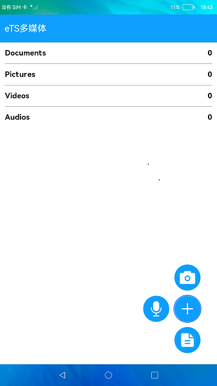

# MultiMedia - Camera and Media Library

## Introduction

This ArkTS Stage-model sample (`ohos.samples.multimedia`) demonstrates photo/video capture, audio recording, and media-file creation, listing, renaming and deletion. Images and videos use `photoAccessHelper`; recordings and documents use the application sandbox.

## Preview



## Usage

1. Launch the application and grant only the permissions required by the selected feature.
2. Touch **+** to display the camera, audio-recording and document buttons.
3. Install `lib/CameraPage-1.0.0.hap` before using the external camera feature. Capture a photo or record a video, then return to the home screen.
4. Open the recording page, start recording, pause/resume if needed, and finish recording.
5. Open the document page, enter text and save it in the sandbox.
6. Open an album to inspect files. Rename or delete only disposable files; deletion changes application/device data.
7. Install `lib/VideoPlayer.hap` before opening a video with the external player.

## Project structure

```text
AppScope/                              Application metadata and resources
build-profile.json5                    Product, SDK and local signing configuration
entry/src/main/ets/
  Application/AbilityStage.ts           Stage entry
  MainAbility/MainAbility.ts            Application ability and permission requests
  pages/                               Home, album, camera, recording and document pages
  model/MediaUtils.ts                   Media-library and sandbox operations
  model/RecordModel.ts                  Recorder lifecycle and native adapter
  model/DateTimeUtil.ts                 Filename date/time formatting
  model/TimeUtils.ts                    Duration display formatting
  view/BasicDataSource.ets              Data storage and change notifications
entry/src/ohosTest/ets/
  test/List.test.ets                    Safe default suite registration
  test/*Logic.test.ets                  Deterministic production-logic tests
  test/MultiMediaUiTest.test.ets         Optional legacy UI tests
  utils/                               Assertion logging and injected test dependencies
lib/                                   External camera/player artifacts and source archives
```

## Implementation

- [MediaUtils](entry/src/main/ets/model/MediaUtils.ts) selects the media backend, manages asset handles and closes fetch results. Typed dependencies allow tests to exercise production logic without accessing real media files.
- [RecordModel](entry/src/main/ets/model/RecordModel.ts) uses `media.createAVRecorder`, handles state callbacks and releases recorders on completion/failure. Test factories replace only the native recorder boundary.
- [DateTimeUtil](entry/src/main/ets/model/DateTimeUtil.ts) and [TimeUtils](entry/src/main/ets/model/TimeUtils.ts) format filename components and recording durations.
- [BasicDataSource](entry/src/main/ets/view/BasicDataSource.ets) preserves item/array identity and sends explicit data-change notifications.
- [CameraService](entry/src/main/ets/model/CameraService.ts) contains hardware-dependent camera operations; deterministic logic tests do not establish camera or microphone correctness.

## Permissions

Complete media functionality requires `ohos.permission.CAMERA`, `ohos.permission.MICROPHONE`, `ohos.permission.MEDIA_LOCATION`, `ohos.permission.WRITE_IMAGEVIDEO` and `ohos.permission.READ_IMAGEVIDEO`. Audio recordings and documents use the application sandbox, so `READ_AUDIO` and `WRITE_AUDIO` are neither declared nor requested at startup.

The current local manifest has been externally changed to declare only CAMERA and MICROPHONE, while MainAbility still requests all five permissions. This mismatch failed the supplementary permission check and was not overwritten during the four-case fix. Full media functionality is not accepted: restore consistent declarations and validate the real media operations separately.

API 26 defines `READ_IMAGEVIDEO` and `WRITE_IMAGEVIDEO` as `user_grant` permissions with `system_basic` available level and provision support. The signing profile must authorize these permissions through the appropriate APL/ACL; a runtime permission dialog cannot fix installation-time authorization failure. Removing permissions needed by the existing media-library features is not a functionality-preserving installation fix.

Logic tests do not request additional permissions, record audio/video, open real media-library assets, or delete device files.

## Dependencies

The test module uses `@ohos/hypium` 1.0.6. The external camera/player artifacts are required only for the corresponding UI features, not for deterministic logic tests.

## Constraints and build

- Standard-system OpenHarmony devices with `default` or `tablet` support.
- OpenHarmony API 26, SDK 26.0.0.38; `runtimeOS` is `OpenHarmony`.
- Use DevEco Studio with the matching API 26 SDK and Hvigor toolchain.
- Configure the SDK locally in the ignored `local.properties`: `sdk.dir=E:/sdk` for this workstation. Do not distribute signing credentials or local paths with a source change.
- Main HAP: `hvigorw --mode module -p module=entry@default -p product=default -p buildMode=debug assembleHap --no-daemon`.
- Test HAP: replace `module=entry@default` with `module=entry@ohosTest`.
- If a daemon retains an old SDK path, run `hvigorw --stop-daemon` before rebuilding.
- Both signed HAPs rebuilt successfully after the close-error fix; only the entry_test HAP was updated on the device, successfully and without uninstalling or clearing data. The rebuilt main HAP was not deployed because its current permission declarations differ from the runtime requests. No signing credentials or authorization levels were changed. Earlier 9568320/unsigned and 9568289/READ_AUDIO failures are historical; successful logic tests do not establish complete main-application functionality.

## Tests

See [ohosTest.md](ohosTest.md) for the case catalog, safe execution commands, actual validation results and known limitations. The default entry runs 22 deterministic logic suites with 958 cases. Cases 1196–1199 exposed duplicate close attempts on the device when close threw during a return inside try/finally; moving the successful return after finally fixed the issue without changing assertions or removing cases. The targeted device run passed 4/4, followed by 958/958 in the default device run with zero failures/errors/ignored cases and matching unique source IDs. Host regression also passed 958 cases with 12,454 assertions, and both HAP targets compiled. UI/hardware interactions remain untested, and the current permission-manifest mismatch remains unresolved.

Legacy UI tests contain deletion operations and are registered only when the class selection contains exclusively `MultiMediaUiTest` tests; an IDE “run all” mixed selection does not enable them. The UI suite also requires an empty Documents sandbox: existing `.txt` files or a failed directory read prevent execution. Use only an isolated, disposable test installation.

## Download

The following example uses the upstream `master` branch; select the actual target branch when preparing a PR.

```bash
git init
git remote add origin https://gitcode.com/openharmony/applications_app_samples.git
git sparse-checkout init --cone
git sparse-checkout set code/Solutions/Media/MultiMedia
git pull origin master
```
