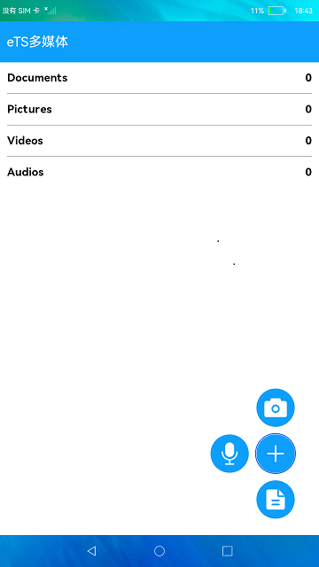

# MultiMedia - 相机和媒体库

## 介绍

本示例使用 ArkTS 和 Stage 模型，包名为 `ohos.samples.multimedia`，展示拍照、录像、录音，以及媒体文件的创建、查询、重命名和删除. 图片、视频通过 `photoAccessHelper` 管理，音频录制文件和文档保存在应用沙箱中.

## 效果预览



## 使用说明

1. 启动应用，根据需要授权所使用功能的权限.
2. 点击 **+**，展开相机、录音和文档入口.
3. 使用外部相机入口前，安装 `lib/CameraPage-1.0.0.hap`. 拍照或录像后返回首页.
4. 进入录音页面，开始录音，根据需要暂停、继续，结束录音后返回首页.
5. 进入文档页面，输入内容并保存到应用沙箱.
6. 进入相册查看文件. 删除和重命名会改变实际数据，只对可丢弃的测试文件操作.
7. 调起外部视频播放前，安装 `lib/VideoPlayer.hap`.

## 工程目录

```text
AppScope/                              应用信息和资源
build-profile.json5                    产品、SDK 和本机签名配置
entry/src/main/ets/
  Application/AbilityStage.ts           Stage 入口
  MainAbility/MainAbility.ts            主 Ability 和权限申请
  pages/                               首页、相册、相机、录音、文档页面
  model/MediaUtils.ts                   媒体库和沙箱文件操作
  model/RecordModel.ts                  录音生命周期和原生适配器
  model/DateTimeUtil.ts                 文件名日期、时间格式化
  model/TimeUtils.ts                    录音时长格式化
  view/BasicDataSource.ets              数据存储和变化通知
entry/src/ohosTest/ets/
  test/List.test.ets                    默认安全测试入口
  test/*Logic.test.ets                  确定性的真实业务逻辑测试
  test/MultiMediaUiTest.test.ets         可选的原有 UI 测试
  utils/                               断言日志和注入式测试依赖
lib/                                   外部相机、播放器产物及源码归档
```

## 具体实现

- [MediaUtils](entry/src/main/ets/model/MediaUtils.ts) 管理不同媒体类型的后端选择、文件句柄及查询结果释放. 测试通过类型化依赖替换文件系统和媒体库边界，仍然调用生产实现，而不是复制业务算法.
- [RecordModel](entry/src/main/ets/model/RecordModel.ts) 使用 `media.createAVRecorder`，处理状态回调和结束、失败时的资源释放. 测试工厂只替换原生录音器边界.
- [DateTimeUtil](entry/src/main/ets/model/DateTimeUtil.ts) 和 [TimeUtils](entry/src/main/ets/model/TimeUtils.ts) 分别处理文件名日期、时间与录音时长.
- [BasicDataSource](entry/src/main/ets/view/BasicDataSource.ets) 保留数据数组和条目引用，按既有契约发送显式变化通知.
- [CameraService](entry/src/main/ets/model/CameraService.ts) 包含依赖相机硬件的实现. 确定性逻辑测试不能替代真实拍照、录像和麦克风验证.

## 相关权限

完整媒体功能需要以下权限；本次检视修复已恢复 MEDIA_LOCATION、WRITE_IMAGEVIDEO、READ_IMAGEVIDEO 的清单声明，使声明与 MainAbility 的五项运行时申请一致. 恢复后的安装、签名授权和真实媒体操作仍需单独验收：

- `ohos.permission.CAMERA`
- `ohos.permission.MICROPHONE`
- `ohos.permission.MEDIA_LOCATION`
- `ohos.permission.WRITE_IMAGEVIDEO`
- `ohos.permission.READ_IMAGEVIDEO`

音频录制和文档使用应用沙箱，不需要音频媒体库权限，已从清单和启动申请中移除 `READ_AUDIO`、`WRITE_AUDIO`. API 26 将 `READ_IMAGEVIDEO`、`WRITE_IMAGEVIDEO` 定义为 `user_grant`、`system_basic` 且支持 provision 授权；签名 profile 的权限等级/授权列表（APL/ACL）仍需满足保留的图片和视频功能. 运行时弹窗不能解决安装阶段的权限授权失败. 新增逻辑测试不增加权限，不录制音视频，不打开真实媒体库资产，也不删除设备文件.

## 依赖

测试框架为 `@ohos/hypium` 1.0.6. 外部相机和播放器产物仅用于对应界面功能，逻辑测试不依赖安装它们.

## 约束与限制

1. 支持标准系统 OpenHarmony 设备，设备类型为 `default` 或 `tablet`.
2. 使用 OpenHarmony API 26，SDK 26.0.0.38，`runtimeOS` 为 `OpenHarmony`.
3. 使用支持对应 API 26 SDK 的 DevEco Studio 和 Hvigor 工具链.
4. 本机通过已忽略的 `local.properties` 配置 SDK，本工作站为 `sdk.dir=E:/sdk`. 不应将本机签名凭据或 SDK 路径作为源码变更分发.
5. 编译主包：`hvigorw --mode module -p module=entry@default -p product=default -p buildMode=debug assembleHap --no-daemon`.
6. 编译测试包时，将 `module=entry@default` 改为 `module=entry@ohosTest`.
7. 修改 SDK 后若 daemon 仍使用旧路径，先执行 `hvigorw --stop-daemon` 再重新编译.
8. 四条关闭异常用例修复后，两个 signed HAP 已重编成功；仅更新设备 entry_test 测试模块，安装成功，未卸载或清数据. 本次检视修复已恢复与运行时申请一致的权限声明并重新编译两个 HAP，但恢复后的主包未部署到设备，也未修改签名凭据或提升权限等级. 9568320/unsigned、9568289/READ_AUDIO 属于此前安装记录；逻辑测试通过不代表完整主应用功能已验收.

## 测试说明

用例目录、执行步骤、真实验证结果和覆盖限制见 [ohosTest.md](ohosTest.md). 1196–1199 在设备上发现 try 内 return、finally 关闭抛错时重复关闭；将成功返回移到 finally 后，未删用例或放宽断言. 修复后四条定点设备用例全部通过，随后默认 22 个逻辑套件、958 条设备用例全部通过，0 Failure/Error/Ignore，唯一编号及开始/通过记录与源码一致. 主机 958 条、12,454 条断言通过，两个 HAP 编译成功. UI/硬件交互未执行，权限声明已恢复一致，恢复后的真机媒体功能仍待验收.

原有 UI 套件包含删除操作，只有 class 选择中全部条目都是 `MultiMediaUiTest` 测试时才注册，IDE “运行全部”的混合选择不会启用该套件. UI 套件还要求 Documents 沙箱为空：存在既有 `.txt` 文件或目录读取失败时会阻止执行. 仅在隔离、可丢弃的测试安装中运行.

## 下载命令

下面示例使用上游 `master` 分支. 准备 PR 时，应按实际目标分支调整，当前本机目录不是 Git 仓库，未执行提交或推送.

```bash
git init
git remote add origin https://gitcode.com/openharmony/applications_app_samples.git
git sparse-checkout init --cone
git sparse-checkout set code/Solutions/Media/MultiMedia
git pull origin master
```
