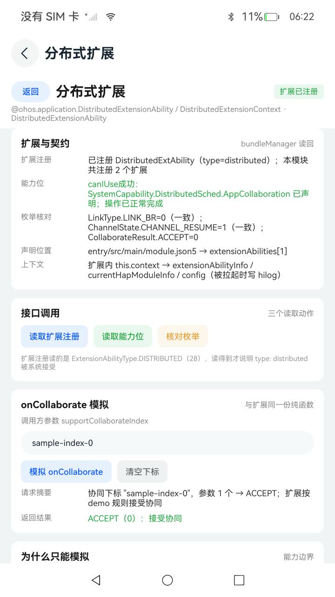
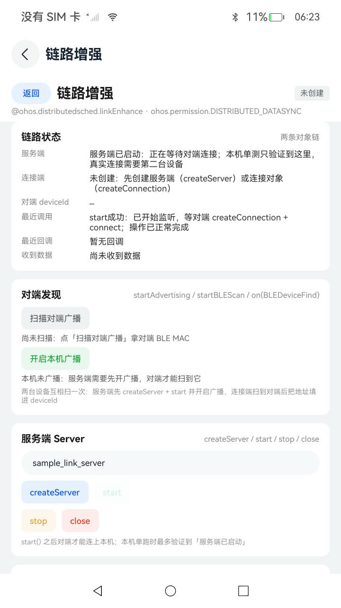

# DistributedExtension

演示 OpenHarmony 分布式扩展与链路三个能力的示例工程：
`@ohos.application.DistributedExtensionAbility`、`@ohos.distributedsched.linkEnhance`、
`@ohos.distributedsched.proxyChannelManager`。

工程以 `Navigation` 作为页面根容器，首页给出三个能力的元数据、前置条件（syscap 与两个权限）与统一日志面板，
每个能力有独立演示页。演示页里的每个按钮都直接调用系统接口，把**真实返回码、原始 message、错误分类**同时写进
hilog 与页面日志。

已在真机（OpenHarmony 7.1.0.22 / API 26，`const.product.devicetype = default`）上安装运行，
`entry/src/ohosTest` 的 3016 个用例连续两轮全部通过（单次执行，`Failure: 0`，见「运行测试」）；
同一份构建也在 OpenHarmony 7.0.0.38 的机器上跑过一遍全量，同样 3016/3016。

## 效果预览

截图为 dayu200 真机（720×1280）实拍，两个 `user_grant` 权限均已授权：

| 首页 | 分布式扩展 | 链路增强 |
| --- | --- | --- |
|  |  |  |
| syscap 已声明 AppCollaboration、`DISTRIBUTED_DATASYNC` 与 `ACCESS_BLUETOOTH` 均为「已授权」，3 个能力入口与首页事件日志 | `bundleManager` 读回扩展注册（`type=distributed`，本模块共 2 个扩展）、能力位与枚举核对三项一致；模拟 `onCollaborate` 返回 `ACCEPT (0)` | `createServer` + `start` 后服务端落「服务端已启动：正在等待对端连接」；单机最多验到这里，`connect` 需要第二台设备 |

首页与演示页的日志面板是同一条链路的页面内副本，hilog 侧另有完整调用记录，
按 domain `0xF811`（`hdc shell hilog -T DistributedExtension`）与 tag 过滤即可。

## 四个接口与演示入口

| 接口 | 示例入口 | 关键约束 | 演示内容 |
| --- | --- | --- | --- |
| `@ohos.application.DistributedExtensionAbility` | 首页「分布式扩展」 | 需成为系统应用并配置 ACL 才会被系统拉起 | `module.json5` 注册 `type: "distributed"` 的扩展，页面用 `bundleManager` 读回注册信息，并模拟 `onCollaborate` 的 ACCEPT / REJECT |
| `@ohos.application.DistributedExtensionContext` | 同上 | 随扩展生命周期提供（`this.context`） | 扩展本体在 `onCreate(want)` 里先记 bundleName / abilityName，再读 `this.context` 的 `extensionAbilityInfo` / `currentHapModuleInfo` / `config` 写 hilog；读取与兜底在 `model/ExtensionContextInfo`，两条用例覆盖 |
| `@ohos.distributedsched.linkEnhance` | 首页「链路增强」 | `ohos.permission.DISTRIBUTED_DATASYNC`；真实连接需两台设备 | 服务端 `createServer → start → stop → close`，连接端 `createConnection → connect → sendData → disconnect → close`，单次发送上限 1024 字节 |
| `@ohos.distributedsched.proxyChannelManager` | 首页「代理通道」 | `ohos.permission.ACCESS_BLUETOOTH`；只支持 `LinkType.LINK_BR`，对端必须已配对 | `openProxyChannel({ linkType, peerDevAddr, peerUuid })` 拿 `channelId`，`sendData` 收发，`on('receiveData' / 'channelStateChange')` 订阅，`closeProxyChannel` 关闭 |

`linkEnhance` 的 `deviceId` 在 d.ts 里写明是**对端设备的 BLE MAC 地址**（`getPeerDeviceId()` 返回空串表示未知），
页面输入框按 MAC 格式提示；`proxyChannelManager` 的 `peerDevAddr` 同样是 MAC，`peerUuid` 为 8-4-4-4-12 形式，
两个参数都在本地做了格式校验，格式不对不会发出调用。

## 真机实测结论

以下结论均来自本机（OpenHarmony 7.1.0.22 / API 26）的实际执行，不是文档转述。

**1. `type: "distributed"` 的扩展能被系统接受**

`readExtensionInfo()` 通过 `getBundleInfoForSelfSync(GET_BUNDLE_INFO_WITH_HAP_MODULE | GET_BUNDLE_INFO_WITH_EXTENSION_ABILITY)`
读回：`declared=true，扩展总数=2`，命中的是 `DistributedExtAbility`，`extensionAbilityTypeName` 为 `distributed`，
`extensionAbilityType` 等于 `bundleManager.ExtensionAbilityType.DISTRIBUTED`（28）。扩展页把这段读回结果原样展示。

**2. syscap 与枚举契约一致**

`canIUse('SystemCapability.DistributedSched.AppCollaboration')` 返回 true；
`proxyChannelManager.LinkType.LINK_BR === 0`、`ChannelState.CHANNEL_RESUME === 1`、
`AbilityConstant.CollaborateResult.ACCEPT === 0`，与工程里固化的常量逐项一致。

**3. 两个权限都能在页面上申请到**

首页「申请两个权限」调用 `requestPermissionsFromUser` 一次申请 `DISTRIBUTED_DATASYNC` 与 `ACCESS_BLUETOOTH`，
系统弹出「允许"分布式扩展"使用多设备协同？」对话框，点「允许」后两个权限都变为已授权。
授权前 `DISTRIBUTED_DATASYNC` 是可申请的 user_grant 权限，本工程没有配置 ACL 也能弹窗。

**4. 未授权时 `linkEnhance.createServer` 抛的是"无错误码异常"**

未授权时点击 `createServer`，页面显示：

```
createServer失败（-2）：Permission verification failed. The application does not have the permission required to call the API.
```

这是本工程在开发中发现并修掉的一个真实缺陷：这个异常既没有数值 `code`，`message` 里也没有错误码数字，
原实现按 `code = 0` 处理会把失败**误报成"成功"**。现在 `codeOfThrown()` 取不到数字码时统一记为
`LOCAL_THROWN_CODE = -2`，页面再根据 message 是否含 `permission` 给出授权提示。授权后同一个按钮返回：

```
createServer成功：服务端 sample_link_server 已创建
start成功：已开始监听，等对端 createConnection + connect
```

**5. 代理通道对未配对对端返回的是 `32390100`，不是文档里的 `32390002`**

授权后，用页面预置的默认对端地址 + 默认服务 UUID 打开通道，实测返回：

```
openProxyChannel失败（32390100）：BusinessError 32390100: Internal error, It is can be ignored.
```

`32390100` 真正的来源是 `module.json5` 没声明 `action.ohos.pull.listener`（见下面第 10 条），
和配对无关。这里保留原样记录，避免把“当时看到的现象”当成结论。

同一次失败只会在 hilog 里留一条记录：`LinkRunner` / `ChannelRunner` 的 catch 只返回 `ProbeOutcome`，
不自己打日志，由页面的 `report()` 通过 `Logger.record()` 统一写 hilog 与日志面板。

**6. 未授权时 `openProxyChannel` 的 Promise 长时间不返回**

未授权状态下调用 `openProxyChannel`，4 秒内 Promise 既不 resolve 也不 reject（设备用例用
`Promise.race` 记录为本地超时码 `-9001`）。授权后同一次调用会立刻返回上面的 32390100。
因此设备用例对这条路径做了显式超时保护，不会因为系统挂起而卡死测试进程。

**7. `onCollaborate` 只做本地模拟**

`module.json5` 里的扩展声明有效（见第 1 条），但系统只会对系统应用（APL 为 system_basic / system_core 且配置了 ACL）
拉起分布式扩展，本工程是普通应用签名（`apl: normal`），没有可用的拉起路径。扩展页因此把
`collaborateIndex()` / `shouldAccept()` / `collaborateResultName()` 这三个与扩展共用的纯函数暴露成「模拟 onCollaborate」，
展示"读到 `ohos.extra.param.key.supportCollaborateIndex` → 回 ACCEPT / REJECT"的判定过程；
真实回调要等系统拉起，扩展本体的 `onCreate` / `onCollaborate` 日志走 hilog，不在页面里。

扩展本体的 `onCreate` 现在还多读一次 `this.context`（`DistributedExtensionContext` 继承自 `ExtensionContext`）：
取 `extensionAbilityInfo`（name / `extensionAbilityType`）、`currentHapModuleInfo.name`、`config.language`，
拼成一行写进 hilog，tag 为 `onCreate.context`。这段同样只在系统拉起扩展时执行——装好新包后
`hilog -x | grep -i DistributedExtAbility` 只有页面「扩展注册」那两条，没有任何 `onCreate` 条目，
反过来可以证明「扩展确实没被拉起」。读取逻辑本身抽在 `model/ExtensionContextInfo`（纯函数），
两条用例覆盖字段保留、type 28 的识别与空值兜底，不依赖扩展进程。

**8. `start()` 不会让本机在 BLE 上可见，服务端必须自己开广播**

只按 `createServer` → `start` 的顺序做，对端点 `connect` 实测两种结果：116 ms 就回调
`connectResult` 且 `reason=32390300`（Internal error），或者干脆挂起 30 秒以上无回调。
同期服务端 `dsoftbus` 日志里有 `CreateServer# create server success`，说明 `start()` 确实接到了系统服务；
但蓝牙 `snoop.log` 大小完全没变，即**没有任何 HCI 广播活动**。
按官方开发指导里「通过蓝牙广播/扫描接口获取对端设备 BLE MAC」补上 `ble.startAdvertising()` 后，
对端立刻能扫到本机（扫描日志里 `StartAdvertising: result: 0`）。

因此页面把「对端发现」提到服务端卡片上方：服务端先 `createServer` + `start` 再点「开启本机广播」，
连接端点「扫描对端广播」把扫到的地址填进 `deviceId`。

**9. 两台真机（A ，B）之间的完整链路**

> 本节及下文的实测记录不展示任何设备地址：只保留设备名称、数量与结论，地址一律用「该行地址」「上一步扫到的地址」这类说法代替。

| 步骤 | 实测结果 |
| --- | --- |
| A `createServer` / `start` | `createServer成功`、`start成功：已开始监听` |
| A 开广播 → B 扫描 | B 扫到 A，名称 `OpenHarmony 3.2`、RSSI -35，并带回一条 BLE 地址 |
| B `createConnection` + `connect` | 约 4 s 后回调 `connectResult：连接成功`，`deviceId` 即上一步扫到的那条地址 |
| A 侧 | 同一时刻收到 `connectionAccepted`（`deviceId=（空）`） |
| B → A `sendData` | B `sendData成功：17 字节`，A `dataReceived：17 字节`，dsoftbus 侧 `DataReceived# notify data received succ` |
| A → B `sendData` | A `sendData成功：17 字节`（`napi send handle=738197506, len=17`），B `dataReceived：17 字节` |
| B `disconnect` | B `disconnect成功`，A 收到 `disconnected：被动断开，reason=-425918059` |

三个要注意的细节：

1. **扫描到的地址不是设备常驻 BLE MAC。** A 的 `bt_config.xml` 里记录的常驻地址与上表扫到的那条地址不一致，
   后者是一条随机地址（蓝牙侧日志 `GenResPriAddrResult: ResPriAddr = …`）。
   把扫描到的随机地址直接填进 `createConnection` 就能连通，所以 deviceId 取「扫描结果」而不是配置里的地址。
2. **服务端侧的 `getPeerDeviceId()` 返回空串**（不抛异常），对端地址只有连接端能从 `connectResult` 拿到。
   页面因此不在服务端猜一个地址，只如实显示 `（空）`。
3. **断连后对同一条 `Connection` 再 `connect`，`connectResult` 不再回调。**
   A 侧仍会收到 `connectionAccepted`、双向 `sendData` / `dataReceived` 也都正常，但 B 侧页面会停在「正在连接」。
   需要重连时重新 `createConnection` 更稳，这一点已写进连接端卡片的说明文字。

**10. `openProxyChannel` 打不开，是三个前提里缺了第 2 个**

同样的两台机器，把 `peerDevAddr` 换成 A 的**经典蓝牙**常驻地址（不是第 9 条里那个 BLE 随机地址），
依次排除了「参数错」和「没配对」，最终落在 `module.json5` 的 `action` 声明上。分层证据：

| 阶段 | 页面上看到的 | 底层日志 | 判定 |
| --- | --- | --- | --- |
| 配对前 | `32390100` | `[br_proxy] openBrProxy failed! ret:8521221`（0x820605） | 配对不是唯一原因 |
| A 点 `xxxxx` → 双方「蓝牙配对请求」→ 配对码 280215 → 两边确认 | 仍是 `32390100` | 同上，`ret:8521221` | **配对后照样失败**，排除前提 ① |
| 同一次失败的系统侧日志 | — | `br_proxy_common.cpp:232 GetCallerHapInfo# get abilityName failed, ret=8521221`、`br_proxy_server_manager.c:760 get caller hap info failed!`；同刻 BMS：`no matching abilityInfo action:action.ohos.pull.listener` | 系统在按 `action.ohos.pull.listener` 反查调用方 ability，查不到 |
| 补上该 action 后重新安装 | 变成 `32390101` | `ProxyChannelMgrGetAbilityName# get appIndex:0, uid:20010051`（反查成功）、`trans_client_proxy_standard.cpp:609 OnBrProxyQueryPermission# Remote is nullptr`、`br_proxy_server_manager.c:495 PermissionCheckPass# query permission from push_service failed! ret:-426115026`、`TransGetBrProxyInfo# get callerInfo failed, ret=-426114795` | 越过前提 ②，卡在前提 ③ |

`@ohos.distributedsched.proxyChannelManager.d.ts` 第 20-30 行的 `# Instructions` 就是这两个前提的出处：

```text
1. Apply for the ohos.permission.ACCESS_BLUETOOTH permission.
2. For application processes that need to be started by proxy, set the action field to
   action.ohos.pull.listener in the module.json5 file.
```

所以 `module.json5` 里给 `EntryAbility` 加了第二个 `skills` 项（`actions: ["action.ohos.pull.listener"]`），
安装后用 `bm dump -n <bundle> | findstr pull.listener` 能读到这条声明。

**本机结论：** 第 ③ 个前提在本镜像上无法满足。`hidumper -ls` 的全量 SA 列表里没有任何 push_service
（只有 `DistributedNotificationService`，`hidumper -s DistributedNotificationService -a -h` 能正常应答），
因此 `query permission from push_service` 必然拿到 `Remote is nullptr`，`openProxyChannel` 恒返 `32390101`。
这属于设备镜像不具备该能力，不是参数或配对问题；换集成推送服务的设备镜像才有继续验证的余地。
页面里按这三步给出提示（`ErrorUtil.distributedErrorHint` 的 `32390100` / `32390101` 也按实测链条写），
不把「打开失败」笼统归因到对端。

**11. 代理通道页的对端地址改成「扫描后一键填入」**

手工输入 17 位 MAC 容易出错，而系统没有「查看本机经典蓝牙 MAC」的接口（只有 `connection.getLocalName()`），
所以取址只能从对端视角做。代理通道页新增「获取对端地址」卡片，两条通路都走 `@ohos.bluetooth.connection`：

| 通路 | 接口 | 实测结果（B 侧 11:45:38） |
| --- | --- | --- |
| 读取已配对 | `getPairedDevices()` + `getRemoteDeviceName()` | 返回 3 台，均带回地址与名称，其中一台是 A |
| 发现附近设备 | `startBluetoothDiscovery()` + `on('bluetoothDeviceFind')` | 12 s 窗口内新发现 2 台设备，候选从 3 台变 5 台 |

点 A 那一行的「填入」后，页面上 `peerDevAddr` 被替换成该行带回的地址（日志：`已填入 …（已配对，OpenHarmony 3.2）`），
与手动输入的值完全一致。但再点 `openProxyChannel` 仍是 `32390101`：**取址问题解决了，第三前提（push_service）依旧不满足**，
与第 10 条的结论一致。

两个实测细节：

1. **本机返回的是真实地址，不是虚拟地址。** `connection.d.ts` 写着 API 26 起未持有
   `ohos.permission.GET_BLUETOOTH_PEERS_MAC`（system_basic，普通应用申请不到）时返回虚拟地址；
   但 dayu200 上 `getPairedDevices()` 给出的地址与 A 的 `bt_config.xml` 完全一致，
   说明这个镜像没做地址虚拟化。换镜像后可能变，页面因此保留了一条说明，不假定拿到的就是硬件 MAC。
2. **发现结束后再调 `stopBluetoothDiscovery()` 会抛错。** 经典蓝牙发现约 12 s 后系统自行结束，
   此时再 stop 得到 `2900099 Operation failed`（底层 `bluetoothManager napi assert failed`）。
   原实现把 `off('bluetoothDeviceFind')` 写在同一个 try 里，跳过后会留下未退订的回调；
   现在把 stop 与 off 拆成两段（stop 失败只告警），并让工具层 12 s 自动收尾，按钮不会一直停在「停止发现」。

**12. 第 ③ 个前提为什么在本镜像补不上：`push_service` 必须是本机 native SA，而镜像里没有这个部件**

第 10 条只能说明「卡在 push 校验」，这一条把「为什么补不上」钉死。三个来源互相印证：

1. **dsoftbus 自己的断言**。`image/dayu200` 里 `libsoftbus_server.z.so`（未 strip）的字符串表含：
   `[br_proxy] push must be native sa`、`[br_proxy] query permission from push_service failed! ret:%{public}d`、
   `[br_proxy] Push identity verification failed! ret:%{public}d`。也就是说 push 侧必须是一个注册到软总线的 native SA，
   不是普通应用能顶替的角色。
2. **设备侧不存在**。`hidumper -ls` 的全量 SA 列表（33 行、约 100 个名字，含 `DistributedNotificationService`）没有任何 push 项；
   `ps -ef | grep -i push` 为空；`bm dump -a` 的 50 个 bundle 无 push；`/system/profile` 下 113 个 SA 配置 json 无 push；
   `/system/etc/init`、`/system/app`（50 项）也都没有（该镜像没有 `/system/lib64` 这个目录，`ls` 直接报错）。
3. **构建配置里也没编进去**。`parts_info.json` 只出现 `dsoftbus_feature_lnn_push`（dsoftbus 自己的 feature），
   `parts_modules_info.json` 对 push 零命中——镜像里根本没有 push 部件。

两条常见「能不能绕过」的路也走不通：

- **拉起 HAP 自愈分支走不到。** dsoftbus 里确实有 `PullUpHap`、`start pull up hap`、`no need pull up hap`、
  `startAbility failed` 这组串（校验不过时会尝试拉起对端 HAP），但它排在 `Remote is nullptr` 之后：
  连不上 `push_service` 就直接 `get callerInfo failed` 返回了，A、B 两侧日志里从头到尾没出现过 `try to pull up hap`。
- **应用侧没有能申请的权限。** `/system/etc/access_token/permission_definitions.json:2775` 有
  `ohos.permission.ACCESS_PUSH_SERVICE`，但它是 `grantMode: system_grant` + `availableLevel: system_basic` +
  `availableType: SYSTEM`；同文件 7798 行的 `ohos.permission.CONNECT_PUSH_EXTENSION` 是 system_basic + SERVICE。
  普通应用申请不到，因此无法靠加权限越过校验。

**结论：** `32390101` 是镜像缺件（缺 `push_service`）导致的，与对端选择、MAC 输入方式、配对状态、`action` 声明都无关，
应用侧改代码补不上。要在集成 PUSH 服务的设备镜像上才有继续验证 `openProxyChannel` 的余地；本工程按「接口可调、失败可解释」交付，
不改写系统返回码。

## 目录结构

```
DistributedExtension
├── AppScope
├── entry/src/main
│   ├── ets
│   │   ├── common
│   │   │   ├── AppConstants.ets            AppStorage key、路由 key、日志容量、hilog domain/tag、权限与长度上限
│   │   │   ├── StringResource.ets          用户可见文本的解析入口（text / text1~text4 按资源名取值）
│   │   │   └── Theme.ets                   颜色、间距、圆角、字号常量
│   │   ├── model
│   │   │   ├── DistributedCatalog.ets      三个能力的元数据、搜索过滤
│   │   │   ├── ProbeState.ets              错误码分类、状态文案、ChannelState / LinkType / CollaborateResult 常量
│   │   │   ├── LinkSession.ets             linkEnhance 的两条状态机（Server / Connection）与按钮可用性
│   │   │   ├── ChannelSession.ets          proxyChannelManager 状态机、MAC / UUID 校验
│   │   │   ├── CollabModel.ets             onCollaborate 的参数解析与结果文案
│   │   │   ├── ExtensionContextInfo.ets    扩展上下文（ExtensionContext 三字段）的快照与兜底
│   │   │   ├── TextCodec.ets               UTF-8 编解码、字节数、十六进制预览、按字节裁剪
│   │   │   └── LogStore.ets                日志条目、追加/查询/计数/清空（纯函数）
│   │   ├── utils
│   │   │   ├── DistributedProbe.ets        bundleManager 读回、syscap、枚举快照、LinkRunner、ChannelRunner
│   │   │   ├── BlePeerScanner.ets          BLE 对端扫描（BlePeerScanner）与广播（BleAdvertiser）
│   │   │   ├── BtPeerScanner.ets           经典蓝牙（BR/EDR）取址：已配对列表 + 主动发现，供代理通道填入
│   │   │   ├── ErrorUtil.ets               错误码提示、异常对象错误码提取、格式化描述
│   │   │   ├── PermissionUtil.ets          两个权限的查询与申请
│   │   │   ├── FormatUtil.ets              pad2、时间/日期/时长格式化、中间截断
│   │   │   └── Logger.ets                  hilog 封装 + AppStorage 中央日志
│   │   ├── components
│   │   │   ├── CommonWidgets.ets           卡片、按钮、标签、状态胶囊、键值行
│   │   │   └── LogPanel.ets                按 source / 级别 / 关键字过滤的日志面板
│   │   ├── pages/Index.ets                 Navigation 外壳与首页（前置条件、搜索、三张卡片、日志）
│   │   ├── pages/demos                     ExtensionDemo / LinkEnhanceDemo / ProxyChannelDemo
│   │   ├── distributedextensionability     DistributedExtAbility（onCreate 读 this.context / onDestroy / onCollaborate）
│   │   ├── entryability                    EntryAbility
│   │   └── entrybackupability              EntryBackupAbility
│   └── resources                           字符串（`base/element/string.json` 存全部用户可见文案）、颜色、主题、页面配置
├── entry/src/ohosTest/ets/test             设备侧测试（71 个测试文件 + List.test.ets，3016 个用例）
├── entry/src/ohosTest/ets/util/TestTick.ets 用例间让出主线程的定时器（各 describe 的 beforeEachIt 调用它）
├── build-profile.json5                     产品与模块配置（`signingConfigs` 为空数组）
├── code-linter.json5                       静态检查规则
├── hvigorfile.ts                           构建脚本入口（工程根与 entry 各一份）
├── hvigor/hvigor-config.json5              hvigor 版本与插件依赖
├── oh-package.json5 / oh-package-lock.json5 三方依赖（hypium / hamock）
├── screenshot                              效果预览截图（首页 / 分布式扩展 / 链路增强）
├── ohosTest.md                             测试说明（环境、分层、步骤、结果、限制、静态审计）
└── README.md
```

## 获取代码

本工程位于 `applications_app_samples` 仓库的 `code/SuperFeature/DistributedAppDev/DistributedExtension` 目录，
建议用 sparse-checkout 只拉这一份：

```bash
git clone --filter=blob:none --no-checkout https://gitcode.com/openharmony/applications_app_samples.git
cd applications_app_samples
git sparse-checkout init --cone
git sparse-checkout set code/SuperFeature/DistributedAppDev/DistributedExtension
git checkout master
```

## 约束与限制

**运行环境**

- 需要 OpenHarmony API 26（SDK 26.0.0）及以上；`runtimeOS` 为 `OpenHarmony`，`products[0]` 必须显式写
  `compileSdkVersion`，否则 hvigor 报 `00303034 Configuration Error`。
- `module.json5` 与 `entry/src/ohosTest/module.json5` 的 `deviceTypes` 只声明 `default` / `tablet`。
  OpenHarmony SDK 的 `ets/api/device-define` 没有 `phone`，保留 `phone` 会让 `runtimeOS: OpenHarmony` 的
  构建在 `SyscapTransform` 报 `00303060`（系统能力交集为空）。
- `type: "distributed"` 的扩展需应用具备系统应用身份与 ACL 才会被系统真正拉起；本示例只演示注册信息
  读回与 `onCollaborate` 的参数处理。

**功能边界**

- `linkEnhance` 的真实连接需要两台设备同时在线；`proxyChannelManager` 的 `openProxyChannel` 要求对端是
  已配对的经典蓝牙设备。没有对端时页面只能演示参数校验与失败分支。
- `DISTRIBUTED_DATASYNC` 与 `ACCESS_BLUETOOTH` 都是 user_grant 权限，第一次运行需在首页点「申请两个权限」
  完成授权，未授权时接口返回 201 或抛无错误码异常。
- 本示例不做网络请求、不写数据库，除上述两个权限外不再申请权限。

## 构建、签名与安装

仓库里的 `build-profile.json5` 中 `signingConfigs` 为空数组（`"signingConfigs": []`），`assembleHap` 只产出
`-unsigned.hap`，`SignHap` 跳过并提示：

```
WARN: Will skip sign 'hap'. No signingConfigs profile is configured in current project.
```

要装到真机，先用 DevEco Studio 生成一套属于本机的签名：

1. 用 DevEco Studio 打开工程，`File > Project Structure > Signing Configs`，勾选
   `Automatically generate signature`，登录后由 IDE 生成 `.p12` / `.cer` / `.p7b` 并写入 `build-profile.json5`；
2. `products[0]` 里已有 `"signingConfig": "default"`，它只是指向配置名，材料没生成时仍只产 unsigned 包。
   若材料生成后 `products[0]` 里缺这一行，`assembleHap` 会打印 `WARN: No signingConfig found for product default`；
3. 之后再走命令行构建，`SignHap` 才会执行并产出 `-signed.hap`。

```powershell
# 主模块
& "<DevEco>\tools\hvigor\bin\hvigorw.bat" --mode module `
  -p module=entry@default -p product=default assembleHap --no-daemon

# ohosTest 包
& "<DevEco>\tools\hvigor\bin\hvigorw.bat" --mode module `
  -p module=entry@ohosTest -p isOhosTest=true -p product=default -p buildMode=test assembleHap --no-daemon
```

安装（主包与测试包必须出自同一次签名）：

```powershell
hdc uninstall com.example.distributedextension
hdc install -r entry\build\default\outputs\default\entry-default-signed.hap
hdc install -r entry\build\default\outputs\ohosTest\entry-ohosTest-signed.hap
```

启动 UI：在设备桌面点击本应用图标。

> `signingConfigs` 里的口令是 IDE 加密后的串，改成明文会让 hvigor 报 `00303116`；本机的签名配置也不要提交上库。

## DevEco 自动签名实测

本工程必须申请 `ohos.permission.DISTRIBUTED_DATASYNC`（system_basic 级），IDE 的自动签名在这条路上有两道坎，
都已在真机上复现。

**坑一：材料生成了，配置没绑到 product。** IDE 会把 `.p12/.cer/.csr/.p7b` 落到
`C:\Users\<user>\.ohos\config\`，并在 `build-profile.json5` 写入 `signingConfigs`；但若 `products[0]` 里
没有 `"signingConfig": "default"`，`assembleHap` 仍打印 `WARN: No signingConfig found for product default`，
只产出 `-unsigned.hap`。补上这一行 `SignHap` 才会真正执行并产出 `-signed.hap`。

**坑二：换签名包覆盖安装会被拒，报错却像是权限问题。** 设备上已装有另一套证书签的同名包时，
`hdc install -r` 与 IDE 的 Run 都会走 provision 合并校验，实测四组对照：

| 设备上已有 | 要装的包 | 结果 |
| --- | --- | --- |
| release 模板 | IDE debug | `9568289 install failed due to grant request permissions failed` |
| release 模板 | release 模板 | 成功 |
| IDE debug | release 模板 | `9568332 install sign info inconsistent` |
| IDE debug | IDE debug | 成功 |

为确认 9568289 与 `requestPermissions` 无关，这个错误码出现在「换证书覆盖安装」路径上，系统在 SPM 阶段拒绝。

hilog 里只有校验码，不指向具体权限：
`CheckPermissionInfo failed ret:12100061`、`spm check permission failed errCode:8519711`。
处理办法：**切换签名路线前先 `hdc uninstall <bundleName>`**。

两种包的 profile 差异如下（`hap-sign-tool verify-profile` 解开后可对照）：

| 字段 | IDE 自动签名 | 本工程脚本（release 模板） |
| --- | --- | --- |
| `type` | `debug` | `release` |
| `app-distribution-type` | 无 | `os_integration` |
| `permissions` | `{}` | `{"restricted-permissions": []}` |
| `acls.allowed-acls` | `[]` | `[""]` |
| `debug-info.device-ids` | 20 个 UDID | 无（release 不需要） |
| `issuer` | `app_gallery` | `pki_internal` |

另外 hvigor 不接受明文口令：把材料直接指向 SDK 的 `OpenHarmony.p12` 并在 `build-profile.json5` 里写明文
`storePassword`，会报

```
00303116 Configuration Error
The length of the storePassword or keyPassword field in the signature configuration is less than 32
```

也就是说 IDE 构建只认 IDE 加密过的口令。

## 运行测试

**DevEco Studio：** 打开 `entry/src/ohosTest/ets/test/List.test.ets`，点击 `testsuite` 左侧的运行按钮即可一次跑完全部用例；
只跑单个套件时，点对应 `describe` 左侧的运行按钮。`List.test.ets` 只允许「默认导入 `*.test` 模块 + 直接调用
`xxxTest();`」这一种写法——多一个别的导入（连 `@ohos/hypium`、辅助模块都不行）就够让 IDE 的静态扫描清零，
报 `00502002`。IDE 自动签名与脚本签名不能混装，切换前先卸载（见上一节）。
用例串行执行，单例超时 5 s，含设备真调用与 UI 冒烟，整套约 2 分钟，运行配置里的总超时建议不低于 30 分钟。

构建测试包前确认 `entry/src/ohosTest/module.json5` 里声明了 `TestAbility`：本工程带 `ets/testrunner/OpenHarmonyTestRunner.ets`，
hvigor 会判定测试模板已手写而跳过注入，漏写时产物 `abilities` 为空，测试命令找不到 `entry_test/TestAbility` 会一直干等到超时
（判定规则与验证方法见 [ohosTest.md](ohosTest.md) 第三节第 5 小节）。

结果（连续两轮，单次执行）：
```
OHOS_REPORT_RESULT: stream=Tests run: 3016, Failure: 0, Error: 0, Pass: 3016, Ignore: 0
```

环境、六层分布、命令行步骤、结果记录与已知限制的完整说明见 [ohosTest.md](ohosTest.md)。

**为什么能一次跑完。** hypium 把整批用例串在同一个主线程任务里执行，`await` 一个已完成的 Promise 只产生微任务，
不会把控制权交还事件循环；累计占用超过 6 s 时系统判定 `THREAD_BLOCK_6S` 并结束进程（报告里表现为
`TestFinished-ResultMsg: App died`，faultlog 在 `/data/log/faultlog/faultlogger` 下）。
3016 条用例按每条约 10 ms 计已经超过这条线，所以每个 `describe` 里都注册了一个 `beforeEachIt` 钩子
（辅助函数在 `entry/src/ohosTest/ets/util/TestTick.ets`），每 10 条用例插入一次真实定时器任务让出主线程，
占用计时随之归零，整批就能在同一个进程里跑完，不必再分批。钩子放在各个 `describe` 内而不是 `List.test.ets`
里，是为了让 list 文件保持纯净形态，否则 IDE 扫描会清零（原因见上一节）。

两个实测细节：

- 定时器延迟必须大于 0：`setTimeout(resolve, 0)` 会被并进同一次任务，实测仍然在 500 多条处被杀，改成 1 ms 才生效；
- 不需要每条都等：设备上定时器回调要几十毫秒，每条都等会把整套时长从 1 分半拉到 3 分钟以上，每 10 条一次足够。

用例按「分 - 总」组织，71 个测试文件共 3016 条：先用纯逻辑与细粒度矩阵把每个模块单独钉住（分），
再按质量维度（性能 / 稳定性 / 非法输入 / 兼容 / 国际化 / 恢复）成轴各穿一遍，最后把多个模块串成页面真实会走的链路、
把多类设备接口放在同一台机器上组合调用（总）。

**第一层：纯逻辑与本地守卫（18 个文件，305 条）**

| 文件 | 条数 | 覆盖内容 |
| --- | --- | --- |
| `DistributedCatalogMatrix.test.ets` | 20 | 三张卡片的元数据、搜索命中的字段范围（`entryFunction` 不参与搜索这条边界）、枚举守卫 |
| `DistributedProbeStateMatrix.test.ets` | 20 | 16 个状态的名称与建议、20 个错误码的分类、通道状态与协同结果常量 |
| `DistributedErrorMapMatrix.test.ets` | 20 | 19 个登记码各自的处理建议（两两不同）、未登记码与 0 码的兜底、异常对象提取 |
| `DistributedLinkStageMatrix.test.ets` | 23 | Server / Connection 状态机的合法与非法转移、按钮可用集合 |
| `DistributedChannelStageMatrix.test.ets` | 19 | 通道状态机四个状态 × 五个动作、MAC / UUID 格式校验边界 |
| `DistributedCollabMatrix.test.ets` | 17 | `supportCollaborateIndex` 的键名、取值、判定与 ACCEPT / REJECT 文案 |
| `DistributedProbeOutcomeMatrix.test.ets` | 17 | `ProbeOutcome` / `ExtensionInfoResult` / `EnumSnapshot` 的三种文案分支与 hint |
| `DistributedRunnerGuardMatrix.test.ets` | 17 | `LinkRunner` / `ChannelRunner` 的参数不合法与前置未就绪时本地返回 -1、状态不被改动 |
| `DistributedPayloadPreviewMatrix.test.ets` | 17 | 十六进制预览的 16 字节上限、按字节裁剪不切半个字符 |
| `DistributedLogStoreMatrix.test.ets` | 20 | 日志追加顺序、source / 级别 / 关键字过滤、200 条容量、清空 |
| `DistributedFormatMatrix.test.ets` | 16 | `pad2`、时间 / 日期 / 时长、中间截断 |
| `DistributedThemeMatrix.test.ets` | 12 | 语义色格式、互不相同、前景与背景的亮度差 |
| `DistributedWidgetTone.test.ets` | 24 | `WidgetTone` 五种语气的枚举值、前景 / 背景配对、亮度与色相、集合相交性 |
| `DistributedConstantsMatrix.test.ets` | 15 | 常量取值与相互约束（上限递增、路由守卫、默认对端参数能过校验器） |
| `DistributedPeerModelMatrix.test.ets` | 12 | 对端候选列表的标签拼装、扫描器「未开始就停止」的空转 |
| `DistributedContextMatrix.test.ets` | 12 | 扩展上下文三字段的保留与空值兜底、type 28 识别 |
| `DistributedTextCodecMatrix.test.ets` | 15 | 手写 UTF-8 编解码、字节数、非法字节丢弃 |
| `DistributedPermissionModelMatrix.test.ets` | 9 | `PermissionOutcome.describe()` 的文案规则 + 设备上真查两个 user_grant 权限 |

**第一层补充：输入值网格（17 个文件，1239 条）**

前 18 个文件把「哪些函数该有什么行为」钉住了，但每个函数只用了几个代表值。这一批把**输入值本身**铺开：
同一个函数，换一个新输入值就是一条新用例，断言仍落在主代码的真实出口上。

| 文件 | 条数 | 展开维度 |
| --- | --- | --- |
| `DistributedUtf8AsciiGrid.test.ets` | 95 | 0x20–0x7E 逐字符：字节序列（十进制串）、字节数、回环相等 |
| `DistributedUtf8LatinGrid.test.ets` | 96 | U+00A0–U+00FF 逐码点：钉住 0xC2 / 0xC3 两个首字节 |
| `DistributedUtf8TwoByteGrid.test.ets` | 120 | U+0080–U+07FF 步长 16 抽样：首字节区间与 10xxxxxx 掩码 |
| `DistributedUtf8CjkGrid.test.ets` | 100 | CJK 基本区步长 37 抽样的前 100 个汉字：三字节编码逐字节核对 |
| `DistributedUtf8CjkGridPart2.test.ets` | 100 | 同一步长继续抽样到第 200 个汉字，拆两个文件控制单文件规模 |
| `DistributedUtf8FourByteGrid.test.ets` | 64 | U+10000–U+10FFFF 步长 16384 抽样：代理对拼接与 0xF0–0xF4 |
| `DistributedUtf8MalformedGrid.test.ets` | 22 | 截断尾字节、非法首字节、越界码点、孤立代理、0xC0 0x80 超长编码 |
| `DistributedUtf8MixedGrid.test.ets` | 18 | 页面上真实出现的服务名、权限名、MAC、UUID、40 位数字载荷 |
| `DistributedHexPreviewGrid.test.ets` | 43 | 0x00–0x20 / 0x7F / 0x80 / 0xAB / 0xFF 逐字节补零，加 6 组 limit 收尾 |
| `DistributedPad2Grid.test.ets` | 109 | 0–99 全铺，加三位数、四位数、负数（负数会拼出 `0-1`，如实钉住） |
| `DistributedDurationGrid.test.ets` | 91 | 毫秒段步长 11 逐点推进 |
| `DistributedDurationSecondGrid.test.ets` | 66 | 秒段 1000–59500 步长 900，核对 `toFixed(1)` 的 `.x s` 形态 |
| `DistributedDurationMinuteGrid.test.ets` | 75 | 分钟段步长 1 分钟，含 59999 / 60000 / 60001 进位边界与负值 |
| `DistributedClockGrid.test.ets` | 96 | 24 个钟点 × 4 组时分秒（全 0 / 单位数 / 59 / 秒 1） |
| `DistributedStampGrid.test.ets` | 8 | 闰日、月末、世纪边界与普通日期，核对 `年-月-日 时:分:秒` 拼装 |
| `DistributedTruncateGrid.test.ets` | 84 | 4 个字符串 × `maxLength` 0–20：不截断 / 只剩省略号 / 头长尾短三种形态 |
| `DistributedClampGrid.test.ets` | 52 | 4 个字符串 × `maxBytes` 0–12：ASCII / CJK / 代理对三种字符宽度，逐例核对裁剪结果与最终字节数不超上限 |

**第一层补充之二：查询与状态机路径网格（17 个文件，983 条）**

第二批把输入值铺在纯函数上，这一批铺在**带状态的模块**上：日志查询、目录检索、协同参数、两条状态机、错误文案。

| 文件 | 条数 | 展开维度 |
| --- | --- | --- |
| `DistributedLogQueryGrid.test.ets` | 120 | 来源（5 种，含空串与不存在的来源）× 最低级别（4 档）× 关键字（6 个，含空串与无命中词）：36 条固定语料上逐个核对命中条数、首条 id、页内级别下界 |
| `DistributedLogLimitGrid.test.ets` | 50 | 5 种来源 / 级别组合 × 10 个 `limit`（0、1、恰好等于语料长度、超过语料长度）：`limit=0` 表示不限条数 |
| `DistributedLogCapacityGrid.test.ets` | 48 | 容量 1–12、0、-1、20、50 × 追加 1 / 3 / 25 条：容量非法时退回 200，且新日志始终前插 |
| `DistributedLogTagGrid.test.ets` | 12 | 6 个真实 tag + 大小写、尾随空格、拼接词、空串、不存在词：`countByTag` 是严格相等，不做归一化 |
| `DistributedCatalogKeywordGrid.test.ets` | 55 | 55 个关键字覆盖 code / 标题 / 接口名 / 摘要，含大小写、前缀片段、符号与中文 |
| `DistributedCatalogFieldGrid.test.ets` | 45 | 按字段取样，其中 `note`、`permission`、`entryFunction` 不在检索范围内，取样里专门放它们的词，结果必须为 0 |
| `DistributedCollabIndexGrid.test.ets` | 43 | 36 个协同下标（空串、纯空白、制表符、全角空格、中文、emoji、长串）× 7 种 `wantParam` 键组合 |
| `DistributedLinkTriplePathGrid.test.ets` | 64 | 链路 8 个动作的三步序列共 512 条，等距取 128 条的前 64 条：逐条推进并核对终点阶段 |
| `DistributedLinkTriplePathGridPart2.test.ets` | 64 | 承接前 64 条推进剩余 64 条三步序列；非法序列（如未创建就 connect）也要求「原地不动」作为终点 |
| `DistributedLinkQuadPathGrid.test.ets` | 50 | 四步序列从 8^4 条里等距取 100 条的前 50 条 |
| `DistributedLinkQuadPathGridPart2.test.ets` | 50 | 承接前 50 条，覆盖「关闭后重建」「启动后停止再重建」这类深路径，终点核对 `canSend` / `allowedActions` |
| `DistributedCodecAffixGrid.test.ets` | 81 | ASCII 与 Latin-1 段：每个字符 × 前缀 / 后缀 / 两侧包裹三种形态，首尾 ASCII 只贡献 1 字节 |
| `DistributedCodecAffixGridPart2.test.ets` | 81 | CJK 与 emoji 段（含代理对）：同一组三种包裹形态，`decode(encode(x))` 必须与原文全等 |
| `DistributedChannelPathGrid.test.ets` | 63 | 通道 5 个动作的 125 条三步序列取 63 条，重点覆盖「打开失败后重开」 |
| `DistributedErrorMessageGrid.test.ets` | 63 | 21 个错误码（含 2 个未登记码）× 3 种 message：`describeThrown` 必须是 `formatError + 分号 + hint` 的严格拼接 |
| `DistributedComposeGrid.test.ets` | 39 | 4 段文案 × 10 个字节上限：裁剪 → 编码 → 十六进制预览 → 解码回原文四步串起来 |
| `DistributedHexLimitGrid.test.ets` | 55 | 5 个缓冲区（空 / 单字节 / 边界字节 / 16 字节 / 17 字节）× 11 个 `limit`（1–32）：省略号在 16/17 字节处分叉 |

**第二层：分层细粒度矩阵（分，8 个文件，199 条）**

| 文件 | 条数 | 覆盖内容 |
| --- | --- | --- |
| `DistributedErrorCrossMatrix.test.ets` | 31 | 每个登记码一条用例，同一个码同时穿过分类、状态名、处理建议、登记判断、`ErrorInfo`、`formatError`、`describeThrown`、`ProbeOutcome`、`codeOfThrown` 九个出口 |
| `DistributedLinkFsmMatrix.test.ets` | 30 | 链路 8 个阶段 × 8 个动作的转移表逐格断言，再按动作、路径、两步 / 三步组合反向核对 |
| `DistributedChannelFsmMatrix.test.ets` | 27 | 通道 4 × 5 转移表逐格断言；MAC / UUID 校验器按「每一位 × 每种替换字符」铺开 |
| `DistributedCodecBoundaryMatrix.test.ets` | 25 | UTF-8 1~4 字节区间上下界、孤立代理、截断尾字节、非法首字节、预览 limit 边界、码点扫描往返 |
| `DistributedLogQueryMatrix.test.ets` | 23 | `queryLogs` 的来源 × 级别 × 关键字 × 条数网格、`appendLog` 容量分支、`Logger` 写 AppStorage 全路径 |
| `DistributedCollabCatalogMatrix.test.ets` | 22 | 协同参数取值类型 × 键个数网格、首页搜索四类关键字穷举、`FeatureKind` 与路由 / 权限 / 文档交叉一致 |
| `DistributedFormatContextMatrix.test.ets` | 21 | `formatDuration` 四段分支边界、`truncateMiddle` 全长度扫描、日期进位、`ContextSnapshot` 2×2×2×2 兜底网格 |
| `DistributedThrownParseMatrix.test.ets` | 20 | 异常对象五种形态（数字 code / 字符串 code / 只有 message / 只有 name / 都没有）与 message 取码的边界 |

**第三层：组合大场景（总，2 个文件，34 条）**

| 文件 | 条数 | 覆盖内容 |
| --- | --- | --- |
| `DistributedPipelineScenario.test.ets` | 20 | 跨模块流水线：20 个登记码 → `ProbeOutcome` → 日志存储 → 查询统计；5 段文本 × 6 个字节上限的裁剪 / 编码 / 解码；两条状态机按脚本走完整会话；MAC × UUID 门禁网格；两个 Runner 的守卫与日志；协同请求 × 目录 × 路由；线性同余序列驱动的状态机模糊测试（链路 737 次、通道 1176 次状态变化，零违规）；整段会话写入容量受限的日志 |
| `DistributedDeviceComboScenario.test.ets` | 14 | 设备真调用组合：权限 + syscap + 枚举 + 扩展注册体检；`linkEnhance` 直接调用与 `LinkRunner` 对照；`proxyChannelManager` 的 close / on / off × 5 个无效 channelId（25 次）、`sendData` 多尺寸、坏 MAC / 坏 UUID 打开；经典蓝牙扫描报错链；6 个权限名查询；一次覆盖全部载体的端到端体检，按状态直方图断言 |

**第四层：质量轴（6 个文件，180 条）**

同一批主代码从六个质量维度再穿一遍。断言全部落在 `main/ets` 的真实导出函数上，测试里不复写主代码的常量、
校验器与文案规则。

| 文件 | 条数 | 维度 | 覆盖内容 |
| --- | --- | --- | --- |
| `DistributedPerfBudget.test.ets` | 30 | 性能 | 编码、裁剪、日志、状态机、校验器、目录检索的耗时上界（2 s 宽松门限）加结果精确断言；循环规模压在百次级，避免整套占用越过 6 s |
| `DistributedStabilityLoop.test.ets` | 30 | 稳定性 | 相同流程循环 20 轮：日志容量挤占与顺序、清空后重建、两条状态机终点、编解码往返全等、过滤顺序、入参不被修改 |
| `DistributedInputGuard.test.ets` | 30 | 安全 / 非法输入 | MAC 与 UUID 的合法与非法样本表、关键字里的正则元字符按字面量、UTF-8 截断与非法首字节、异常对象五种形态、各类兜底文案 |
| `DistributedCompatMatrix.test.ets` | 30 | 兼容 / 常量 | 路由 key 与枚举、文档页 / 入口函数 / 接口名、权限名、三档载荷上限的递增关系、16 个状态值连续、五种语言文本的字节数 |
| `DistributedTextContract.test.ets` | 30 | 国际化 / 文案 | 16 个状态名与建议、19 个登记码给 19 条互异建议、四个通道阶段与协同结果文案、`undefined` / `null` / 换行不漏到界面、`（未提供）` 占位 |
| `DistributedRecoverPath.test.ets` | 30 | 离线 / 恢复 | 通道打开失败后重开、链路断开后重连、日志写满后挤掉、清空后重建、关键字无命中后换词、权限 denied 转 granted 的文案切换 |

**第五层：设备真调用（2 个文件，46 条）**

| 文件 | 条数 | 覆盖内容 |
| --- | --- | --- |
| `DistributedData.test.ets` | 32 | 能力元数据与搜索、三个错误码表（24 个码）的分类与文案、UTF-8 编解码与字节裁剪、协同参数解析、扩展上下文快照、三条状态机、MAC / UUID 校验、异常对象错误码提取、时间与时长格式化、日志追加与过滤 |
| `DistributedDevice.test.ets` | 14 | `bundleManager` 读回分布式扩展、syscap 探测、枚举快照、`LinkRunner` / `ChannelRunner` 的真实调用、`openProxyChannel` 的超时保护、两个权限的查询 |

**第六层：页面 UI 冒烟（1 个文件，30 条）**

`DistributedUiSmoke.test.ets` 用 `@ohos.UiTest` 驱动真实页面，按页分摊：首页 6 条、扩展页 6 条、链路页 7 条、代理通道页 11 条。

- 首页：标题块与前置条件卡、两个 `user_grant` 权限与申请按钮、三张卡片的计数与搜索 / 空态 / 清空。
- 扩展页：开页前两张卡、`bundleManager` 注册读回、枚举核对、「模拟 onCollaborate」的 ACCEPT / REJECT 两分支、
  页内「返回」把动作记回首页日志。
- 链路页：两条对象链的 `未创建` 初始态、「对端发现 / 服务端 / 连接端」三张卡的按钮与说明、载荷字节计数、
  `createServer` 双分支。
- 代理通道页：状态行与 BR 取址卡、默认参数本地校验、未打开时的 `closeProxyChannel` 守卫、六行状态初始态、
  对端参数三前提、载荷上限、能力边界，以及「读取已配对 / 发现附近设备 / `openProxyChannel`」三个真调用按钮的分支断言。

导航用 `currentPage` 显式跟踪，不靠「首页文案还在不在」判断（`Navigation` 栈下首页一直留在组件树里，这样判断会假阳）。

UI 冒烟依赖应用在前台且停在首页：连跑多轮时若上一轮把页面留在子页、或应用被别的操作挤到后台，
`backToHome` 会失败并让这一层整片报红（实测一轮 13 失败 / 2 错误，全部落在本层，`stream` 里是 `expect no-driver equals ok`
这类断言）。跑前先 `<ability-subcommand> force-stop` 再 `<ability-subcommand> start -a EntryAbility` 把应用拉回首页即可恢复
（`<ability-subcommand>` 是设备镜像自带的应用管理子命令，可在 `hdc shell` 里执行 `help` 查看）。

**只写跑得出来的断言。** UI 层同样不做「必须成功」的假设：`openProxyChannel` 在这台镜像上会以 `32390101` 收尾，
用例对成功与失败两个分支各有一组断言，并按分支去核对状态行（`通道已打开` / `打开失败`）。反过来，
有两类写法在实测里被证伪、已经删掉：`createConnection` 按钮在首屏之外，`click()` 打空返回 true 但没有触发调用；
`.enabled(false)` 的 `start` 按钮用 uitest 注入点击仍会走到 `startServer()`，所以「禁用了就点不出反应」这条假设不成立。
广播 / 扫描这类会拉起蓝牙栈的按钮不在 UI 用例里点——本机权限未授予时会把进程带崩（`TestFinished-ResultMsg: App died`），
它们的失败路径由 `DistributedDevice.test.ets` 的 runner 用例覆盖。

设备用例对系统返回码不做"必须成功"的假设：`createServer` 既允许成功也允许抛错，`openProxyChannel`
允许返回错误码、成功或超时，每个分支都有自己的断言，并检查状态对象与返回码一致。

组合场景里的设备实测要点（未授权状态，本机）：

- `linkEnhance.createServer / createConnection` 抛出对象的 `code` 是字符串 `'201'`，`codeOfThrown()` 取不到数字码，记为 -2；
- `proxyChannelManager` 对无效 channelId 的 `closeProxyChannel`、`on / off('channelStateChange' | 'receiveData')` 同步抛 `32390004`；
- `sendData` 对无效 channelId 异步 reject `32390004`（1 / 4 / 4096 / 5000 字节一致），0 字节则同步抛 `32390006`；
- 格式不合法的 MAC / UUID 交给 `openProxyChannel`，几十毫秒内以 `32390006` 拒绝，不会挂起；
- 经典蓝牙 `getPairedDevices` 抛 `201`，`startBluetoothDiscovery` 抛的异常没有数字码（记为 0）。

### 测试设计

**设计原则。** 每条用例只钉一个点，三条底线：

1. 断言必须依赖被测源码——从 `main/ets` import 真实函数，或在真机上读真实 UI 状态；测试里不做主代码的镜像副本。
2. 断言必须存在可失败路径——不写 `expect(true)`、`assertEqual(true)`、只比 `typeof` 这类恒真判断；非法输入要断言到具体返回值或兜底文案。
3. 全局单例用完即还原——`AppStorage` 里的日志、`Logger` 计数、页面当前路由都在用例内 `try / finally` 或显式清空，避免用例之间互相污染。

**被测对象拆解。** 主模块去掉页面渲染后只剩四类可断言的东西，全部用例都落在这四类上：

| 对象 | 源码 | 它决定什么 |
| --- | --- | --- |
| 常量与元数据 | `AppConstants.ets`、`DistributedCatalog.ets` | 路由、权限名、三档载荷上限、卡片文案与文档锚点 |
| 纯函数与状态机 | `TextCodec`、`FormatUtil`、`LinkSession`、`ChannelSession`、`LogStore` | 编解码、格式化、两条状态机的转移表、日志过滤与容量 |
| 文案与错误映射 | `ProbeState`、`ErrorUtil`、`PermissionUtil` | 16 个状态、20 个错误码、异常对象取码、建议文案兜底 |
| 系统接口 | `linkEnhance`、`proxyChannelManager`、`bluetooth`、`bundleManager` | 真调用返回码、超时、权限与能力位 |

**覆盖维度。** 功能维度按模块切（第一至三层、第五至六层），质量维度按轴切（第四层），两向交叉：

| 维度 | 落点 |
| --- | --- |
| 功能 | 每个导出函数至少一条正向用例与一条边界用例 |
| 状态 | 链路 8 × 8、通道 4 × 5 转移表逐格断言，加脚本化多步序列 |
| 数据 | 编码 1~4 字节区间上下界、裁剪上限网格、日志容量与过滤网格 |
| 性能 | 六类操作各一组耗时上界，只拦「退化成秒级」的回归 |
| 稳定性 | 相同流程循环 20 轮，断言无状态残留、结果逐轮全等 |
| 安全 | 非法 MAC / UUID / 关键字 / 字节流 / 异常对象，断言不抛未捕获异常 |
| 兼容 | 枚举值、常量关系、多语言文本字节数、三档布局无关的纯计算 |
| 恢复 | 失败 → 重试 → 回退 → 再成功的完整路径 |
| 集成 | 跨模块流水线、多设备接口串跑、真实页面 UI 冒烟 |

**充分性说明。** 3016 条用例的分布与依据：

- 各层的用例数与导出函数数量同阶，每个登记错误码至少被 4 条用例穿过（分类、建议、登记判断、异常提取）。
- 两条状态机的转移表是穷举的，不是抽样；非法转移的断言数量是合法转移的两倍以上。
- 编解码与裁剪按「每字节区间 × 横切位置」铺开，边界值全部取自源码里的常量而不是手写魔数。
- 性能与稳定性两条轴只做宽松门限与轮次复算，不追数字精度——真机负载波动会让精确门限变成噪声。
- 设备用例对系统返回码不做「必须成功」的假设，成功、抛错、超时三种分支各自有断言，因此换一台权限状态不同的机器也不会假失败。
- 已知不覆盖的部分写在「已知限制」里：跨设备链路末段、代理通道在被测镜像上打不开、系统拉起分布式扩展，这三点需要第二台设备或系统级签名。

### 用例静态审计

提交前用一份本地审计脚本，把《XTS编码常见问题集规范指导手册》里能机械判定的条目全扫了一遍
（脚本是开发环境工具，不随工程提供）：

检查内容：`@tc.number` / `@tc.name` / `@tc.desc` 是否齐全，`@tc.name` 与 `it()` 是否同名，`@tc.number` 与 `it()` 名是否全局唯一，
每条用例是否至少 3 处 `expect(`，是否出现 `expect(true)` / `assertEqual(true)` / `expect(typeof x)` 这类恒真或弱断言，
单行是否超过 120 字符，每个测试文件是否都在 `List.test.ets` 里注册。
当前输出：`文件 72 个，用例 3016 条，审计通过：0 违规`。审计按文件全扫，不区分执行方式，所以一次跑完不影响这条结论。

## 已知限制

- **跨设备链路需要两台真机**：`connect → connectResult → sendData → dataReceived` 已在两台真机上跑通（第 9 条），
  但单机（或单模拟器）能验证到的最后一步仍是“服务端已启动”，`connect()` 之后的回调不会到达；
  设备用例因此对这条路径只做本地守卫与超时保护，不假设一定连得上。
- **代理通道在本镜像上打不开**：三个前提（已配对 / `action.ohos.pull.listener` / push_service 权限校验）里，
  前两个已在本机补齐（配对码 280215、`module.json5` 已声明 action），第三个因镜像里没有名为 `push_service` 的 native SA
  无法满足（SA 列表 / 进程 / bundle / 镜像部件四处都查不到，第 12 条），`openProxyChannel` 恒返 `32390101`（第 10 条）。
  对端地址现在可以从「已配对 / 附近发现」列表一键填入（第 11 条），但换地址不影响这个结果。
- **分布式扩展不会被系统拉起**：普通应用签名（`apl: normal`）没有拉起路径，`onCollaborate` 的 ACCEPT / REJECT
  只在页面上模拟；`this.context` 的读取代码已接进 `onCreate`，但同样要等拉起才执行，设备上目前只有页面侧的注册读回日志。
  要让系统真正调用，需要把应用配置为系统应用并在 profile 里声明 ACL。
- **`linkEnhance.sendData` 单次上限 1024 字节、`proxyChannelManager.sendData` 上限 4096 字节**：
  两者都在本地先做长度校验，超长不会发出调用；代理通道页面另设 256 字节的演示软上限，方便观察字节数。
- **错误码以系统实测为准**：文档登记的错误码之外，系统还可能抛出不带数字码的异常（第 4 条）；
  `32390100` 在实测中对应「系统反查调用方 ability 失败」（缺 `action.ohos.pull.listener`，第 10 条）。
  页面统一展示系统原始 message，本工程只补充处理建议，不改写错误码。
- **主线程占用仍有 6 s 上限**：`ets/util/TestTick.ets` 只能把用例之间的累计占用切开，单条用例自身若同步阻塞超过 6 s 仍会被判
  `THREAD_BLOCK_6S`。性能类用例因此只做"小规模循环 + 宽松时间上界"，规模上限写在 `DistributedPerfBudget.test.ets` 的常量注释里。
- **权限拒绝文案随系统版本变化**：`linkEnhance` 未授权时，7.1.0.22 抛
  `Permission verification failed. The application does not have the permission required to call the API.`，
  7.0.0.38 抛 `Permission denied.`。`DistributedDeviceComboScenario` 因此断言"属于这两条实测文案之一"，
  而不是写死某一条；两个版本各跑一遍全量都是 3016/3016 全绿。
- **IDE 报 `00502002`（包中未找到测试用例）按顺序查三件事**：
  1. `List.test.ets` 是否是「默认导入 `*.test` + `xxxTest();` 直接调用」的纯净写法。表驱动会被判未注册
     （单文件跑报 `00502004`）；**任何一个非 `*.test` 的导入**（`@ohos/hypium`、`./TestTick` 这类辅助模块）
     都会让静态扫描整体清零，报 `00502002`。本工程最初把 `beforeEachIt` 钩子写在 list 文件里，就是踩了这一条；
  2. 设备上的包与 IDE 构建出来的包是否**同一签名身份**。命令行若用另一套证书（例如 release 模板）
     重签，设备上就多了一套身份：IDE 部署会先以
     `9568332 install sign info inconsistent`（反向装则 `9568289 grant request permissions failed`）失败，
     测试框架随即退出并报 `00502002`，`idea.log` 里表现为 `DeployHapTask create` 之后再无 `perform`、
     `<test-subcommand>` 从未拉起（`hdclib.log` 里出现 `Running` 记录才说明部署真的过了）；
     注意 IDE 部署测试包时基座应用要在设备上，手工卸载后直接点运行同样会卡在这一步；
  3. 连了多台设备时，IDE 是否跑在装了旧包的设备上——那台设备的测试包没有新套件，按套件名过滤后同样是 0 条
     （实测 7.0.0.38 那台停在旧包时 `-s class` 返回 0，同一命令在 7.1.0.22 上返回 39）。
- **构建时不要覆盖签名**：签名材料由 DevEco 自动签名生成并写入本机的 `build-profile.json5`，
  hvigor 产出的 signed hap 与 IDE 部署的包同一身份，可以互相覆盖安装；换成另一套证书重签后，
  装过旧签名的设备要先 `hdc uninstall` 再回到 IDE 构建。

## 参考资料

- 整改表第 39 项：Distributed Service Kit / DistributedAppDev / 分布式扩展与链路
- `js-apis-distributedExtensionAbility.md`、`js-apis-distributedExtensionContext.md`
- `js-apis-link-enhance.md`、`js-apis-proxyChannelManager.md`
- 内部规范：《XTS编码常见问题集规范指导手册》
