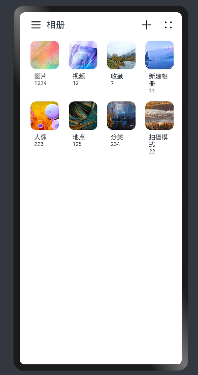
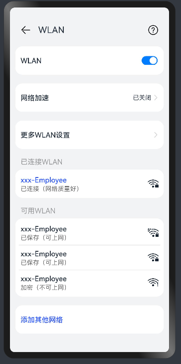
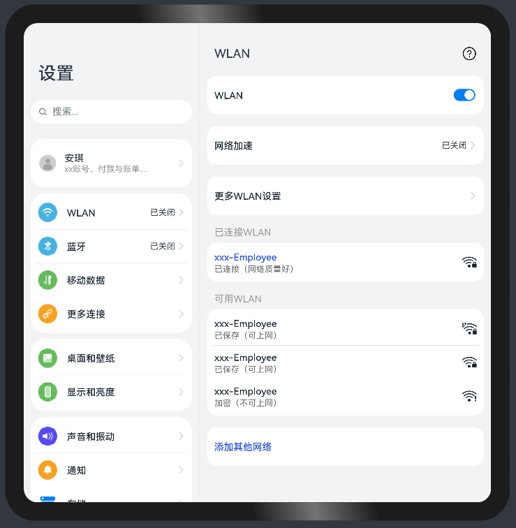
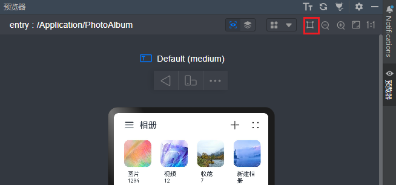

# One-Time Development for Multi-Device Deployment: Multi-Column Layout

### Introduction

This sample demonstrates the responsive behavior of the multi-column layout in different scenarios.

The sample uses the [SideBarContainer](https://gitcode.com/openharmony/docs/blob/master/en/application-dev/reference/apis-arkui/arkui-ts/ts-container-sidebarcontainer.md) component and the [Navigation](https://gitcode.com/openharmony/docs/blob/master/en/application-dev/reference/apis-arkui/arkui-ts/ts-basic-components-navigation.md) component. The corresponding scenarios are as follows:

* A+B+C: SideBarContainer combined with Navigation
* A+C: SideBarContainer only
* B+C: Navigation only

### Preview

Effect in the previewer:

**A+B+C**:

| 360vp                               | 600vp                               | 840vp                               |
| ----------------------------------- | ----------------------------------- | ----------------------------------- |
|  |  |  |

**A+C**:

| 360vp                               | 600vp                               |
| ----------------------------------- | ----------------------------------- |
|  |  |

**B+C**:

| 360vp                                | 600vp                               |
| ------------------------------------ | ----------------------------------- |
|  |  |

How to use:

1. View the page effect in the previewer.

2. Enable the window drag mode in the previewer and drag to resize the window. The responsive change of the components is displayed, as shown below:



### Project Structure

```
MultiColumns/entry/src/main/ets/
|---model
|   |---DataType.ets                       // Sidebar menu data types
|---Application
|   |---MailBox.ets                        // Mail box
|   |---PhotoAlbum.ets                     // Photo album
|   |---Settings.ets                       // Settings
|---pages
|   |---Index.ets                          // Home page
|---common
|   |---BreakpointSystem.ets               // Media query
|   |---Constants.ts                       // Breakpoint keys, routes, sizes, and log constants
|   |---MailContent.ets                    // Mail detail
|   |---MailNavigation.ets                 // Mail navigation
|   |---MailSideBar.ets                    // Mail sidebar
|   |---PhotoContent.ets                   // Photo detail
|   |---PhotoSideBar.ets                   // Photo sidebar
|   |---SettingItem.ets                    // Settings item
|   |---WlanItem.ets                       // WLAN detail page
```

Test project structure:

```
entry/src/ohosTest/ets/
|---test                                       // Test suites (19 suites)
|   |---BreakpointTypeCore.test.ets            // L1: BreakpointType six-dimension cases
|   |---ModelSpecCore.test.ets                 // L1: DataType and specification constants
|   |---NavStackCore.test.ets                  // L1: NavPathStack routing stack
|   |---Bp*Vol*.test.ets / ModelVol*.test.ets  // L1: @volume cases
|   |---BpEdgeReal.test.ets                    // L1: Hand-written boundary cases
|   |---Ability.test.ets                       // L2: Window dragging (ActsAbilityTest)
|   |---ResponsiveUi.test.ets                  // L2: Responsive UI interaction
|   |---List.test.ets                          // Suite registration entry
|---TestRunner
|   |---OpenHarmonyTestRunner.ts               // Test runner
|---util
|   |---Logger.ts                              // Log utility
```

### Test

- Test project: `entry/src/ohosTest` (bundleName `com.samples.multicolumns`, test module `entry_test`, runner `OpenHarmonyTestRunner`)
- Scale: **19 suites / 986 test cases** (L1 logic cases + L2 real UI cases, numbered with `SUB_MC_*`)
- Result: all **986/986** cases passed on a real device (720×1280 phone form factor)

The following commands are executed in the project root directory. Build the test HAP (the node and hvigorw bundled with DevEco Studio 26 are required; quote paths that contain spaces):

```
"<DevEco>/tools/node/node.exe" "<DevEco>/tools/hvigor/bin/hvigorw.js" --mode module -p module=entry@ohosTest -p product=default assembleHap --no-daemon
```

Install and run (all suites registered in `List.test.ets` run when `-s class` is not specified):

```
hdc install -r entry/build/default/outputs/ohosTest/entry-ohosTest-signed.hap
hdc shell aa test -b com.samples.multicolumns -m entry_test -s unittest /ets/TestRunner/OpenHarmonyTestRunner -s timeout 15000
```

For the case matrix, six-dimension coverage, and real-device environment constraints (full-screen windows cannot be resized, Navigation intercepts the back key, and so on), see [ohosTest.md](./ohosTest.md).

### Implementation

* The auto-hide capability of the [SideBarContainer](https://gitcode.com/openharmony/docs/blob/master/en/application-dev/reference/apis-arkui/arkui-ts/ts-container-sidebarcontainer.md) component is implemented by its `minContentWidth` and `minSideBarWidth` attributes. When the display type of the [SideBarContainer](https://gitcode.com/openharmony/docs/blob/master/en/application-dev/reference/apis-arkui/arkui-ts/ts-container-sidebarcontainer.md) component is set to `SideBarContainerType.Embed` and the window width reaches the boundary of `minContentWidth + minSideBarWidth`, the sidebar is automatically hidden.

* The auto-hide capability of the [Navigation](https://gitcode.com/openharmony/docs/blob/master/en/application-dev/reference/apis-arkui/arkui-ts/ts-basic-components-navigation.md) component is implemented by its `minContentWidth` attribute. When the content area of the [Navigation](https://gitcode.com/openharmony/docs/blob/master/en/application-dev/reference/apis-arkui/arkui-ts/ts-basic-components-navigation.md) component reaches the value set by `minContentWidth`, the navBar is automatically hidden.

**Responsive rules**

**Scenario 1: A+B+C**

1. When the previewer window width is greater than 840vp, columns A, B, and C are displayed. When the window is enlarged or reduced, column C changes first.
2. When the previewer window width is less than or equal to 840vp and greater than 600vp, columns B and C are displayed. When the window is enlarged or reduced, column C changes first.
3. When the previewer window width is less than or equal to 600vp and greater than 360vp, only column C is displayed.

**Scenario 2: A+C**

1. When the previewer window width is greater than 600vp, columns A and C are displayed. When the window is enlarged or reduced, column C changes first.
2. When the previewer window width is less than or equal to 600vp and greater than 360vp, only column C is displayed.

**Scenario 3: B+C**

1. When the previewer window width is greater than 600vp, columns B and C are displayed. When the window is enlarged or reduced, column C changes first.
2. When the previewer window width is less than or equal to 600vp and greater than 360vp, only column C is displayed.

### Required Permissions

N/A

### Dependencies

N/A

### Constraints

1. This sample can only run on standard systems, and `deviceTypes` is set to `default` (standard devices such as phones, tablets, and 2-in-1 devices).

2. This sample uses the stage model, with `compileSdkVersion`, `compatibleSdkVersion`, and `targetSdkVersion` all set to `26.0.0` (runtimeOS: OpenHarmony).

3. This sample can be compiled and run only with DevEco Studio 26 (bundled with hvigor 6.26.8) or later versions.

4. When this sample runs on a real device, you need to modify the system configuration file of the device to enable the free-form window capability. If this capability is not enabled, the window runs in full-screen mode and `Window.resize()` is unavailable. In this case, the L2 window dragging cases automatically fall back to the "window size occupies the whole screen" verification (see [ohosTest.md](./ohosTest.md)).

```
# Grant the read and write permission for the file system of the development board.
hdc shell mount -o rw,remount /
# Obtain the original configuration file.
hdc file recv system/etc/window/resources/window_manager_config.xml <local path>
# Change <decor enable="false"></decor> to <decor enable="true"></decor> in the file.
# Replace the original file in the system with the modified file.
hdc file send <local path>/window_manager_config.xml system/etc/window/resources/window_manager_config.xml
# Restart the device for the modification to take effect.
hdc shell reboot
```

### How to Download

If you need to download this project separately, run the following commands:

```
git init
git config core.sparsecheckout true
echo code/SuperFeature/MultiDeviceAppDev/MultiColumns/ > .git/info/sparse-checkout
git remote add origin https://gitcode.com/openharmony/applications_app_samples.git
git pull origin master
```
