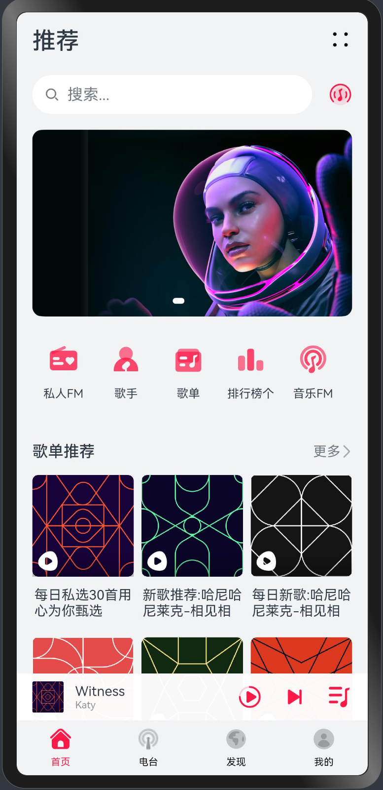
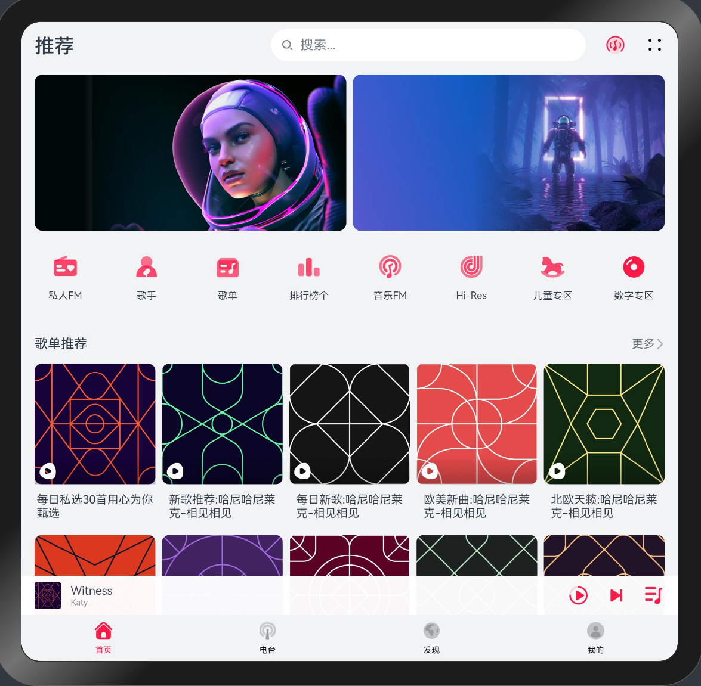
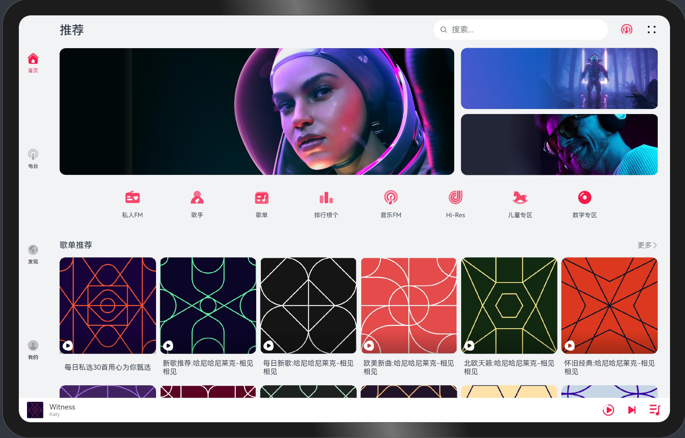
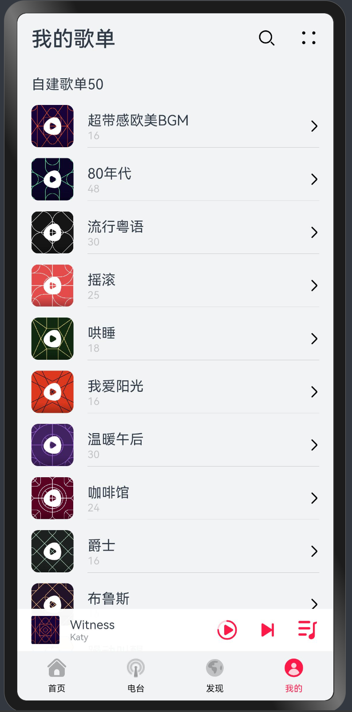
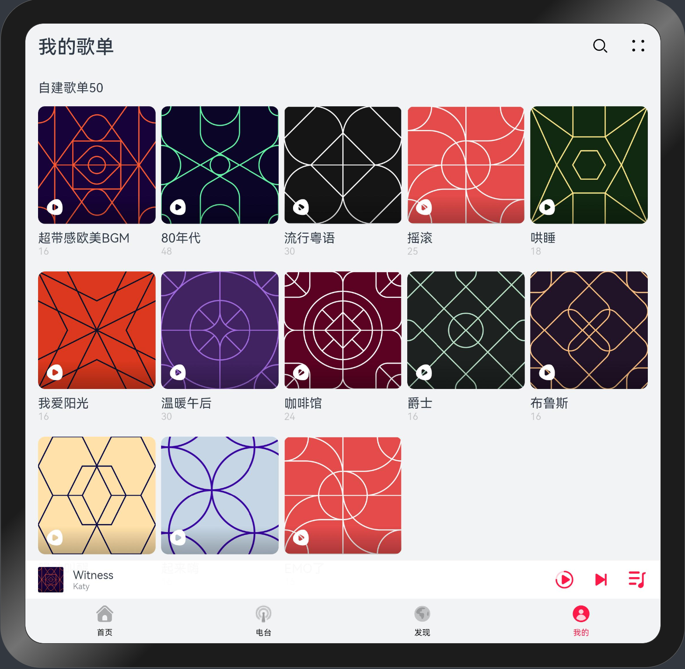
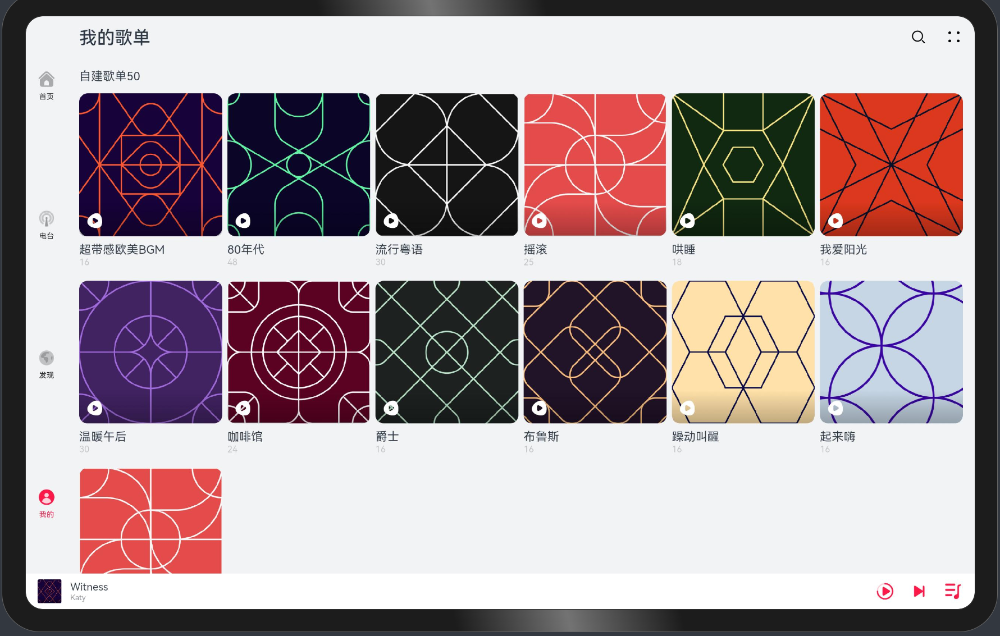
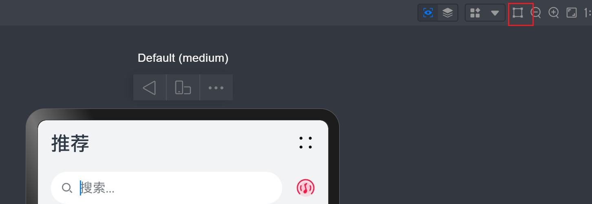

# MultiMusic

### Introduction

This sample demonstrates the adaptive layout of a music application on different window sizes (phones, foldables, tablets and 2in1 devices) with the [one-time development for multi-device deployment](https://gitcode.com/openharmony/docs/tree/master/en/application-dev/key-features/multi-device-app-dev) capabilities. The application has four tabs: Home (Recommend), Radio, Discovery and Mine (My Playlists). Recommend and My Playlists are fully implemented, while Radio and Discovery are placeholder pages used to observe how the tab bar direction changes with the breakpoint.

The UI switches its layout on the window breakpoints `sm` / `md` / `lg`:

- **Recommend**: uses [GridRow](https://gitcode.com/openharmony/docs/blob/master/en/application-dev/reference/apis-arkui/arkui-ts/ts-container-gridrow.md), [List](https://gitcode.com/openharmony/docs/blob/master/en/application-dev/reference/apis-arkui/arkui-ts/ts-container-list.md), [Grid](https://gitcode.com/openharmony/docs/blob/master/en/application-dev/reference/apis-arkui/arkui-ts/ts-container-grid.md) and [Swiper](https://gitcode.com/openharmony/docs/blob/master/en/application-dev/reference/apis-arkui/arkui-ts/ts-container-swiper.md). The title bar span, banner count, category spacing and playlist columns all follow the breakpoint.
- **My Playlists**: the same data set is rendered as a list at `sm` (cover, title, count, arrow and divider) and as a 5 / 6 column grid at `md` / `lg`.
- **Tabs**: the tab bar stays at the bottom and horizontal at `sm` / `md`, and turns into a vertical bar on the left at `lg`. The mini player sits at the bottom of the page at `sm` / `md` and below the tab area at `lg`.
- **Breakpoint system**: every layout difference is driven by the `BreakpointType` triple and `GridRow.onBreakpointChange`. Child components read `currentBreakpoint` from AppStorage, so no size is hard-coded.
- **Localization resources**: all UI strings are resolved through `$r` resources (`base` / `zh_CN` / `en_US`), and the self-built playlist count uses a `%d` format resource, which keeps localization and later adaptation simple.
- **Automated tests** cover 37 suites / 2461 cases; see [ohosTest.md](./ohosTest.md) for the case matrix and how to run them.

### Display Effect

* Recommend

| sm device                           | md device                           | lg device                           |
| ----------------------------------- | ----------------------------------- | ----------------------------------- |
|  |  |  |

* My Playlists

| sm device                           | md device                           | lg device                           |
| ----------------------------------- | ----------------------------------- | ----------------------------------- |
|  |  |  |

Dragging the window to observe breakpoint changes:



### How to Use

1. Install the compiled HAP package and launch the application. It opens on the **Recommend** tab.
2. Open the previewer in DevEco Studio, or drag the application window to change its width, and observe the title bar, banner, category entries and playlist grid at `sm` / `md` / `lg`.
3. Tap the tab bar at the bottom (on the left at `lg`) to switch between **Recommend** and **My Playlists**. My Playlists is a list at `sm` and a grid at `md` / `lg`.
4. Observe the mini player: it stays at the bottom of the page at `sm` / `md` and below the tab area at `lg`.

### Project Structure

```
MultiMusic
└──entry/src
   ├──main
   │  ├──ets
   │  │  ├──entryability
   │  │  │  └──EntryAbility.ts             // Application entry
   │  │  ├──model
   │  │  │  ├──DataSummary.ets             // Frozen recommend data (12 items)
   │  │  │  └──DataType.ets                // IconItem / OffsetDataType / PaddingDataType / SongType
   │  │  ├──pages
   │  │  │  └──Index.ets                   // Home page: four tabs and the mini player
   │  │  └──common
   │  │     ├──BreakpointSystem.ets        // Breakpoint triple BreakpointType
   │  │     ├──Constants.ets               // Layout and style constants
   │  │     ├──RecommendPage.ets           // Recommend page: title bar, banner, categories, playlist grid
   │  │     ├──TitleBar.ets                // Title bar
   │  │     └──UserSongList.ets            // My Playlists page
   │  └──resources                         // Strings, colors and images (base / zh_CN / en_US)
   └──ohosTest                             // Automated tests, see ohosTest.md
      └──ets
         ├──test                           // 37 suites / 2461 cases, registered in List.test.ets
         ├──testability                    // UIAbility and page used by the test HAP
         ├──testrunner                     // OpenHarmonyTestRunner
         └──util                           // Resource resolution, logging and display helpers
```

### How to Implement

**Breakpoint system**

[BreakpointSystem.ets](entry/src/main/ets/common/BreakpointSystem.ets) defines `BreakpointType<T>(sm, md, lg)`, which keeps the three variants of one property together. `getValue(currentBreakpoint)` returns the matching slot only when the key is `sm`, `md` or `lg`; any other input (empty string, case variants, keys with leading or trailing spaces, `undefined`) returns `undefined`, and the call site falls back to its default.

Breakpoints come from the `GridRow` defaults `['320vp', '600vp', '840vp']`. `onBreakpointChange` on the root `GridRow` of `Index.ets` writes the new breakpoint into the AppStorage key `currentBreakpoint` through `animateTo` (600 ms, `Curve.Smooth`). `RecommendPage`, `TitleBar` and `UserSongList` subscribe with `@LocalStorageProp`, and `Index` binds it with `@LocalStorageLink`, so all children switch together while the window is dragged, with a transition animation.

| Component | sm | md | lg |
| -------- | -------- | -------- | -------- |
| Root grid columns | 4 | 8 | 12 |
| Tab bar | Bottom, horizontal | Bottom, horizontal | Left, vertical |
| Title bar columns / title span | 8 / 7 | 16 / 6 | 24 / 15 |
| Title bar rows | 2 | 1 | 1 |
| Banner | Swiper, 1 item | Swiper, 2 items | 1 large + 2 small |
| Category spacing | 0 | 35vp | 63vp |
| Recommend grid columns | 3 | 5 | 6 |
| My Playlists columns | 1 (list) | 5 | 6 |
| Mini player | Page bottom | Page bottom | Full width below tabs |

**Title bar**

[TitleBar.ets](entry/src/main/ets/common/TitleBar.ets) uses a `GridRow` with 8 / 16 / 24 columns and declares `span` and `order` for the title, the search box, the more icon and the listener icon. At `sm`, the title (7 columns) and the more icon (1 column) occupy the first row, while the search box (7 columns) and the listener icon (1 column) occupy the second row. At `md` / `lg`, the four items share a single row with 6+8+1+1 and 15+7+1+1 columns. The search box is 40vp high, the icon area is 56vp high, and the title uses a 33vp line height with a 24vp font size.

**Banner**

At `sm` / `md`, a `Swiper` is used: `displayCount` is 1 / 2, height is 191vp, corner radius is 10vp, with `loop(true)`, `cachedCount(3)` and `itemSpace(8vp)`. The indicator is shown only at `sm`. At `lg`, `BannerColumn` replaces the swiper: the large image on the left takes 66% of the width and 249vp in height, while the two images on the right take 33% of the width and 120vp each, with a 13vp column gap.

**Music categories**

Eight entries (private FM, singer, playlist, ranking, music FM, Hi-Res, children and digital album) are rendered by a horizontal `List`. Icons are 40vp, the container is 64vp high, the scroll bar is hidden, and the item spacing is 0 / 35vp / 63vp depending on the breakpoint.

**Recommend playlist**

`SongList` in [RecommendPage.ets](entry/src/main/ets/common/RecommendPage.ets) renders the 12 frozen items with `Grid` in 3 / 5 / 6 columns, and `columnsTemplate` is provided by `BreakpointType`. Each `GridItem` computes its row count as `Math.ceil(12 / columns)` in `onAreaChange` and sets the grid height to `(16vp row gap + item height) × rows − 16vp`. At breakpoints other than `lg`, another 48vp is added so that the mini player at the bottom of the page never covers the content.

**My Playlists**

[UserSongList.ets](entry/src/main/ets/common/UserSongList.ets) holds 13 `SongType` items (counts from 16 to 48). At `sm`, the `Flex` direction is `Row`: a 48vp cover, a 16vp title, a 12vp count, a trailing arrow and a 1px divider indented by 64vp. At `md` / `lg`, the direction becomes `Column`: the cover fills the cell width with an 8vp corner radius, and the title and count are stacked. The subtitle "Self-built playlists (50 songs)" is composed from the `app.string.build_self_song_count` resource and the `UserSongListConstants.SELF_BUILD_SONG_COUNT` constant, so both the wording and the number can be adapted in the resource layer.

**Tabs and mini player**

In [Index.ets](entry/src/main/ets/pages/Index.ets), `Tabs` sets `barPosition` to `End` / `End` / `Start` and `vertical` to `false` / `false` / `true`. `scrollable(false)` disables swipe-based page switching, and `onChange` keeps the current index for icon highlighting (selected icons come from the `ic_*_h` family). The mini player is a 48vp high `MusicPlayer` component: the recommend page and the My Playlists page draw it at the bottom of their `Stack` at `sm` / `md`, and the home page draws it below `Tabs` at `lg`, so it is always visible in every window form.

**Localization resources**

`entry/src/main/resources` keeps one `string.json` (43 keys) per locale: `base`, `zh_CN` and `en_US`. `module_desc`, `EntryAbility_desc` and `EntryAbility_label` have locale variants. Colors, font sizes and spacings are centralized in [Constants.ets](entry/src/main/ets/common/Constants.ets), and the pages contain no literal Chinese or English text.

### Test

- Test project: `entry/src/ohosTest` (bundleName `com.sample.multimusic`, test module `entry_test`, runner `OpenHarmonyTestRunner`).
- Scale: 37 suites / 2461 cases — 206 hand-written behavior cases, 2175 specification regression cases and 80 UI probe cases.
- Result: all 2461 cases passed on a real device (OpenHarmony 7.1.0.21 / API 26) on 2026-11-19, executed in 9 batches.

For the case matrix, the `@tc` metadata, the build/signing steps and the batch commands, see [ohosTest.md](./ohosTest.md).

### Required Permissions

N/A

### Dependency

No third-party dependencies.

### Constraints

1. This sample runs on standard systems only.
2. This sample is a Stage model project built with API version 26; `compileSdkVersion`, `compatibleSdkVersion` and `targetSdkVersion` are all `"26.0.0"` (runtimeOS: OpenHarmony).
3. DevEco Studio 26.0.0.851 or later (hvigor 6.26.8) is required to build and run this sample.
4. Breakpoints are driven by the window width (defaults 320vp / 600vp / 840vp). The three levels can only be observed on devices that support window dragging or split screen, or in the previewer; a phone in portrait usually stays at `sm`.
5. Radio and Discovery are placeholder color blocks without business content. All images are static sample resources, and the sample does not provide real playback.
6. The on-device result of the automated tests was collected on a single 720×1280 standard-system device and has not been re-run on foldables or tablets. See [ohosTest.md](./ohosTest.md) for details.
7. Running all 2461 cases in a single process triggers App died, so the automated regression must follow the 9-batch plan in [ohosTest.md](./ohosTest.md).

### How to Download

To download this project separately, run the following commands:

```shell
git init
git config core.sparsecheckout true
echo code/SuperFeature/MultiDeviceAppDev/MultiMusic/ > .git/info/sparse-checkout
git remote add origin https://gitcode.com/openharmony/applications_app_samples.git
git pull origin master
```
