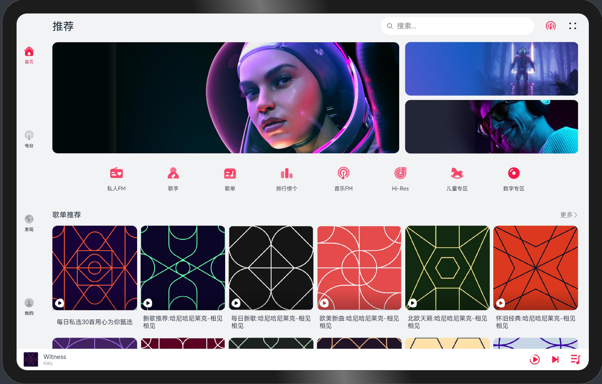
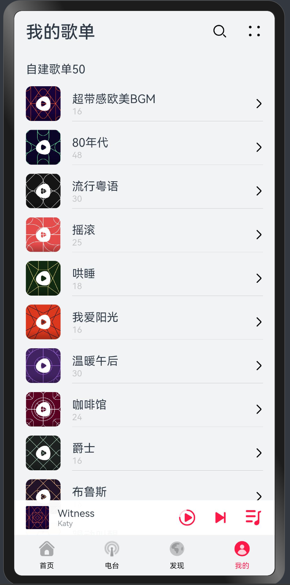
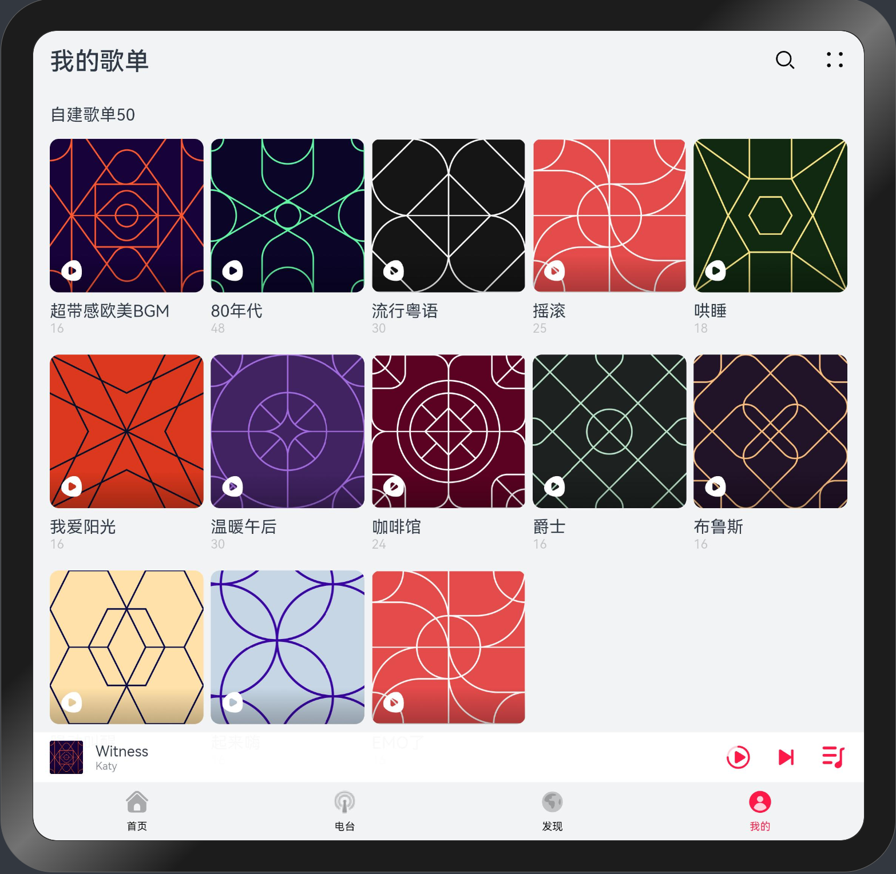
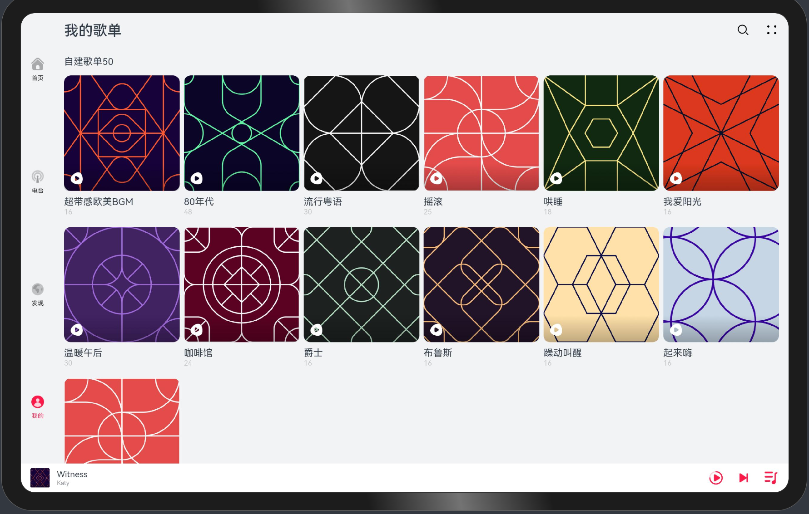
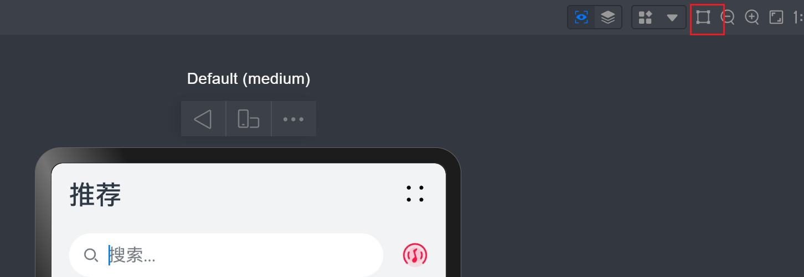

# 一多音乐典型场景

### 介绍

本示例基于「一次开发、多端部署」展示音乐类应用在手机、折叠屏、平板与 2in1 等不同窗口尺寸下的自适应布局。应用包含首页（推荐）、电台、发现、我的（我的歌单）四个页签，其中推荐与我的歌单为完整实现，电台与发现为占位页，用于观察页签方向随断点变化。

界面按窗口断点 `sm` / `md` / `lg` 切换布局：

- **推荐**：使用 [GridRow](https://gitcode.com/openharmony/docs/blob/master/zh-cn/application-dev/reference/apis-arkui/arkui-ts/ts-container-gridrow.md)、[List](https://gitcode.com/openharmony/docs/blob/master/zh-cn/application-dev/reference/apis-arkui/arkui-ts/ts-container-list.md)、[Grid](https://gitcode.com/openharmony/docs/blob/master/zh-cn/application-dev/reference/apis-arkui/arkui-ts/ts-container-grid.md) 与 [Swiper](https://gitcode.com/openharmony/docs/blob/master/zh-cn/application-dev/reference/apis-arkui/arkui-ts/ts-container-swiper.md) 组件，标题栏跨列、轮播图数量、分类入口间距与歌单列数都随断点变化。
- **我的歌单**：同一份数据在 `sm` 断点渲染为列表（封面、标题、数量、箭头与分隔线），在 `md` / `lg` 断点渲染为 5 / 6 列网格。
- **页签**：`sm` / `md` 断点在底部横向排列，`lg` 断点切换为左侧纵向 Tabs；迷你播放器在 `sm` / `md` 位于页面底部，在 `lg` 位于页签下方通栏。
- **断点体系**：所有布局差异由 `BreakpointType` 三元组与 `GridRow.onBreakpointChange` 驱动，子组件统一从 AppStorage 中的 `currentBreakpoint` 读取，不写死尺寸。
- **多语言资源**：文案全部走 `$r` 资源（`base` / `zh_CN` / `en_US` 三套），自建歌单数量使用 `%d` 格式化资源，便于多语言与后续适配。
- **自动化测试**：覆盖 37 个套件 / 2461 条用例，用例矩阵与运行方式见 [ohosTest.md](./ohosTest.md)。

### 效果预览

* 推荐页

| sm 设备                             | md 设备                             | lg 设备                             |
| ----------------------------------- | ----------------------------------- | ----------------------------------- |
|  |  |  |

* 我的歌单

| sm 设备                             | md 设备                             | lg 设备                             |
| ----------------------------------- | ----------------------------------- | ----------------------------------- |
|  |  |  |

窗口拖拽观察断点变化：



### 使用说明

1. 安装编译生成的 HAP 包并打开应用，默认停在「推荐」页。
2. 在 DevEco Studio 中打开预览器，或直接拖动应用窗口改变宽度，观察标题栏、轮播图、分类入口与歌单网格在 `sm` / `md` / `lg` 三档下的差异。
3. 点击底部（`lg` 为左侧）页签，在「推荐」与「我的歌单」之间切换；在 `sm` 下我的歌单为列表形态，在 `md` / `lg` 下为网格形态。
4. 观察迷你播放器：`sm` / `md` 固定在页面底部，`lg` 固定在页签下方。

### 工程目录

```
MultiMusic
└──entry/src
   ├──main
   │  ├──ets
   │  │  ├──entryability
   │  │  │  └──EntryAbility.ts             // 程序入口类
   │  │  ├──model
   │  │  │  ├──DataSummary.ets             // 推荐歌单冻结数据（12 条）
   │  │  │  └──DataType.ets                // IconItem / OffsetDataType / PaddingDataType / SongType
   │  │  ├──pages
   │  │  │  └──Index.ets                   // 首页：四页签与迷你播放器
   │  │  └──common
   │  │     ├──BreakpointSystem.ets        // 断点三元组 BreakpointType
   │  │     ├──Constants.ets               // 各组件布局与样式常量
   │  │     ├──RecommendPage.ets           // 推荐页：标题栏、轮播、分类入口、歌单网格
   │  │     ├──TitleBar.ets                // 标题栏
   │  │     └──UserSongList.ets            // 我的歌单页
   │  └──resources                         // 字符串、颜色与图片资源（base / zh_CN / en_US）
   └──ohosTest                             // 自动化测试用例，详见 ohosTest.md
      └──ets
         ├──test                           // 37 个套件 / 2461 条用例，注册表 List.test.ets
         ├──testability                    // 测试用 UIAbility 与页面
         ├──testrunner                     // OpenHarmonyTestRunner
         └──util                           // 资源解析、日志与显示辅助工具
```

### 具体实现

**断点体系**

[BreakpointSystem.ets](entry/src/main/ets/common/BreakpointSystem.ets) 中的 `BreakpointType<T>(sm, md, lg)` 把同一个属性的三档取值收在一处，`getValue(currentBreakpoint)` 只在 key 等于 `sm` / `md` / `lg` 时返回对应槽位，其它输入（空串、大小写变体、带前后空格的 key、`undefined`）一律返回 `undefined`，调用点据此回退到默认值。

断点值来自 `GridRow` 的默认断点 `['320vp', '600vp', '840vp']`：`Index.ets` 根 `GridRow` 的 `onBreakpointChange` 在断点变化时通过 `animateTo`（600ms，`Curve.Smooth`）把新断点写入 AppStorage 的 `currentBreakpoint`，`RecommendPage`、`TitleBar`、`UserSongList` 用 `@LocalStorageProp` 订阅，`Index` 用 `@LocalStorageLink` 双向绑定，因此窗口拖动时所有子组件同时换档且带过渡动画。

| 组件 | sm | md | lg |
| -------- | -------- | -------- | -------- |
| 根栅格列数 | 4 | 8 | 12 |
| 页签方向 | 底部横向 | 底部横向 | 左侧纵向 |
| 标题栏列数 / 标题跨列 | 8 / 7 | 16 / 6 | 24 / 15 |
| 标题栏行数 | 2 行 | 1 行 | 1 行 |
| 轮播形态 | Swiper 1 张 | Swiper 2 张 | 1 大 2 小并列 |
| 分类入口间距 | 0 | 35vp | 63vp |
| 推荐歌单列数 | 3 | 5 | 6 |
| 我的歌单列数 | 1（列表） | 5 | 6 |
| 迷你播放器位置 | 页内底部 | 页内底部 | 页签下方通栏 |

**标题栏**

[TitleBar.ets](entry/src/main/ets/common/TitleBar.ets) 使用 `GridRow` 的 8 / 16 / 24 列栅格，标题、搜索框、更多与收听图标分别声明 `span` 与 `order`：`sm` 断点下标题（7 列）与更多图标（1 列）占第一行，搜索框（7 列）与收听图标（1 列）占第二行；`md` / `lg` 断点下四项按 6+8+1+1、15+7+1+1 排在单行内。搜索框高 40vp，图标区高 56vp，标题行高 33vp、字号 24vp。

**轮播图**

`sm` / `md` 断点使用 `Swiper`：`displayCount` 取 1 / 2，高 191vp，圆角 10vp，`loop(true)`、`cachedCount(3)`、`itemSpace(8vp)`，指示器只在 `sm` 显示；`lg` 断点改用 `BannerColumn`，左侧大图占 66% 宽、249vp 高，右侧两张小图各占 33% 宽、120vp 高，列间距 13vp。

**音乐分类**

8 个入口（私人 FM、歌手、歌单、排行榜、音乐 FM、Hi-Res、儿童、数字专辑）使用横向 `List` 渲染，图标 40vp、容器高 64vp、关闭滚动条，项间距为 0 / 35vp / 63vp，随断点在同一行内自然排开。

**推荐歌单**

[RecommendPage.ets](entry/src/main/ets/common/RecommendPage.ets) 中的 `SongList` 使用 `Grid` 渲染 12 条冻结数据，列数为 3 / 5 / 6，`columnsTemplate` 由 `BreakpointType` 给出。每个 `GridItem` 在 `onAreaChange` 中按 `Math.ceil(12 / columns)` 计算行数，并把网格高度设为 `(16vp 行距 + 行高) × 行数 − 16vp`；非 `lg` 断点再追加 48vp，为页面底部的迷你播放器留出空间，避免内容被遮挡。

**我的歌单**

[UserSongList.ets](entry/src/main/ets/common/UserSongList.ets) 内置 13 条 `SongType` 数据（数量 16 至 48）。`sm` 断点下 `Flex` 方向为 `Row`：封面 48vp、标题 16vp、数量 12vp、右侧箭头与 1px 分隔线（左缩进 64vp）；`md` / `lg` 断点下方向改为 `Column`：封面占满单元格宽度并保留 8vp 圆角，标题与数量上下排列。副标题「自建歌单（50首）」由资源 `app.string.build_self_song_count` 与常量 `UserSongListConstants.SELF_BUILD_SONG_COUNT` 组合，语言与数字都可在资源层调整。

**页签与迷你播放器**

[Index.ets](entry/src/main/ets/pages/Index.ets) 中 `Tabs` 的 `barPosition` 取 `End` / `End` / `Start`，`vertical` 取 `false` / `false` / `true`，`scrollable(false)` 禁止滑动切页，`onChange` 同步当前页签索引用于图标高亮（选中态使用 `ic_*_h` 系列图标）。迷你播放器为 48vp 高的 `MusicPlayer` 组件：`sm` / `md` 由推荐页与我的歌单页在 `Stack` 底部绘制，`lg` 由首页在 `Tabs` 下方绘制，保证各窗口形态下都始终可见。

**多语言资源**

`entry/src/main/resources` 下 `base`、`zh_CN`、`en_US` 各维护一套 `string.json`（43 个键），`module_desc`、`EntryAbility_desc`、`EntryAbility_label` 有语言变体；颜色、字体与间距常量集中在 [Constants.ets](entry/src/main/ets/common/Constants.ets)，页面内不出现中英文字面量。

### 测试

- 测试工程：`entry/src/ohosTest`（bundleName `com.sample.multimusic`，测试模块 `entry_test`，runner `OpenHarmonyTestRunner`）。
- 规模：37 个套件 / 2461 条用例，分手写行为用例（206 条）、规格回归用例（2175 条）与 UI 探针用例（80 条）。
- 结果：2026-11-19 在真机（OpenHarmony 7.1.0.21 / API 26）分 9 批执行，2461 条全部通过。

用例矩阵、`@tc` 元数据、构建签名与分批命令见 [ohosTest.md](./ohosTest.md)。

### 相关权限

不涉及。

### 依赖

不涉及第三方依赖。

### 约束与限制

1. 本示例仅支持在标准系统上运行。
2. 本示例为 Stage 模型，使用 API version 26 版本 SDK 编译，`compileSdkVersion`、`compatibleSdkVersion` 与 `targetSdkVersion` 均为 `"26.0.0"`（runtimeOS：OpenHarmony）。
3. 本示例需要使用 DevEco Studio 26.0.0.851 及以上版本（hvigor 6.26.8）才可编译运行。
4. 断点由窗口宽度驱动（默认 320vp / 600vp / 840vp），三档差异需要在支持窗口拖拽、分屏或预览器的环境中观察；手机竖屏通常只落在 `sm` 档。
5. 电台与发现两个页签为占位色块，不包含业务内容；图片为静态示例资源，不包含真实播放能力。
6. 自动化用例的真机结果采自单台 720×1280 标准系统设备，未在折叠屏、平板等其它形态上复测，详见 [ohosTest.md](./ohosTest.md)。
7. 单进程整跑 2461 条用例会触发 App died，自动化回归需按 [ohosTest.md](./ohosTest.md) 的 9 批清单分批执行。

### 下载

如需单独下载本工程，执行如下命令：

```shell
git init
git config core.sparsecheckout true
echo code/SuperFeature/MultiDeviceAppDev/MultiMusic/ > .git/info/sparse-checkout
git remote add origin https://gitcode.com/openharmony/applications_app_samples.git
git pull origin master
```
