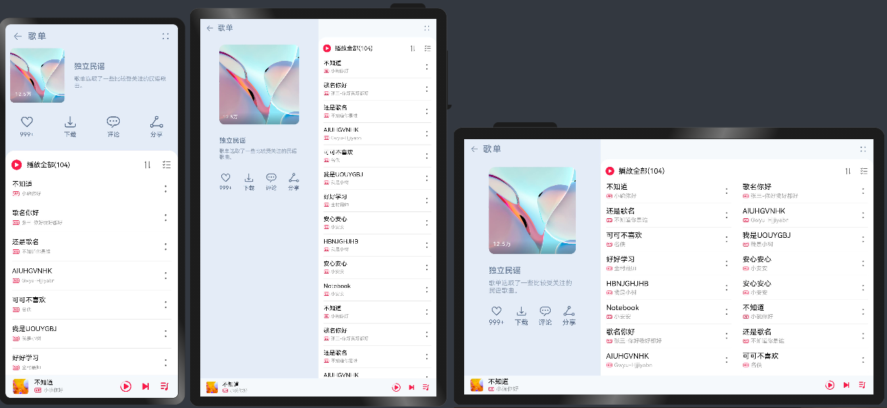

# 一多音乐专辑主页

### 介绍

本示例展示一个音乐专辑（歌单）主页，包括标题栏、歌单封面、歌单列表与底部播放控制栏，体现一次开发，多端部署的能力。示例参考 [一次开发，多端部署](https://gitcode.com/openharmony/docs/tree/master/zh-cn/application-dev/key-features/multi-device-app-dev) 的指导，使用响应式布局的栅格断点系统与自适应拉伸能力，在 SM（320vp ~ 600vp）、MD（600vp ~ 840vp）与 LG（840vp 以上）三档窗口尺寸下重排封面列与歌单列。

工程按完整示例组织，同时兼顾可运行与可教学：

- **标题栏** 由返回图标、歌单标题与更多按钮组成，三段之间用 `Blank` 拉伸，只有间距随断点变化。
- **内容区** 用 `GridRow` / `GridCol` 把页面拆成封面列与歌单列：SM 下两列各占 12 栅格上下堆叠，MD 下各占 6 栅格并排，LG 下分别占 4 与 8 栅格。
- **歌单封面** 由 1:1 封面图、歌单名与简介、收藏 / 下载 / 评论 / 分享四项操作组成；SM 下简介区高度跟随封面实测高度，操作条整体下沉到封面下方。
- **歌单列表** 由播放全部行与 `LazyForEach` 渲染的 24 行歌曲组成，LG 下 `lanes` 为两列、其余断点单列；SM 下用封面实测高度作为列表底部内边距，避免最后几行被播放控制栏遮住。
- **播放控制栏** 固定 48vp 高，左侧是封面与歌名 / 歌手，右侧是播放、下一首、歌单三个按钮，中间用 `Blank` 撑开。
- **断点系统** `BreakpointSystem` 注册三条 `mediaquery`（320vp ~ 600vp / 600vp ~ 840vp / 840vp 以上），命中后写入 `AppStorage` 的 `currentBreakpoint`，并同步字号（14 / 16 / 18）与封面外边距（10 / 30 / 40）。
- **数据层** `MyDataSource` 实现 `IDataSource`，支持 `addData` / `pushData` 与五类数据变更通知；`songList` 为 24 行冻结数据（id 从 1 到 21、再到 23 至 25，缺 22），`optionList` 为 4 项操作数据。
- **自动化测试** 覆盖 39 个套件 / 2633 条用例，用例矩阵与运行方式见 [ohosTest.md](./ohosTest.md)。

三档断点下的差异只体现在布局参数上：SM 下页面底色为 `#e4ecf7`、封面与歌单上下堆叠；MD / LG 下底色为 `#f6f9fc`、两列并排，且 LG 的歌单为双列。拖拽窗口跨断点时，列宽、列数与字号同步刷新。

### 效果预览

本示例在预览器中的效果：



本示例在开发板上运行的效果：

|全屏展示                            |窗口操作按钮                        |悬浮窗口显示                        |
|-----------------------------------|-----------------------------------|-----------------------------------|
||||

### 使用说明

1. 启动应用，首页自上而下依次是标题栏、内容区与播放控制栏；在 SM 窗口下封面与歌单上下堆叠，在 MD / LG 窗口下左右并排。
2. 在应用顶部下滑出现窗口操作按钮（建议通过外接鼠标操作，鼠标移动至顶部即可出现窗口，仅支持标准设备：RK3568）。
3. 点击悬浮图标，将应用切换为悬浮窗显示。
4. 拖动悬浮窗口的四个顶角改变窗口尺寸，窗口跨过 600vp / 840vp 时封面列宽、歌单列宽与字号随之变化；LG 下歌单从单列变为双列。
5. 在歌单列表中上下滑动查看 24 首歌曲，行内 id 从 21 直接跳到 23（id 22 在冻结数据中缺席）；点击歌曲行、播放、下一首或歌单按钮都停留在首页。

### 工程目录

```
MusicAlbum
├──AppScope
│  ├──app.json5                               // 应用配置，bundleName 为 ohos.samples.MusicAlbum
│  └──resources/base/media/app_icon.png
└──entry/src
   ├──main/ets
   │  ├──Application
   │  │  └──MyAbilityStage.ts                 // 自定义 AbilityStage
   │  ├──MainAbility
   │  │  └──MainAbility.ets                   // 主窗口，加载 pages/index
   │  ├──common
   │  │  ├──Header.ets                        // 标题栏：返回图标、歌单标题、更多按钮
   │  │  ├──Content.ets                       // 内容区：GridRow 拆分封面列与歌单列
   │  │  ├──PlayListCover.ets                 // 歌单封面、歌单简介与四项操作
   │  │  ├──PlayList.ets                      // 播放全部行 + 歌曲列表
   │  │  └──Player.ets                        // 底部播放控制栏
   │  ├──model
   │  │  ├──MediaData.ets                     // BreakpointSystem，三条 mediaquery 断点监听
   │  │  ├──SongList.ets                      // songList 24 行与 optionList 4 项冻结数据
   │  │  └──SongModule.ets                    // SongItem 与 MyDataSource
   │  └──pages
   │     └──index.ets                         // 首页入口，组合标题栏、内容区与播放控制栏
   ├──main/resources                          // 字符串、颜色、图标与 main_pages 清单
   └──ohosTest                                // 自动化测试，详见 ohosTest.md
      └──ets
         ├──test                              // 39 个套件 / 2633 条用例，注册表 List.test.ets
         ├──testability                       // 测试用 UIAbility 与页面
         ├──testrunner                        // OpenHarmonyTestRunner
         └──util                              // DataSourceProbe、ListenerProbe、SongTableProbe、UiEnv
```

### 具体实现

**断点系统与响应式令牌**

[MediaData.ets](entry/src/main/ets/model/MediaData.ets) 的 `BreakpointSystem` 在 `register` 中用 `uiContext.getMediaQuery().matchMediaSync` 注册 `(320vp<=width<600vp)`、`(600vp<=width<840vp)`、`(840vp<=width)` 三条查询；命中后调用 `updateCurrentBreakpoint` 写 `AppStorage` 的 `currentBreakpoint`，并分别写入 `fontSize` 14 / 16 / 18 与 `coverMargin` 10 / 30 / 40。[index.ets](entry/src/main/ets/pages/index.ets) 在 `aboutToAppear` 中构造并注册它、在 `aboutToDisappear` 中注销，页面底色按 `currentBreakpoint` 在 `#e4ecf7`（SM）与 `#f6f9fc`（MD / LG）之间切换。

**标题栏**

[Header.ets](entry/src/main/ets/common/Header.ets) 是一个固定 50vp 高的 `Row`：左侧 `ic_back`（`header_back`）与歌单标题（`header_title`，文案取 `app.string.play_list`），中间 `Blank` 吸收剩余空间，右侧 `ic_more`（`header_more`）。三个元素尺寸固定，因此断点只改变两侧外边距与中间拉伸量。

**歌单封面**

[PlayListCover.ets](entry/src/main/ets/common/PlayListCover.ets) 用三组 `GridCol`（`span` 4 / 8 / 12，MD 下 `offset` 为 1 / 2 / 2）承载封面、简介与操作条，外层 `GridRow` 的左右外边距取 `AppStorage` 的 `coverMargin`。封面用 `Image($r('app.media.pic_album'))` 加 `aspectRatio(1)` 保证 1:1，`onAreaChange` 把实测高度写入 `imgHeight`：SM 下简介区高度等于 `imgHeight`（简介压在封面右侧的空白区），其余断点固定 70vp。操作条用 `ForEach(optionList)` 渲染收藏、下载、评论、分享四项，`justifyContent` 为 `SpaceBetween`。

**歌单列表**

[PlayList.ets](entry/src/main/ets/common/PlayList.ets) 顶部是播放全部行（`play_all_row`，含 `play_all_text`、`play_order_btn`、`play_sort_btn`），下方 `Scroll` 内是 `List`（`song_list`），`lanes` 在 LG 为 2、其余断点 1；数据来自 `LazyForEach(new MyDataSource(songList))`，每行 `id` 为 `song_item_<id>`、高 50vp，行间用 0.5vp 的 `Divider` 分隔。列表外层 `Column` 的底部内边距在 SM 下取 `@Consume coverHeight`（由 [Content.ets](entry/src/main/ets/common/Content.ets) 的 `@Provide` 提供），保证堆叠布局下列表不被播放控制栏压住。

**播放控制栏**

[Player.ets](entry/src/main/ets/common/Player.ets) 是固定 48vp 高的 `Row`：左侧 `player_cover`（32vp 圆角方图），随后是歌名（`player_song_name`）与 VIP 角标（`player_vip`）加歌手（`player_singer`），中间 `Blank` 撑开，右侧依次是播放（`player_play_btn`）、下一首（`player_next_btn`）与歌单（`player_list_btn`）三个按钮。

**数据层**

[SongModule.ets](entry/src/main/ets/model/SongModule.ets) 定义 `SongItem` 与 `MyDataSource`：`addData` 用 `splice` 落位后调用 `notifyDataAdd(原始下标)`，`pushData` 追加到尾部并通知新末位下标，`registerDataChangeListener` 用 `indexOf` 去重，另提供 `notifyDataReload / Change / Delete / Move` 四个通知方法。[SongList.ets](entry/src/main/ets/model/SongList.ets) 提供 24 行 `songList`（id 1 ~ 21、23 ~ 25）与 4 项 `optionList`，应用与 ohosTest 引用同一份冻结基线。

### 测试

- 测试工程：`entry/src/ohosTest`（bundleName `ohos.samples.MusicAlbum`，测试模块 `entry_test`，runner `OpenHarmonyTestRunner`）。
- 规模：39 个套件 / 2633 条用例，分手写行为用例（213 条）、规格回归用例（2300 条）与 UI 探针用例（120 条）。
- 结果：2026-11-19 在真机（OpenHarmony 7.1.0.21 / API 26）分 15 批执行，2633 条全部通过。

用例矩阵、`@tc` 元数据、构建签名与分批命令见 [ohosTest.md](./ohosTest.md)。

### 相关权限

不涉及。

### 依赖

不涉及第三方依赖。

### 约束与限制

1. 本示例仅支持在标准系统上运行。
2. 本示例为 Stage 模型，`build-profile.json5` 中 `targetSdkVersion`、`compileSdkVersion`、`compatibleSdkVersion` 均为 `23`（runtimeOS：OpenHarmony）。
3. 本示例需使用支持 `modelVersion` 6.0.2 的 DevEco Studio 编译运行。
4. `MainAbility` 声明了 `minWindowWidth` 320 与 `minWindowHeight` 240，窗口宽度小于 600vp 时封面与歌单上下堆叠，1:1 封面会把歌单列挤出内容带，此时 `song_list` / `song_item_*` 不进入无障碍树，属于该窗口尺寸下的真实排布。
5. 单进程整跑 2633 条用例会触发 App died，自动化回归需按 [ohosTest.md](./ohosTest.md) 的 15 批清单分批执行。
6. UI 探针用例通过 `@ohos.UiTest` 驱动，执行前需保证设备已解锁且无系统弹窗遮挡。

### 下载

如需单独下载本工程，执行如下命令：

```
git init
git config core.sparsecheckout true
echo code/SuperFeature/MultiDeviceAppDev/MusicAlbum/ > .git/info/sparse-checkout
git remote add origin https://gitcode.com/openharmony/applications_app_samples.git
git pull origin master
```
