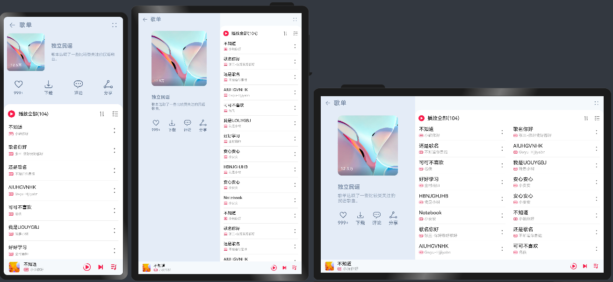
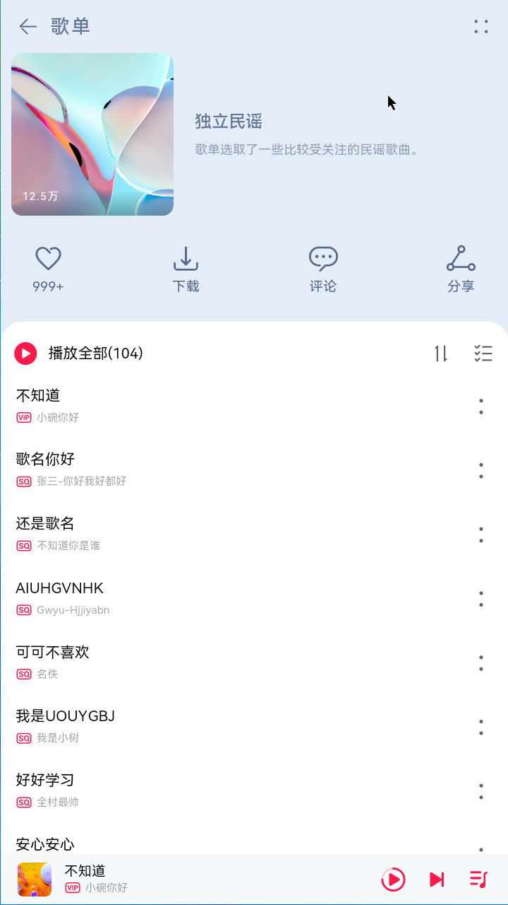
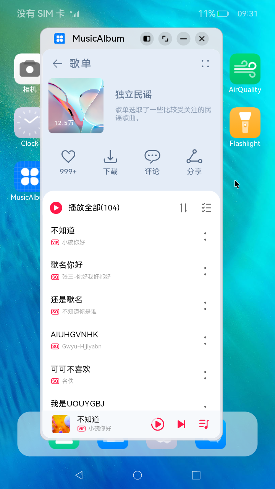

# MusicAlbum

### Introduction

This sample demonstrates one-time development for multi-device deployment by showing how to build a music album (playlist) home page. The page consists of a title bar, the playlist cover, the song list and a bottom player band. Following [One-time development for multi-device deployment](https://gitcode.com/openharmony/docs/tree/master/en/application-dev/key-features/multi-device-app-dev), it uses the responsive grid breakpoint system and the adaptive stretch capabilities to reflow the cover column and the list column at SM (320vp to 600vp), MD (600vp to 840vp) and LG (above 840vp) window sizes.

The project is organized as a complete sample that is both runnable and teachable:

- **Title bar** holds the back icon, the playlist title and the more button. A `Blank` between them absorbs the remaining space, so only the gaps change across breakpoints.
- **Content area** splits the page into a cover column and a list column with `GridRow` / `GridCol`: 12 + 12 spans stacked at SM, 6 + 6 side by side at MD, and 4 + 8 at LG.
- **Playlist cover** combines a 1:1 album image, the playlist name and introduction, and the four actions (collect, download, comment, share). At SM the introduction block takes the measured height of the cover, and the action strip slides below the cover.
- **Song list** pairs a play-all row with 24 rows rendered by `LazyForEach`; `lanes` is 2 at LG and 1 on the other breakpoints. At SM the measured cover height becomes the bottom padding of the list so that the last rows are not hidden by the player band.
- **Player band** keeps a fixed height of 48vp: the album thumbnail and the song/singer copy on the left, the play, next and playlist buttons on the right, and a `Blank` in between.
- **Breakpoint system** `BreakpointSystem` registers three `mediaquery` listeners (320vp to 600vp / 600vp to 840vp / above 840vp) and writes the matched value to `currentBreakpoint` in `AppStorage`, together with the font size (14 / 16 / 18) and the cover margin (10 / 30 / 40).
- **Data layer** `MyDataSource` implements `IDataSource` with `addData` / `pushData` and five change notifications; `songList` is a frozen table of 24 rows (ids 1 to 21 and 23 to 25, id 22 is absent) and `optionList` holds the four actions.
- **Automated tests** cover 39 suites / 2633 cases; see [ohosTest.md](./ohosTest.md) for the case matrix and how to run them.

Across the three breakpoints only layout parameters change: the page background is `#e4ecf7` with a stacked layout at SM, `#f6f9fc` with two columns at MD / LG, and the list turns into two lanes at LG. Dragging the window across a breakpoint refreshes the column widths, the lane count and the font size immediately.

### Display Effect

The previewer shows:



The device shows:

|Full Screen                        |Window Control                     |Floating Window                    |
|-----------------------------------|-----------------------------------|-----------------------------------|
||||

### How to Use

1. Start the app; the home page renders the title bar, the content area and the player band from top to bottom. On a compact window the cover and the list are stacked, on MD / LG they sit side by side.
2. Swipe down at the top of the app to reveal the window control button (a mouse is recommended, only standard devices such as RK3568 are supported).
3. Tap the floating icon to show the app on top of other windows.
4. Drag the four corners of the floating window to resize it; crossing 600vp / 840vp changes the cover width, the list width and the font size, and at LG the list turns into two lanes.
5. Scroll the song list to browse the 24 rows; the row ids jump from 21 to 23 because id 22 is absent in the frozen data. Tapping a row, the play button, the next button or the playlist button keeps the page on the same screen.

### Project Structure

```
MusicAlbum
├──AppScope
│  ├──app.json5                               // App config, bundleName ohos.samples.MusicAlbum
│  └──resources/base/media/app_icon.png
└──entry/src
   ├──main/ets
   │  ├──Application
   │  │  └──MyAbilityStage.ts                 // Custom AbilityStage
   │  ├──MainAbility
   │  │  └──MainAbility.ets                   // Main window, loads pages/index
   │  ├──common
   │  │  ├──Header.ets                        // Title bar: back icon, playlist title, more button
   │  │  ├──Content.ets                       // Content area: GridRow with cover and list columns
   │  │  ├──PlayListCover.ets                 // Album cover, introduction and the four actions
   │  │  ├──PlayList.ets                      // Play-all row + song list
   │  │  └──Player.ets                        // Bottom player band
   │  ├──model
   │  │  ├──MediaData.ets                     // BreakpointSystem with three mediaquery listeners
   │  │  ├──SongList.ets                      // Frozen songList (24 rows) and optionList (4 items)
   │  │  └──SongModule.ets                    // SongItem and MyDataSource
   │  └──pages
   │     └──index.ets                         // Entry page, composes the three bands
   ├──main/resources                          // Strings, colors, icons and main_pages
   └──ohosTest                                // Automated tests, see ohosTest.md
      └──ets
         ├──test                              // 39 suites / 2633 cases, registered in List.test.ets
         ├──testability                       // UIAbility and page used by the test HAP
         ├──testrunner                        // OpenHarmonyTestRunner
         └──util                              // DataSourceProbe, ListenerProbe, SongTableProbe, UiEnv
```

### How to Implement

**Breakpoint system and responsive tokens**

`BreakpointSystem` in [MediaData.ets](entry/src/main/ets/model/MediaData.ets) registers `(320vp<=width<600vp)`, `(600vp<=width<840vp)` and `(840vp<=width)` with `uiContext.getMediaQuery().matchMediaSync()`; when a query matches, `updateCurrentBreakpoint` writes `currentBreakpoint` to `AppStorage` and stores the font size (14 / 16 / 18) and the cover margin (10 / 30 / 40) as well. [index.ets](entry/src/main/ets/pages/index.ets) creates and registers the system in `aboutToAppear`, unregisters it in `aboutToDisappear`, and switches the page background between `#e4ecf7` (SM) and `#f6f9fc` (MD / LG).

**Title bar**

[Header.ets](entry/src/main/ets/common/Header.ets) is a 50vp `Row`: `ic_back` (`header_back`) and the playlist title (`header_title`, text from `app.string.play_list`) on the left, a `Blank` in the middle and `ic_more` (`header_more`) on the right. All three elements keep a fixed size, so a breakpoint only changes the side margins and the stretched space.

**Playlist cover**

[PlayListCover.ets](entry/src/main/ets/common/PlayListCover.ets) lays the cover, the introduction and the action strip out with three `GridCol`s (`span` 4 / 8 / 12, `offset` 1 / 2 / 2 at MD), and the outer `GridRow` takes its side margins from `coverMargin`. The cover uses `Image($r('app.media.pic_album'))` with `aspectRatio(1)` and reports its measured height through `onAreaChange`: at SM the introduction block equals `imgHeight`, on the other breakpoints it is fixed at 70vp. The action strip renders the four `optionList` items with `ForEach` and `justifyContent: SpaceBetween`.

**Song list**

[PlayList.ets](entry/src/main/ets/common/PlayList.ets) draws the play-all row (`play_all_row` with `play_all_text`, `play_order_btn` and `play_sort_btn`) above a `Scroll` that hosts the `List` (`song_list`); `lanes` is 2 at LG and 1 otherwise. Rows come from `LazyForEach(new MyDataSource(songList))`, each row is `song_item_<id>` with a height of 50vp and a 0.5vp `Divider` in between. The outer `Column` takes `@Consume coverHeight` (provided by [Content.ets](entry/src/main/ets/common/Content.ets) through `@Provide`) as its bottom padding at SM, so the stacked layout keeps the list clear of the player band.

**Player band**

[Player.ets](entry/src/main/ets/common/Player.ets) is a 48vp `Row`: the 32vp rounded `player_cover`, the song name (`player_song_name`) and the VIP badge (`player_vip`) plus the singer (`player_singer`), a `Blank`, and then the play (`player_play_btn`), next (`player_next_btn`) and playlist (`player_list_btn`) buttons.

**Data layer**

[SongModule.ets](entry/src/main/ets/model/SongModule.ets) defines `SongItem` and `MyDataSource`: `addData` splices the row in and calls `notifyDataAdd` with the raw index, `pushData` appends and notifies the new last index, `registerDataChangeListener` de-duplicates with `indexOf`, and four more notify methods (`notifyDataReload / Change / Delete / Move`) fan out to the registered listeners. [SongList.ets](entry/src/main/ets/model/SongList.ets) ships the 24 frozen `songList` rows (ids 1 to 21 and 23 to 25) and the 4 `optionList` items, and both the app and ohosTest reference this single baseline.

### Test

- Test project: `entry/src/ohosTest` (bundleName `ohos.samples.MusicAlbum`, test module `entry_test`, runner `OpenHarmonyTestRunner`).
- Scale: 39 suites / 2633 cases — 213 hand-written behavior cases, 2300 specification regression cases and 120 UI probe cases.
- Result: all 2633 cases passed on a real device (OpenHarmony 7.1.0.21 / API 26) on 2026-11-19, executed in 15 batches.

For the case matrix, the `@tc` metadata, the build/signing steps and the batch commands, see [ohosTest.md](./ohosTest.md).

### Required Permissions

N/A

### Dependency

No third-party dependencies.

### Constraints

1. This sample can only be run on standard-system devices.
2. This sample is a Stage model project; `targetSdkVersion`, `compileSdkVersion` and `compatibleSdkVersion` in `build-profile.json5` are all `23` (runtimeOS: OpenHarmony).
3. This sample can be compiled and run only with a DevEco Studio version that supports `modelVersion` 6.0.2.
4. `MainAbility` declares `minWindowWidth` 320 and `minWindowHeight` 240. Below 600vp the cover and the list are stacked, and the 1:1 cover pushes the list column out of the content band, so `song_list` / `song_item_*` do not enter the accessibility tree — this is the real arrangement of that window size.
5. Running all 2633 cases in a single process triggers App died, so the automated regression must follow the 15-batch plan in [ohosTest.md](./ohosTest.md).
6. The UI probe cases are driven by `@ohos.UiTest`; the device must be unlocked and free of system dialogs before running them.

### How to Download

If you need to download this project separately, run the following commands:

```shell
git init
git config core.sparsecheckout true
echo code/SuperFeature/MultiDeviceAppDev/MusicAlbum/ > .git/info/sparse-checkout
git remote add origin https://gitcode.com/openharmony/applications_app_samples.git
git pull origin master
```
