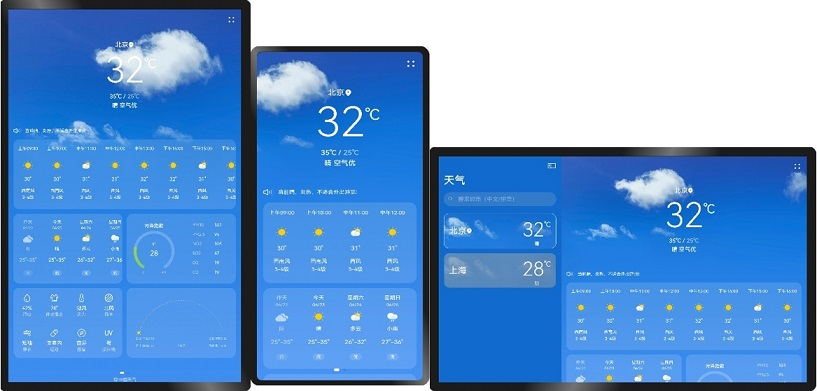
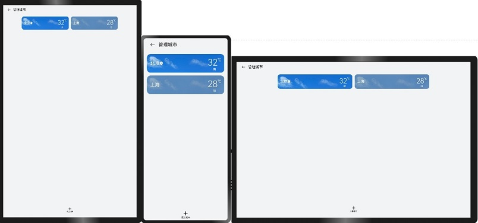
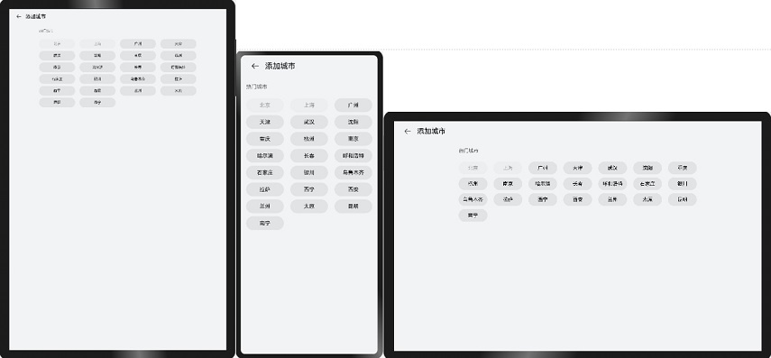

# Weather

### Introduction

This sample demonstrates one-time development for multi-device deployment by showing how to develop a weather app and deploy it across different devices. The demo app includes the following: home page, **Manage City** page, **Add City** page, and **Update Time** page.

**How to Implement**

1. Use the grid breakpoint system of responsive layout to implement different display effects on windows of different sizes.

2. Use [SideBarContainer](https://gitcode.com/openharmony/docs/blob/master/en/application-dev/reference/apis-arkui/arkui-ts/ts-container-sidebarcontainer.md) to implement the sidebar.

3. Use [GridRow](https://gitcode.com/openharmony/docs/blob/master/en/application-dev/reference/apis-arkui/arkui-ts/ts-container-gridrow.md) to implement content split and display.

4. Use **Canvas** and **CanvasRenderingContext2D** to draw curves that show the air quality and sunrise and sunset.

**How to Use**

1. After the demo app is started, weather information of the added cities is displayed on the home page. By default, two cities are present. You can swipe left or right to switch between them. The sidebar is displayed by default on a large-screen (LG) device. When the sidebar is displayed, the content area occupies 2/3 of the screen; when the sidebar is hidden, the content area automatically extends to full screen.

2. On a device that supports free window dragging, you can drag the window to the maximum width to show the sidebar. In this case, you can tap the sidebar control button to hide or display the sidebar. If you resize the window to MD through dragging, the sidebar and sidebar control buttons will be hidden.

3. On a device that supports window dragging, the weather content area is automatically adapted to the window size while you're dragging the window.

4. Touch the menu button in the upper right corner and tap **Update Time**. The **Update Time** page is displayed. This page has two columns on a tablet and one column on a small-screen device.

5. Touch the menu button in the upper right corner and tap **Manage Cities**. The **Manage Cities** page is displayed, showing the cities you've added. This page has two columns on a tablet and one column on a small-screen device like phone.

6. Touch **Add City** on the **Manage Cities** page. On the **Add City** page displayed, tap any city that has not been added before. The city will be added to the city list and the **Manage Cities** page will be displayed.

### Display Effect

| Home | Manage Cities | Add City |
|--------------------------------|--------------------------------|--------------------------------|
||||

### Project Structure

```
Weather
|---common/src/main/ets                      // HAR module shared by the app and the tests
|   |---mock
|   |   |---CityInfo.ts                      // City list mock data
|   |   |---Mock.ts                          // Weather data mock (frozen baseline of the tests)
|   |   |---RequestData.ts                   // Air quality and life index request data
|   |---model
|   |   |---BasicDataSource.ets              // LazyForEach data source
|   |   |---FormDate.ts                      // Date formatting (fill / month-day)
|   |   |---Main.ts                          // Page level models
|   |   |---MenuData.ts                      // Menu entry data
|   |---util
|   |   |---Constants.ts                     // Storage keys, breakpoint and layout constants
|   |   |---Logger.ts                        // hilog wrapper
|   |   |---Style.ts                         // Shared style tokens
|   |---index.ets                            // HAR entry, exports all public symbols
|---product/default/src/main/ets
|   |---Application
|   |   |---MyAbilityStage.ets               // Custom AbilityStage
|   |---common/images                        // Images used by canvas drawing
|   |---feature
|   |   |---AirQualityFeature.ts             // Air quality curve drawing
|   |   |---CanvasConstants.ts               // Canvas size, color and business tokens
|   |   |---SunCanvasFeature.ts              // Sunrise and sunset curve drawing
|   |---MainAbility
|   |   |---MainAbility.ets                  // Main window
|   |---pages
|   |   |---AddCity.ets                      // Add City page
|   |   |---CityList.ets                     // Manage Cities page
|   |   |---Home.ets                         // Entry page with SideBarContainer
|   |   |---home                             // Home page components
|---product/default/src/ohosTest/ets
|   |---Application                          // AbilityStage used by the test HAP
|   |---test                                 // 60 suites / 2445 cases, registered in List.test.ets
|   |---testability                          // UIAbility and page used by the test HAP
|   |---testrunner                           // OpenHarmonyTestRunner
|   |---util                                 // Test helper and UI probe utilities
```

### Test

- Test project: `product/default/src/ohosTest` (bundleName `ohos.samples.weather`, test module `entry_test`, runner `OpenHarmonyTestRunner`)
- Scale: **60 suites / 2445 test cases** (14 hand-written L1 suites, 41 generated `@volume` suites, 5 L2 UI probe suites, numbered with `SUB_WEATHER_*`)
- Result: 2445/2445 cases passed on a real device (OpenHarmony 7.1.0.21, API 26) on 2026-11-19, after the `FormDate.fill()` fix, the resource/constant refactoring and the test-side style cleanup; the 288 affected assertions were recalculated and re-verified in that run.

Build the ohosTest HAP from DevEco Studio (`Build > Build Hap(s)/APP(s) > Build Hap(s)`, target the `ohosTest` of module `default`), with `devecocli build --modules default@ohosTest`, or with the `hvigorw` / `hvigorw.bat` wrappers that ship with the project (the wrapper installs hvigor on first run, so npm access is required):

```shell
# Windows
hvigorw.bat --mode module -p module=default@ohosTest assembleHap --no-daemon
# Linux / macOS
./hvigorw --mode module -p module=default@ohosTest assembleHap --no-daemon
```

The CLI output `default-ohosTest-unsigned.hap` cannot be installed on a real device (`code:9568320 error: no signature file`). Sign it first — enable automatic signing in `File > Project Structure > Signing Configs`, or chain `hap-sign-tool.jar` (`generate-app-cert` → `sign-profile` → `sign-app`) with the `OpenHarmony.p12` / `OpenHarmonyProfileRelease.pem` materials shipped in `toolchains/lib` — then install `default-ohosTest-signed.hap`.

Install and run (all suites registered in `List.test.ets` run when `-s class` is not specified; run the 9 batches listed in [ohosTest.md](./ohosTest.md) if a single full run makes the device abort):

```shell
hdc install product/default/build/default/outputs/ohosTest/default-ohosTest-signed.hap
hdc shell aa test -b ohos.samples.weather -m entry_test -s unittest OpenHarmonyTestRunner -s timeout 60000
```

> The UI probe suites connect to AAMS through `Driver.create()`; make sure the device is unlocked and no system dialog (for example the USB connection prompt) or other app owns the top window. `Can not connect to AAMS, RET_ERR_CONNECTION_EXIST` is cleared by rebooting the device.

For the case matrix, the `@tc` metadata and the batch plan, see [ohosTest.md](./ohosTest.md).

### Required Permissions

N/A

### Dependency

N/A

### Constraints

1. This sample can only be run on standard-system devices.

2. This sample demonstrates the stage model, with `compileSdkVersion` and `compatibleSdkVersion` both set to `"26.0.0"` (runtimeOS: OpenHarmony).

3. This sample can be compiled and run only with DevEco Studio 26 or later versions.

### How to Download

If you need to download this project separately, run the following commands:

```shell
git init
git config core.sparsecheckout true
echo code/SuperFeature/MultiDeviceAppDev/Weather/ > .git/info/sparse-checkout
git remote add origin https://gitcode.com/openharmony/applications_app_samples.git
git pull origin master
```
