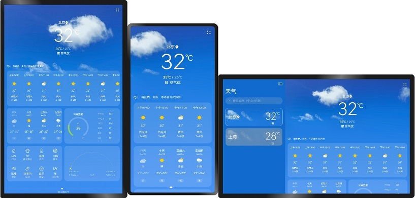
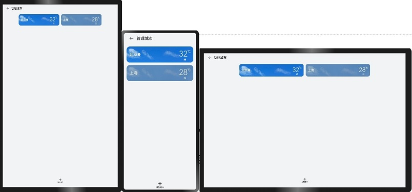
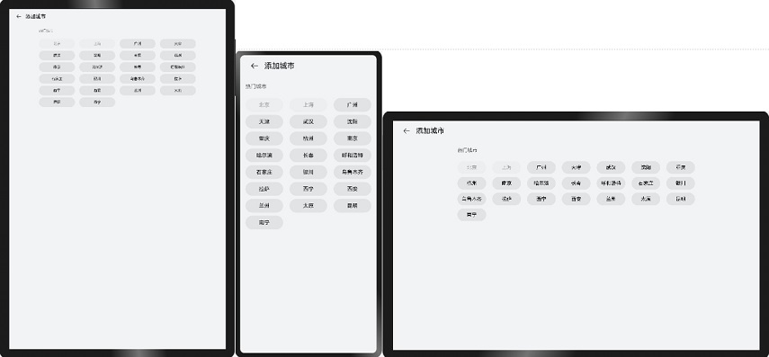

# 一多天气

### 介绍

本示例展示一个天气应用界面，包括首页、城市管理、添加城市与更新间隔弹窗，体现一次开发，多端部署的能力。示例参考 [一次开发，多端部署](https://gitcode.com/openharmony/docs/tree/master/zh-cn/application-dev/key-features/multi-device-app-dev) 的指导，使用响应式布局的栅格断点系统，在 SM（320vp ~ 600vp）、MD（600vp ~ 840vp）与 LG（840vp 以上）三档窗口尺寸下呈现不同的内容分区与列数。

工程按完整示例组织，同时兼顾可运行与可教学：

- **首页**由 `SideBarContainer` 承载侧边栏与内容区，内容区用 `Swiper` 承载多城市，左右滑动或点击侧边栏条目切换当前城市，背景图随当前城市的天气类型切换。
- **城市管理页**展示已添加城市，LG / MD 两列、SM 一列，可继续进入添加城市页。
- **添加城市页**列出热门城市，已添加的城市不可点击，点击未添加城市即加入列表并返回城市管理页。
- **更新间隔弹窗**由标题栏菜单的「更新间隔」打开，列出 1 / 2 / 4 / 6 / 12 / 24 小时与不更新共 7 个单选项，LG 下两列、小屏一列，点击「取消」关闭；该弹窗只做展示，不改变刷新策略。
- **公共 HAR** `common` 提供 mock 数据、数据源、日期格式化、样式令牌与日志封装，应用与 ohosTest 引用同一份冻结基线。
- **自动化测试**覆盖 60 个套件 / 2445 条用例，用例矩阵与运行方式见 [ohosTest.md](./ohosTest.md)。

侧边栏在 LG 断点默认展开，MD / SM 自动隐藏；拖拽窗口跨断点时，侧边栏显隐与内容列数随之变化。

### 效果预览

| 首页 | 城市管理 | 添加城市 |
|--------------------------------------|--------------------------------------|--------------------------------------|
||||

### 使用说明

1. 启动应用后，首页展示已添加城市的天气信息，默认展示 2 个城市，左右滑动可以切换城市；在 LG 设备上默认显示侧边栏，侧边栏显示时右侧内容区占 2/3，侧边栏隐藏时内容区自动铺满界面。
2. 在支持窗口自由拖拽的设备上，把窗口拖到最大时侧边栏显示，点击侧边栏控制按钮（标题栏左侧图标）可以隐藏和显示侧边栏。
3. 在支持窗口自由拖拽的设备上，把窗口缩小到 MD 时侧边栏与侧边栏控制按钮自动隐藏，天气内容区跟随窗口尺寸自动换行显示。
4. 点击右上角菜单按钮，在菜单中点击 **更新间隔**，弹出更新间隔弹窗；在 LG 上显示两列，在小屏设备上显示一列，点击 **取消** 关闭弹窗。
5. 点击右上角菜单按钮，在菜单中点击 **管理城市**，进入城市管理界面，展示已添加的城市；在 LG / MD 上显示两列，在小屏设备上显示一列。
6. 点击城市管理界面的 **添加城市**，进入添加城市界面，已添加的城市不可点击，点击未添加的城市即可添加并返回城市管理界面显示。

### 工程目录

```
Weather
├──common/src/main/ets                        // 公共 HAR 模块，供应用与测试共同引用
│  ├──mock
│  │  ├──CityInfo.ts                          // 城市列表模拟数据（测试冻结基线）
│  │  ├──Mock.ts                              // 天气数据模拟（测试冻结基线）
│  │  └──RequestData.ts                       // 首页、空气质量与生活指数请求数据
│  ├──model
│  │  ├──BasicDataSource.ets                  // LazyForEach 数据源
│  │  ├──FormDate.ts                          // 日期格式化（fill / 月日 / 时间槽）
│  │  ├──Main.ts                              // 页面数据模型
│  │  └──MenuData.ts                          // 菜单条目数据
│  ├──util
│  │  ├──Constants.ts                         // 路由、存储 key、断点、天气与文案常量
│  │  ├──Logger.ts                            // hilog 封装
│  │  └──Style.ts                             // 公共样式令牌
│  └──index.ets                               // HAR 入口，导出全部公共符号
└──product/default/src
   ├──main/ets
   │  ├──Application
   │  │  └──MyAbilityStage.ets                // 自定义 AbilityStage
   │  ├──common/images                        // 绘制曲线使用的图片
   │  ├──feature
   │  │  ├──AirQualityFeature.ts              // 空气质量曲线绘制
   │  │  ├──CanvasConstants.ts                // 画布尺寸、颜色与业务常量
   │  │  └──SunCanvasFeature.ts               // 日出日落曲线绘制
   │  ├──MainAbility
   │  │  └──MainAbility.ets                   // 主窗口
   │  └──pages
   │     ├──AddCity.ets                       // 添加城市
   │     ├──CityList.ets                      // 城市管理
   │     ├──Home.ets                          // 首页入口，SideBarContainer + Swiper
   │     └──home
   │        ├──AirQuality.ets                 // 空气质量卡片
   │        ├──HomeContent.ets                // 单城市内容区
   │        ├──HoursWeather.ets               // 每小时天气
   │        ├──IndexEnd.ets                   // 首页尾部
   │        ├──IndexHeader.ets                // 首页头部天气信息
   │        ├──IndexTitleBar.ets              // 标题栏与菜单
   │        ├──LifeIndex.ets                  // 生活建议
   │        ├──MultidayWeather.ets            // 多日天气
   │        ├──SideContent.ets                // 侧边栏
   │        ├──SunCanvas.ets                  // 日出日落卡片
   │        └──UpdateTimeDialog.ets           // 更新间隔弹窗
   └──ohosTest                                // 自动化测试用例，详见 ohosTest.md
      └──ets
         ├──Application                       // 测试用 AbilityStage
         ├──test                              // 60 个套件 / 2445 条用例，注册表 List.test.ets
         ├──testability                       // 测试用 UIAbility 与页面
         ├──testrunner                        // OpenHarmonyTestRunner
         └──util                              // 测试辅助与 UI 探针工具
```

### 具体实现

**断点监听与侧边栏**

[Home.ets](product/default/src/main/ets/pages/Home.ets) 在 `aboutToAppear` 中注册三个 `mediaquery` 监听（[Constants.ts](common/src/main/ets/util/Constants.ts) 中的 `SM_QUERY` / `MD_QUERY` / `LG_QUERY`），命中时更新 `curBp` 并写入 `AppStorage`；SM / MD 命中时关闭侧边栏，LG 命中时展开侧边栏。`SideBarContainer(SideBarContainerType.Embed)` 固定侧边栏宽度并关闭系统控制按钮，改由标题栏与侧边栏内的图标控制显隐。

**多城市切换与天气背景**

内容区用 `Swiper` + `ForEach` 遍历 `getCityListWeatherData()` 的结果，`onChange` 把当前索引写入 `AppStorage` 的 `swiperIndex`；侧边栏条目点击时同样写该 key，从而与 `Swiper` 双向联动。页面背景由 `getBg(当前城市天气类型)` 得到，城市列表为空时回退为晴天背景。`@StorageLink('isRefresh')` 加 `@Watch` 在数据刷新时重建城市列表。

**侧边栏与标题栏**

[SideContent.ets](product/default/src/main/ets/pages/home/SideContent.ets) 用 `Search` + `LazyForEach(MyDataSource)` 渲染城市列表，条目 `id` 为 `sliderCity<index>`，点击后写入 `swiperIndex` 切换当前城市，首条城市额外显示定位图标。[IndexTitleBar.ets](product/default/src/main/ets/pages/home/IndexTitleBar.ets) 用 `bindPopup` 渲染 `getMenuInfo()` 的两个菜单项：**管理城市** 通过 `router.pushUrl` 跳转，**更新间隔** 打开自定义弹窗。

**城市管理与添加城市**

[CityList.ets](product/default/src/main/ets/pages/CityList.ets) 用 `GridRow` / `GridCol`（`span: { sm: 4, md: 3, lg: 4 }`）按断点排布城市卡片，列表末尾的 **添加城市** 入口（`id` 为 `addCity`）跳转添加页。[AddCity.ets](product/default/src/main/ets/pages/AddCity.ets) 用嵌套的 `GridRow` / `GridCol` 渲染热门城市，`isAdded` 判断城市是否已在列表中，已添加项不可点击，未添加项点击后调用 `addCity` 并返回。

**空气质量与日出日落曲线**

[AirQualityFeature.ts](product/default/src/main/ets/feature/AirQualityFeature.ts) 的 `initRound` 在 `CanvasRenderingContext2D` 上先画背景圆弧、再画一条 `createLinearGradient` 渐变的数值圆弧，最后用 `fillText` 输出空气等级描述、AQI 数值与两端刻度。[SunCanvasFeature.ts](product/default/src/main/ets/feature/SunCanvasFeature.ts) 的 `initSun` / `initMoon` 绘制时间轴基线、太阳与月亮圆弧以及日落标签；画布尺寸、颜色与偏移量集中在 [CanvasConstants.ts](product/default/src/main/ets/feature/CanvasConstants.ts)。

**更新间隔弹窗**

[UpdateTimeDialog.ets](product/default/src/main/ets/pages/home/UpdateTimeDialog.ets) 是 `@CustomDialog`，用 `GridRow` / `GridCol`（`span: 4`，`offset` 随断点 0 / 2 / 4）居中或贴底展示，`List` 的 `lanes` 在 LG 为两列、其它断点为一列，每个间隔项是一个 `Radio`（`group` 为 `RadioGroup.UPDATE_TIME`），点击 **取消** 由 `handleCancelDialog` 回调关闭弹窗。

**公共 HAR**

[common/index.ets](common/index.ets) 统一导出 `RequestData` 的请求函数、`MyDataSource`、页面数据模型、`FormDate`、`Logger`、`Style` 与常量类，应用与 ohosTest 通过 `@ohos/common` 引用同一份实现，测试断言直接锚定这份冻结基线。

### 测试

- 测试工程：`product/default/src/ohosTest`（bundleName `ohos.samples.weather`，测试模块 `entry_test`，runner `OpenHarmonyTestRunner`）。
- 规模：60 个套件 / 2445 条用例，分 L1 手写行为套件（289 条）、`@volume` 规格回归套件（2128 条）与 L2 UI 探针套件（28 条）。
- 结果：2026-11-19 在真机（OpenHarmony 7.1.0.21 / API 26）分 9 批执行，2445 条全部通过。

用例矩阵、`@tc` 元数据、构建签名与分批命令见 [ohosTest.md](./ohosTest.md)。

### 相关权限

不涉及。

### 依赖

不涉及第三方依赖。

### 约束与限制

1. 本示例仅支持在标准系统上运行。
2. 本示例为 Stage 模型，使用 API version 26 版本 SDK 编译，`compileSdkVersion` 与 `compatibleSdkVersion` 均为 `"26.0.0"`（runtimeOS：OpenHarmony）。
3. 本示例需要使用 DevEco Studio 26 及以上版本才可编译运行。
4. 侧边栏仅在 LG 断点（窗口宽度大于 840vp）可用，MD / SM 强制隐藏；更新间隔弹窗只做界面展示，不改变数据刷新周期。
5. 单进程整跑 2445 条用例会触发 App died，自动化回归需按 [ohosTest.md](./ohosTest.md) 的 9 批清单分批执行。

### 下载

如需单独下载本工程，执行如下命令：

```
git init
git config core.sparsecheckout true
echo code/SuperFeature/MultiDeviceAppDev/Weather/ > .git/info/sparse-checkout
git remote add origin https://gitcode.com/openharmony/applications_app_samples.git
git pull origin master
```
