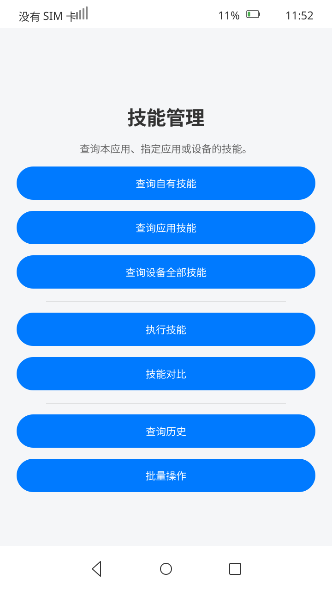
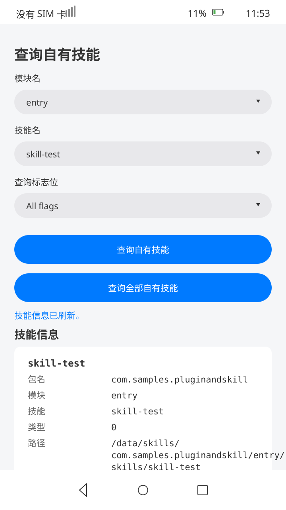
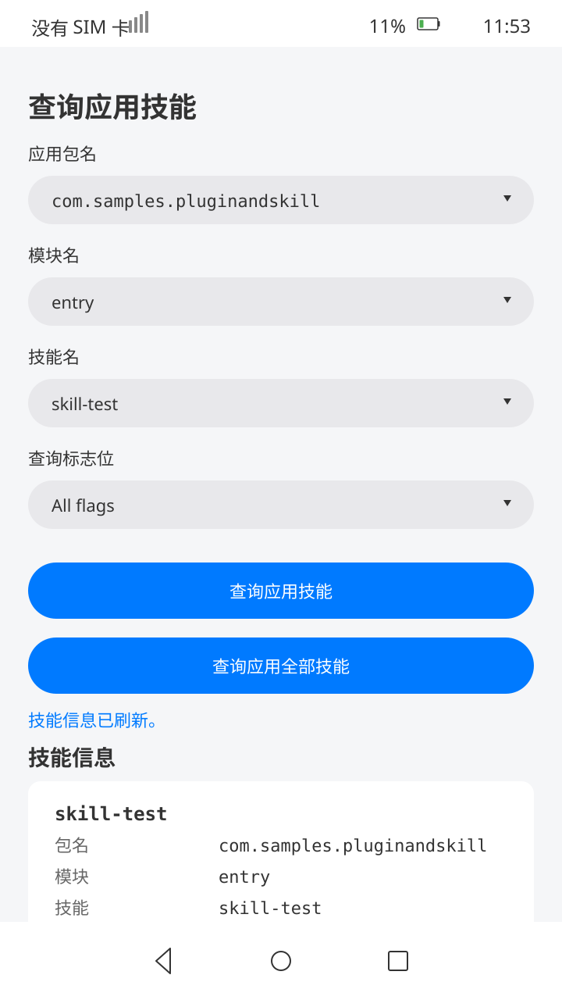
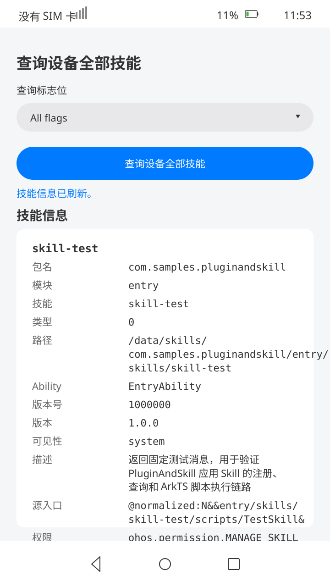

# Skill Management

## Introduction

This sample demonstrates how to use [@ohos.bundle.skillManager](https://gitcode.com/openharmony/docs/blob/master/zh-cn/application-dev/reference/apis-ability-kit/js-apis-skillManager.md) to manage application skills.

**Features:**

1. Query skill information registered by the current application or other applications using `skillManager`.
2. Execute application skills using `scriptManager`.
3. Compare skill information between two skills.
4. View skill execution history with filtering and statistics.
5. Batch execute multiple skills with selection toggles.

## Preview

| Home | Skill Query |
|:---:|:---:|
|  |  |

| Application Skill Query | All Device Skills Query |
|:---:|:---:|
|  |  |

## Usage

1. On the home page, tap **Skills** to enter the skill management page.
2. On the skill management page:
   - Tap **Query own skill** to enter the own skill query page, where you can select module name and skill name using dropdown menus, select a query flag combination from the **Query flags** dropdown, then tap **Query own skill** to query a specific skill or **Query all own skills** to query all skills registered by the current application.
   - Tap **Query application skill** to enter the application skill query page, where you can select bundle name, module name, and skill name using dropdown menus, select a query flag combination from the **Query flags** dropdown, then tap **Query application skill** to query a specific skill or **Query application skills** to query all skills registered by a specified application.
   - Tap **Query all device skills** to enter the all skills query page, select a query flag combination from the **Query flags** dropdown, then tap **Query all device skills** to query all skills available on the device.
   - Tap **Skill execution** to enter the skill execution page, select a module and skill, then tap **Execute** to run the skill script and view results with execution history.
   - Tap **Skill compare** to enter the skill comparison page, select two skills (module + skill name each), then tap **Compare** to view field-level differences.
   - Tap **Skill history** to enter the execution history page, tap **Query all** to view past records with filtering and statistics.
   - Tap **Skill batch** to enter the batch operations page, select skills via toggles or select-all, then tap **Execute** to run them in batch.

## Project Structure

```
entry/src/main/ets/
|---entryability/
|   |---EntryAbility.ets              // Entry ability
|---entrybackupability/
|   |---EntryBackupAbility.ets        // Backup ability
|---pages/
|   |---Index.ets                     // Home page with navigation
|---pluginandskill/pages/
|   |---SkillManagerHome.ets          // Skill management home page
|   |---SelfSkillQueryPage.ets        // Own skill query page
|   |---BundleSkillQueryPage.ets      // Application skill query page
|   |---AllSkillsQueryPage.ets        // All device skills query page
|   |---SkillExecutionPage.ets        // Skill execution page
|   |---SkillComparePage.ets          // Skill comparison page
|   |---SkillHistoryPage.ets          // Skill execution history page
|   |---SkillBatchPage.ets            // Batch skill operations page
|---util/
|   |---Constant.ets                  // UI constants
|   |---Logger.ets                    // Logging utility
|   |---AssertionHelper.ets           // Assertion helper
|   |---PerformanceTracker.ets        // Performance tracking
|   |---TestDataGenerator.ets         // Test data generation
|   |---TestDataProvider.ets          // Test data provider
|   |---TestEnvironmentChecker.ets    // Environment checker
|   |---TestLogAnalyzer.ets           // Log analyzer
|   |---TestMetricsCollector.ets      // Metrics collector
|   |---TestReportGenerator.ets       // Report generator
entry/skills/
|---skill-test/scripts/
|   |---TestSkill.ets                 // Test skill script
|---skill-echo/scripts/
|   |---EchoSkill.ets                 // Echo skill script
|---skill-calculator/scripts/
|   |---CalculatorSkill.ets           // Calculator skill script
|---skill-validation/scripts/
|   |---ValidationSkill.ets           // Validation skill script
entry/src/ohosTest/ets/test/
|---List.test.ets                        // Test suite entry (with SUITE_MANIFEST)
|---Ability.test.ets                     // App launch & navigation tests (2 cases)
|---SelfSkillQuery.test.ets              // Own skill query tests (15 cases)
|---BundleSkillQuery.test.ets            // Application skill query tests (17 cases)
|---AllSkillsQuery.test.ets              // All device skills query tests (8 cases)
|---IndexAndNavigation.test.ets          // Index page & navigation tests (10 cases)
|---ResultFieldValidation.test.ets       // Result field validation tests (20 cases)
|---NavigationFlow.test.ets              // Navigation flow & boundary tests (10 cases)
|---StateConsistency.test.ets            // State consistency tests (10 cases)
|---ErrorHandling.test.ets               // Error handling tests (10 cases)
|---SkillExecution.test.ets              // Skill execution tests (10 cases)
|---SkillCompareAndHistory.test.ets      // Skill compare & history tests (10 cases)
|---PluginCompareAndBatch.test.ets       // Batch operations tests (5 cases)
|---AdvancedFeatureTest.test.ets         // Advanced feature tests (10 cases)
|---AssertionHelper.test.ets             // Assertion helper tests (68 cases)
|---PerformanceTracker.test.ets          // Performance tracker tests (38 cases)
|---TestDataProvider.test.ets            // Test data provider tests (32 cases)
|---TestMetricsCollector.test.ets        // Metrics collector tests (25 cases)
|---TestDataGenerator.test.ets           // Test data generator tests (25 cases)
|---TestEnvironmentChecker.test.ets      // Environment checker tests (25 cases)
|---TestLogAnalyzer.test.ets             // Log analyzer tests (25 cases)
|---TestReportGenerator.test.ets         // Report generator tests (25 cases)
|---ConstantValidation.test.ets          // Constant validation tests (20 cases)
|---SkillManagerHomeExtended.test.ets    // Skill manager home extended tests (8 cases)
|---SkillBatchExtended.test.ets          // Batch operations extended tests (12 cases)
|---SkillHistoryExtended.test.ets        // History extended tests (12 cases)
|---SkillCompareExtended.test.ets        // Compare extended tests (10 cases)
```

> **Note:** See [ohosTest.md](ohosTest.md) for detailed test case documentation.

## Implementation

- **Skill management**: Uses `skillManager` APIs:
  - `getSkillInfoForSelf()`: Queries a specific skill registered by the current application.
  - `getSkillInfosForSelf()`: Queries all skills registered by the current application.
  - `getSkillInfo()`: Queries a specific skill registered by a specified application.
  - `getSkillInfos()`: Queries all skills registered by a specified application.
  - `getAllSkillInfos()`: Queries all skills available on the device.

- **Skill execution**: Application skills are defined in `entry/skills/` and registered in [module.json5](entry/src/main/module.json5) via `skillProfiles`. Skills are executed using `scriptManager.completeArkTSScriptInApp()`. The execution page supports module/skill selection, result display, and execution history tracking.

- **Skill comparison**: The comparison page allows selecting two skills (module + skill name each) and compares their `SkillInfo` fields, displaying total fields, matching count, difference count, and match rate.

- **Skill history**: The history page queries and displays past skill execution records with filtering (success/failed), statistics, and clear functionality.

- **Batch operations**: The batch page allows selecting multiple skills via individual toggles or select-all, then executes them in batch with result display and clear functionality.

## Testing

This project includes an Instrument test suite (ohosTest) with **495 test cases** organized into **25 suites** via `SUITE_MANIFEST`:

| Suite | File | Cases | Description |
|---|---|---:|---|
| PluginAndSkillAbilityTest | Ability.test.ets | 2 | App launch and navigation validation |
| SelfSkillQueryTest | SelfSkillQuery.test.ets | 15 | Own skill query: parameter validation, success, exception, flag verification |
| BundleSkillQueryTest | BundleSkillQuery.test.ets | 17 | Application skill query: parameter validation, success, exception, flag verification |
| AllSkillsQueryTest | AllSkillsQuery.test.ets | 8 | All device skills query: basic query, flag verification |
| IndexAndNavigationTest | IndexAndNavigation.test.ets | 10 | Index page UI, SkillManagerHome navigation, page round-trip flow |
| ResultFieldValidationTest | ResultFieldValidation.test.ets | 20 | Query result card field-level validation across three query pages |
| NavigationFlowTest | NavigationFlow.test.ets | 10 | Multi-step navigation paths, button state, boundary scenarios |
| StateConsistencyTest | StateConsistency.test.ets | 10 | Selector state, result card state, cross-page state isolation |
| ErrorHandlingTest | ErrorHandling.test.ets | 10 | Error message validation, empty parameter validation, error recovery |
| SkillExecutionTest | SkillExecution.test.ets | 10 | Skill execution page: UI validation, execution operations, selector verification |
| SkillCompareAndHistoryTest | SkillCompareAndHistory.test.ets | 10 | Skill comparison and history: compare operations, history records, filter statistics |
| SkillBatchTest | PluginCompareAndBatch.test.ets | 5 | Batch skill operations: UI validation, skill toggling, execution operations |
| AdvancedFeatureTest | AdvancedFeatureTest.test.ets | 10 | Advanced feature scenarios: compare combinations, history details, batch selection, execution records |
| AssertionHelperTest | AssertionHelper.test.ets | 68 | Assertion helper: assertion methods, result collection, statistics, singleton |
| PerformanceTrackerTest | PerformanceTracker.test.ets | 38 | Performance tracker: timer, metrics, category filter, summary, report |
| TestDataProviderTest | TestDataProvider.test.ets | 32 | Test data provider: singleton, param factory, case generation, statistics |
| TestMetricsCollectorTest | TestMetricsCollector.test.ets | 25 | Metrics collector: singleton, record, accumulate, eliminate, summary |
| TestDataGeneratorTest | TestDataGenerator.test.ets | 25 | Test data generator: combination generation, boundary cases, counter |
| TestEnvironmentCheckerTest | TestEnvironmentChecker.test.ets | 25 | Environment checker: singleton, constants, integrity check, report |
| TestLogAnalyzerTest | TestLogAnalyzer.test.ets | 25 | Log analyzer: level filter, tag search, case identification, pass rate |
| TestReportGeneratorTest | TestReportGenerator.test.ets | 25 | Report generator: entry management, quality score, suite grouping |
| ConstantValidationTest | ConstantValidation.test.ets | 20 | Constant validation: array length, defaults, index bounds, flags, UI |
| SkillManagerHomeExtendedTest | SkillManagerHomeExtended.test.ets | 8 | Skill manager home extended: buttons, navigation round-trip, depth |
| SkillBatchExtendedTest | SkillBatchExtended.test.ets | 12 | Batch extended: individual select, summary card, record fields, toggle |
| SkillHistoryExtendedTest | SkillHistoryExtended.test.ets | 12 | History extended: stats accuracy, record fields, filter, accumulation |
| SkillCompareExtendedTest | SkillCompareExtended.test.ets | 10 | Compare extended: same/different compare, not found, selector state |

See [ohosTest.md](ohosTest.md) for the complete test case table, build instructions, and execution guide.

## Permissions

| Permission | Description |
|---|---|
| `ohos.permission.kernel.SUPPORT_LOCAL_PLUGIN` | Required to support local plugins. |
| `ohos.permission.MANAGE_SKILL_PRIVILEGE` | Required to manage skill privileges. |
| `ohos.permission.READ_WRITE_USER_FILE` | Required to read and write user files. |

**Note:** These permissions are system-granted or require specific signing configurations.

## Constraints

1. This sample only supports standard system devices.
2. This sample is based on the Stage model and requires API 26.0.0 SDK.
3. This sample requires DevEco Studio 6.0.0 or later to compile and run.
4. The sample uses open-source SDK version 26.0.0.

## Download

To download this sample separately, run the following commands:

```shell
git init
git config core.sparseCheckout true
echo code/SystemFeature/Ability/PluginAndSkill/ > .git/info/sparse-checkout
git remote add origin https://gitcode.com/openharmony/applications_app_samples.git
git pull origin master
```
