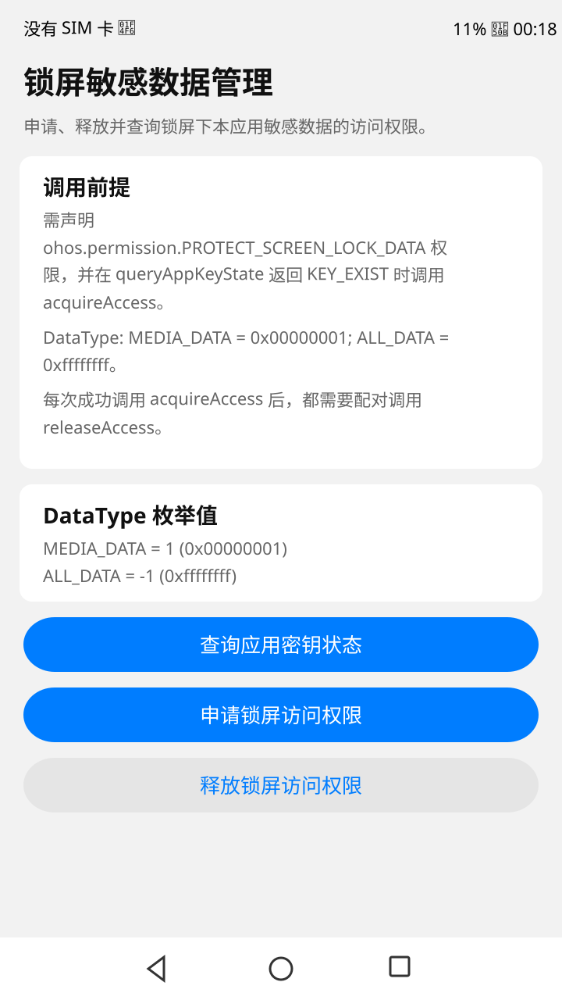
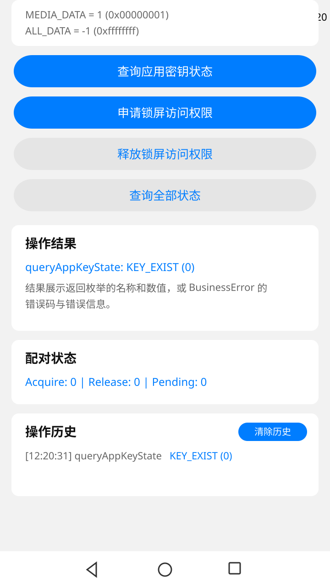
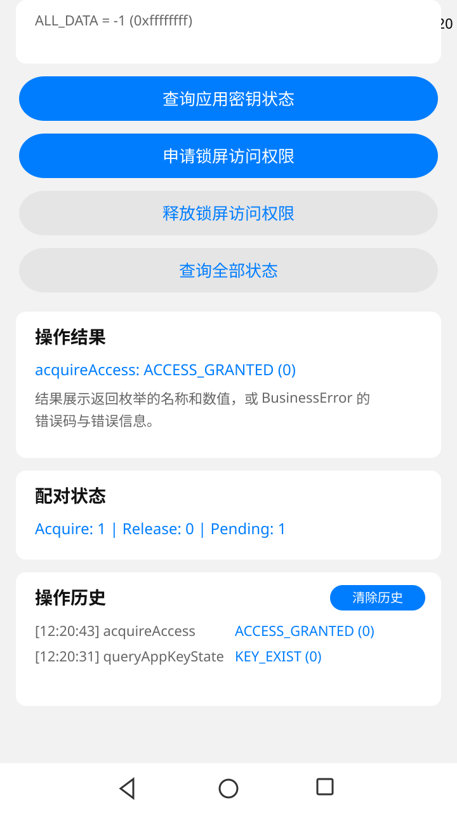

# ScreenLockFile

### 介绍

本示例基于Stage模型和ArkTS语言，使用[@ohos.ability.screenLockFileManager](https://gitcode.com/openharmony/docs/blob/master/zh-cn/application-dev/reference/apis-ability-kit/js-apis-screenLockFileManager.md)提供的`acquireAccess`、`releaseAccess`和`queryAppKeyState`接口，展示锁屏下本应用敏感数据访问权限的申请、释放和密钥状态查询方法。

应用声明`ohos.permission.PROTECT_SCREEN_LOCK_DATA`后，系统为应用提供EL5高安全级别目录。锁屏敏感数据密钥销毁后，相关数据无法读写。成功调用`acquireAccess`可增加密钥引用计数，调用`releaseAccess`可减少引用计数，两者需要配对使用。

### 效果预览

| 主页面 | 查询应用密钥状态 |
|:---:|:---:|
|  |  |

| 申请锁屏访问权限 | 释放锁屏访问权限 |
|:---:|:---:|
|  |  |

### 使用说明

1. 启动ScreenLockFile，阅读主页面的权限、密钥状态和接口配对说明。
2. 点击“查询应用密钥状态”。结果区域展示`KEY_NOT_EXIST`、`KEY_RELEASED`或`KEY_EXIST`的名称和数值。
3. 密钥状态为`KEY_EXIST`时，点击“申请锁屏访问权限”。结果区域展示`ACCESS_GRANTED`或`ACCESS_DENIED`。配对状态区域更新申请次数。
4. 成功申请后，点击“释放锁屏访问权限”。结果区域展示`RELEASE_GRANTED`或`RELEASE_DENIED`。配对状态区域更新释放次数和待配对数。
5. 点击“查询全部状态”，在一行内查看当前密钥状态、申请次数、释放次数和待配对数的汇总信息。
6. 操作历史区域记录最近 10 条操作及时间戳。点击“清除历史”可清空历史记录，保留申请次数、释放次数和待配对数，避免与系统密钥引用计数不一致。
7. 设备不支持该系统能力、应用未开启锁屏敏感数据保护或调用顺序不满足要求时，结果区域展示实际`BusinessError`错误码和错误信息。

### 工程目录

```
entry/src/main/ets/
|---entryability
|   |---EntryAbility.ets                       // 应用入口元能力
|---screenlockfile
|   |---pages
|       |---ScreenLockFileHome.ets             // 三个接口的操作页面和结果展示
|---pages
|   |---Index.ets                              // 唯一入口页面
entry/src/ohosTest/ets/test/
|---SharedDriver.ets                          // UI操作共享工具类
|---SharedDriverExt.ets                       // 共享驱动扩展工具
|---TestConstants.ets                         // 测试常量（DOMAIN、TAG）
|---TestHelper.ets                            // 测试断言辅助类
|---List.test.ets                             // SUITE_MANIFEST测试套件入口（53个套件）
|---AbilityLifecycle.test.ets                 // [阶段0] 应用启动与页面元素（3）
|---ApiStates.test.ets                        // [阶段0] API状态机与枚举值（6）
|---UiInteraction.test.ets                    // [阶段0] 按钮交互与结果展示（7）
|---EdgeCases.test.ets                        // [阶段0] 重复调用、异常顺序与边界（7）
|---QueryAppKeyState.test.ets                 // [阶段1] 查询密钥状态API（30）
|---AcquireAccess.test.ets                    // [阶段1] 申请访问权限API（30）
|---ReleaseAccess.test.ets                    // [阶段1] 释放访问权限API（30）
|---QueryAllStates.test.ets                   // [阶段1] 全状态查询API（25）
|---EnumValues.test.ets                       // [阶段1] 枚举值一致性（25）
|---ApiReturnType.test.ets                    // [阶段1] 返回值类型验证（20）
|---ApiSequence.test.ets                      // [阶段1] 调用顺序验证（20）
|---ApiIdempotency.test.ets                   // [阶段1] 幂等性验证（25）
|---KeyStatusEnum.test.ets                    // [阶段1] KeyStatus枚举覆盖（30）
|---AccessStatusEnum.test.ets                 // [阶段1] AccessStatus枚举覆盖（25）
|---ReleaseStatusEnum.test.ets                // [阶段1] ReleaseStatus枚举覆盖（25）
|---ConstantsValidation.test.ets              // [阶段1] 常量定义一致性（20）
|---ButtonClick.test.ets                      // [阶段2] 按钮点击交互（35）
|---ResultDisplay.test.ets                    // [阶段2] 结果内容展示（30）
|---PairingStatusDisplay.test.ets             // [阶段2] 配对状态计数展示（25）
|---HistoryList.test.ets                      // [阶段2] 历史记录列表（30）
|---PageLayout.test.ets                       // [阶段2] 页面布局验证（25）
|---ButtonStyle.test.ets                      // [阶段2] 按钮样式验证（20）
|---ScrollBehavior.test.ets                   // [阶段2] 滚动容器行为（20）
|---CardStyle.test.ets                        // [阶段2] 卡片样式与圆角（20）
|---FontHierarchy.test.ets                    // [阶段2] 字体层级验证（15）
|---TextContent.test.ets                      // [阶段2] 文本内容验证（10）
|---PageStructure.test.ets                    // [阶段2] 页面结构验证（25）
|---SectionLayout.test.ets                    // [阶段2] 分区布局与间距（25）
|---ComponentSpacing.test.ets                 // [阶段2] 组件间距与对齐（25）
|---ResponsiveLayout.test.ets                 // [阶段2] 响应式布局适配（20）
|---VisualConsistency.test.ets                // [阶段2] 视觉一致性检查（25）
|---KeyStateTransition.test.ets               // [阶段3] 按键状态转换（30）
|---LifecycleState.test.ets                   // [阶段3] 生命周期状态（25）
|---ForegroundBackground.test.ets             // [阶段3] 前后台状态行为（25）
|---StateConsistency.test.ets                 // [阶段3] 状态一致性验证（25）
|---PendingState.test.ets                     // [阶段3] Pending状态逻辑（20）
|---RestartRecovery.test.ets                  // [阶段3] 重启恢复验证（25）
|---ApiErrorHandling.test.ets                 // [阶段3] API错误处理（30）
|---ErrorInfoValidation.test.ets              // [阶段3] 错误信息字段（25）
|---ErrorRecovery.test.ets                    // [阶段3] 错误恢复重建（25）
|---ErrorUIImpact.test.ets                    // [阶段3] 错误对UI影响（25）
|---SequentialErrors.test.ets                 // [阶段3] 连续错误处理（25）
|---ErrorBoundary.test.ets                    // [阶段3] 错误边界极端值（25）
|---HistoryRecord.test.ets                    // [阶段4] 历史记录基本功能（30）
|---HistoryLimit.test.ets                     // [阶段4] 历史记录上限（25）
|---HistoryClear.test.ets                     // [阶段4] 历史清除功能（25）
|---HistoryMixedOps.test.ets                  // [阶段4] 混合操作历史（25）
|---HistoryAfterRestart.test.ets              // [阶段4] 清除后历史恢复（25）
|---AcquireCount.test.ets                     // [阶段4] 申请计数精确值（30）
|---ReleaseCount.test.ets                     // [阶段4] 释放计数精确值（30）
|---PendingCount.test.ets                     // [阶段4] 待配对计数逻辑（25）
|---PairingSymmetry.test.ets                  // [阶段4] 配对对称性（25）
|---CounterOverflow.test.ets                  // [阶段4] 计数器溢出极端值（25）
```

### 具体实现

* 功能接口直接通过`@kit.AbilityKit`中的`screenLockFileManager`调用。[ScreenLockFileHome.ets](entry/src/main/ets/screenlockfile/pages/ScreenLockFileHome.ets)分别调用`screenLockFileManager.acquireAccess()`、`screenLockFileManager.releaseAccess()`和`screenLockFileManager.queryAppKeyState()`，将返回枚举转换为名称和数值展示。同时记录操作历史（最近 10 条带时间戳）、维护申请/释放配对计数器，并提供“查询全部状态”汇总视图。接口异常统一转换为`BusinessError`，页面显示错误码和错误信息，并通过`hilog`记录日志。
* 入口页面[Index.ets](entry/src/main/ets/pages/Index.ets)仅负责承载功能组件。页面使用滚动布局、最大内容宽度和中英文资源，适配不同窗口尺寸。
* 测试套件采用`SUITE_MANIFEST`模式按主题组织，共 1218 条用例分布在 53 个套件中，分 5 个阶段：阶段 0 基础功能验证（4 套件，23 条）、阶段 1 API 深度验证（12 套件，305 条）、阶段 2 UI 与布局验证（15 套件，365 条）、阶段 3 状态与错误处理（12 套件，305 条）、阶段 4 历史与计数器验证（10 套件，255 条）。测试基础设施包括 [SharedDriver.ets](entry/src/ohosTest/ets/test/SharedDriver.ets)、[SharedDriverExt.ets](entry/src/ohosTest/ets/test/SharedDriverExt.ets)、[TestConstants.ets](entry/src/ohosTest/ets/test/TestConstants.ets) 和 [TestHelper.ets](entry/src/ohosTest/ets/test/TestHelper.ets)。

### 相关权限

[ohos.permission.PROTECT_SCREEN_LOCK_DATA](https://gitcode.com/openharmony/docs/blob/master/zh-cn/application-dev/security/AccessToken/permissions-for-all.md#ohospermissionprotect_screen_lock_data)为`normal`级别，采用`system_grant`授权方式，用于开启锁屏敏感数据保护功能。

### 依赖

无外部依赖。所有接口直接通过系统库`@kit.AbilityKit`中的`screenLockFileManager`调用。

### 约束与限制

1. 本示例适用于标准系统的Phone、Tablet和PC/2in1设备，需要设备支持`SystemCapability.Security.ScreenLockFileManager`。当前未进行真机布局和功能验证。
2. 本示例为Stage模型，使用OpenHarmony API version 26 SDK。工程的`compileSdkVersion`、`targetSdkVersion`和`compatibleSdkVersion`均为`26.0.0`，构建模型版本为6.1.0。
3. 请使用支持OpenHarmony API version 26的DevEco Studio和构建工具链。
4. `acquireAccess`和`releaseAccess`自API version 12开始支持，`queryAppKeyState`自API version 18开始支持。本工程统一使用API 26编译。
5. 调用接口前需声明相关权限并开启锁屏敏感数据保护。未开启保护、系统能力异常或访问状态不满足要求时，接口可能返回801、29300002、29300003、29300004或29300005错误码。

### 下载

如需单独下载本工程，执行如下命令：

```
git init
git config core.sparsecheckout true
echo code/SystemFeature/Ability/ScreenLockFile/ > .git/info/sparse-checkout
git remote add origin https://gitcode.com/openharmony/applications_app_samples.git
git pull origin master
```
