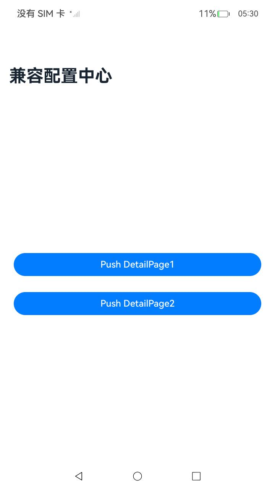
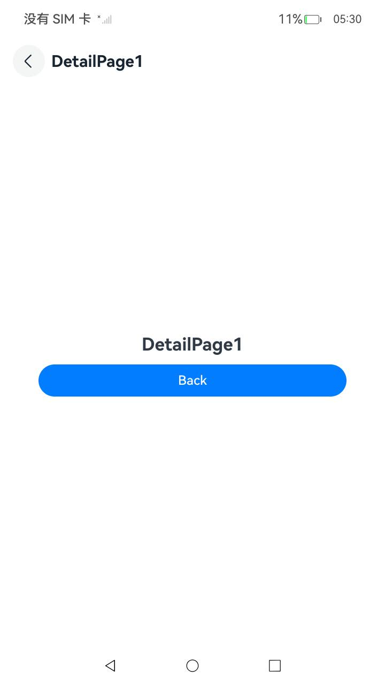

# CompConfigCenter

### 介绍

本示例展示了 OpenHarmony 多设备兼容子系统（Compatibility Config Center，兼容配置中心）的应用侧适配能力。应用在 module.json5 中通过 `"easyGo": "$profile:easy_go"` 声明兼容适配配置，系统侧由 bundlemanager 解析后交由兼容配置中心按设备形态合并下发，实现同一应用在直板手机、折叠屏、平板、2in1 等多种设备上的兼容运行。

本示例基于 ArkTS 1.1（Dynamic）范式与 Navigation 框架，演示 `displayModeOptions.navigationSplitOptions` 分栏配置的应用侧声明方式：在宽窗口场景下 Navigation 自动分栏，`DetailPage2` 作为过渡页（transPages）固定右侧显示，`DetailPage1` 参与右推左转场。

### 效果预览

|主页|DetailPage1|DetailPage2|
|--------------------------------|--------------------------------|--------------------------------|
||||

使用说明

1. 在主界面，点击 Push DetailPage1 按钮进入普通详情页，该页参与 Navigation 右推左转场；
2. 在主界面，点击 Push DetailPage2 按钮进入过渡详情页，该页配置在 transPages 中，宽窗口分栏场景下固定在右侧显示；
3. 点击 Back 按钮返回主页。

### 工程目录

```
entry/src/main/
|---ets
|   |---entryability
|   |   |---EntryAbility.ets               // 应用入口，加载 pages/Index
|   |---pages
|       |---Index.ets                     // 主页：Navigation 容器与 PageMap 路由
|       |---DetailPage1.ets                // 普通详情页（独立路由页）
|       |---DetailPage2.ets                // 过渡详情页（独立路由页）
|---resources/base/profile
    |---easy_go.json                       // easyGo 兼容适配配置声明
    |---main_pages.json                    // 路由页面配置
```

### 具体实现

* easyGo 兼容配置声明：[module.json5](entry/src/main/module.json5) 中 module 节点声明 `"easyGo": "$profile:easy_go"`，指向 [easy_go.json](entry/src/main/resources/base/profile/easy_go.json)；
    * `displayModeOptions.wideWindowMode` 配置为 `navigationSplit`，宽窗口场景启用 Navigation 分栏；
    * `navigationSplitOptions.homeNavigationId` 指定主页 Navigation 的 id（与 [Index.ets](entry/src/main/ets/pages/Index.ets) 中 `.id('MainNavigation')` 一致）；
    * 系统侧由兼容配置中心将应用声明与系统配置合并后下发，应用无需任何代码即可获得分栏行为。
* Navigation 路由与转场：[Index.ets](entry/src/main/ets/pages/Index.ets) 使用 `NavPathStack` 与 `@Builder PageMap` 实现路由，`NavDestination` 页面通过 `pushPathByName` 跳转。

### 手动启用 easyGo 配置（修改 module 校验文件）

本示例在 module.json5 中声明了 `easyGo` 字段。该字段的构建链 schema 支持依赖 [developtools_packing_tool PR #1611](https://gitcode.com/openharmony/developtools_packing_tool/pulls/1611) 合入，合入前构建链的 module.json 校验文件（modulecheck/module.json）不认识 `easyGo` 字段，直接编译会报 `propertyNames` 校验错误，可按以下步骤手动修改本地 SDK 的校验文件后编译运行：

1. 打开本机 OpenHarmony SDK 的校验文件（DevEco Studio 内可在 Settings > OpenHarmony SDK 中查看 SDK 安装路径）：

```
<sdk路径>/toolchains/modulecheck/module.json
```

2. 在 `properties.module.allOf` 中 entry 类型分支（`"type"` 为 `"const": "entry"`）的 `propertyNames.enum` 数组末尾新增 `"easyGo"`：

```json5
"launchServices",
"easyGo"
```

3. 在 `properties.module.properties` 中（与 `"appStartup"` 同级）新增 easyGo 属性定义：

```json5
"easyGo": {
  "description": "Point to the path of easyGo file which is to store compatibility mode configuration",
  "type": "string",
  "pattern": "^[$]profile:[0-9a-zA-Z_.]+$",
  "maxLength": 255
},
```

4. 若 hvigor 常驻进程已启动，需要结束 `daemon-process-boot-script` 相关进程（校验文件有内存缓存）后重新编译运行。

### 相关权限

无。本示例不申请任何权限。

### 依赖

不依赖任何 Sample。

### 约束与限制

1. 本示例仅支持标准系统上运行，支持设备：default、tablet；
2. 本示例为 Stage 模型，基于 OpenHarmony SDK API 26 及以上版本编译；
3. 编译本示例需先手动修改构建链校验文件（见"手动启用 easyGo 配置"），待 packing_tool 的 easyGo schema 支持合入后无需此步骤；
4. 设备镜像需包含多设备兼容子系统（multidevicecompatibility）与 bundlemanager 的 easyGo 解析能力，否则 easyGo 声明不生效（应用功能不受影响）；
5. 宽窗口分栏效果需要设备处于宽窗口/大屏形态下可见。

### 下载

如需单独下载本工程，执行如下命令：

```
git init
git config core.sparsecheckout true
echo code/SystemFeature/Compatibility/CompConfigCenter/ > .git/info/sparse-checkout
git remote add origin https://gitcode.com/openharmony/applications_app_samples.git
git pull origin master
```
