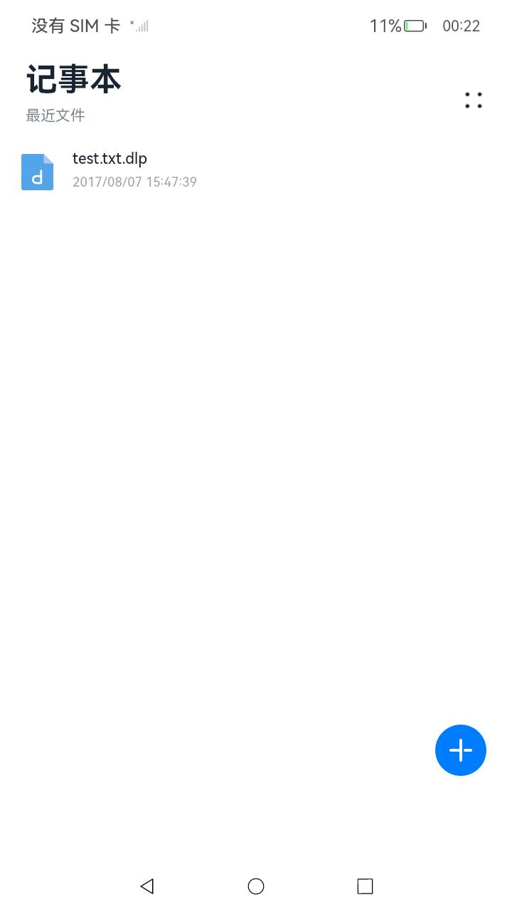
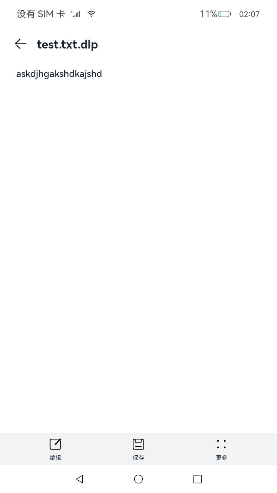

# DLPManager

### Introduction

This sample demonstrates DLP (Data Loss Prevention) file management. It uses
[@ohos.dlpPermission](https://gitee.com/openharmony/docs/blob/master/zh-cn/application-dev/reference/apis-data-protection-kit/js-apis-dlppermission-sys.md),
[@ohos.file.fs](https://gitee.com/openharmony/docs/blob/master/zh-cn/application-dev/reference/apis-core-file-kit/js-apis-file-fs.md),
[@ohos.file.fileAccess](https://gitee.com/openharmony/docs/blob/master/zh-cn/application-dev/reference/apis-core-file-kit/js-apis-fileAccess-sys.md),
[@ohos.file.picker](https://gitee.com/openharmony/docs/blob/master/zh-cn/application-dev/reference/apis-core-file-kit/js-apis-file-picker.md)
and [@ohos.app.ability.Want](https://gitee.com/openharmony/docs/blob/master/zh-cn/application-dev/reference/apis-ability-kit/js-apis-app-ability-want.md)
to create and open DLP files, list the original files of the application sandbox, edit and save files, pull folders,
view file permissions and listen for DLP file changes. This sample also provides search, recently used files,
permission templates, settings and an error code center.

### Preview

|Home|File content page|
|--------------------------------|--------------------------------|
|||

### Usage

1. Launch the application. The list of original files in the application sandbox is displayed.

2. Tap the icon in the upper right corner to obtain the sandbox retention information.

3. Tap the plus icon in the lower right corner to enter a folder.

4. Tap a file to display its content.

5. On the file page, tap the edit icon to modify the content and tap the save icon to save it. Tap More to save the
   file as a copy and view its permissions.

6. When setting the permission of a txt file, enter a user account and press Enter before confirming.

7. Tap **Search files** in the **More** menu of the home page to filter by file name, type or encryption state and sort
   by name, size or time. Long press the list to enter multi-selection and apply a batch authorization template.

8. Tap **Recents & favorites** to view recently opened files and mark favorites. Records can be removed or the recent
   list can be cleared.

9. Tap **Permission templates** to manage the built-in read-only, editable, printable, copyable and full-control
   templates, and to create, modify or delete custom templates.

10. Tap **Settings** to adjust the log level, page size, theme, default permission template and delete confirmation.
    Enter **Error code center** from Settings to search common file and DLP error codes by category or keyword.

### Project Structure

```
entry/src/main/ets/
|---core                              // Pure function layer independent of system APIs
|   |---TextCodecCore.ets             // UTF-8 encoding/decoding and text processing
|   |---UriCore.ets                   // URI parsing, building and percent encoding/decoding
|   |---FileKindCore.ets              // File type, MIME and magic number detection
|   |---DlpPolicyCore.ets             // DLP permission bits and policy serialization
|   |---FileQueryCore.ets             // Search, filter, sort and pagination
|   |---FormatCore.ets                // Size, time and percentage formatting
|   |---ErrorCodeCore.ets             // Error code to message and hint mapping
|---feature                           // Business state and persistence
|   |---SearchModel.ets               // Search and multi-selection state machine
|   |---DetailModel.ets               // File detail row builder
|   |---RecentModel.ets               // Recent LRU list and favorites
|   |---TemplateModel.ets             // Permission template CRUD and validation
|   |---SettingsModel.ets             // Settings validation and serialization
|   |---ErrorCenterModel.ets          // Error code lookup
|   |---PreferenceStore.ets           // Preferences wrapper
|---entryability
|   |---EntryAbility.ets               // Ability of the dlpSample application
|   |---FuncAbility.ets                // Ability that displays DLP files
|---media
|   |---dlpPage.ets                    // DLP file content page
|   |---filePage.ets                   // Original file content page
|   |---MediaFileUri.ts                // File read/write and file URI handling
|---pages
|   |---Index.ets                      // Home page
|   |---SearchPage.ets                 // Search, filter and batch selection entry
|   |---DetailPage.ets                 // File details
|   |---RecentsPage.ets                // Recents and favorites
|   |---TemplatePage.ets               // Permission template management
|   |---SettingsPage.ets               // Settings
|   |---ErrorCodePage.ets              // Error code center
|---utils
|   |---Logger.ts                      // Logging utility
entry/src/test/                        // Local unit tests (DevEco Local Test)
entry/src/ohosTest/ets/test/           // Device-side UI automation cases (Hypium + UiTest)
```

### Implementation

* The feature that obtains the DLP file and normal file lists is mainly implemented in Index. For details, see
  [Index.ets](entry/src/main/ets/pages/Index.ets).
    * Obtaining the list: onPageShow() in the Index page calls fs.listFile() and fs.stat() to obtain the original file
      list in the application sandbox. context.startAbility(want) creates and opens DLP files, and the dlpPermission
      APIs are used to view DLP file permissions.

* The new capabilities are built on the core pure function layer, and pages only manage state and layout:
    * Search and filter: SearchModel combines the filter, sort and pagination results of FileQueryCore, and SearchPage
      renders the keyword, type and encryption filters and maintains the multi-selection set.
    * Recents and favorites: RecentModel keeps records in LRU order and preserves favorite marks, and PreferenceStore
      serializes them to Preferences.
    * Permission templates: TemplateModel manages custom templates on top of the built-in templates of DlpPolicyCore,
      validates names and permission bits, and then persists them.
    * Settings and error code center: SettingsModel handles value constraints and serialization, and ErrorCenterModel
      provides category and keyword search based on ErrorCodeCore.

### Permissions

| Permission                                                   | Description                                                     | Level        |
| ------------------------------------------------------------ | --------------------------------------------------------------- | ------------ |
| [ohos.permission.MEDIA_LOCATION](https://gitee.com/openharmony/docs/blob/master/zh-cn/application-dev/security/AccessToken/permissions-for-all.md#ohospermissionmedia_location) | Allows an application to access the geographic location in user media files | normal       |
| [ohos.permission.FILE_ACCESS_MANAGER](https://gitee.com/openharmony/docs/blob/master/zh-cn/application-dev/security/AccessToken/permissions-for-system-apps.md#ohospermissionfile_access_manager) | Allows a file management application to access public data files through the FAF framework | system_basic |
| [ohos.permission.GET_BUNDLE_INFO_PRIVILEGED](https://gitee.com/openharmony/docs/blob/master/zh-cn/application-dev/security/AccessToken/permissions-for-system-apps.md#ohospermissionget_bundle_info_privileged) | Allows an application to query basic and sensitive information of applications | system_basic |
| [ohos.permission.ACCESS_DLP_FILE](https://gitee.com/openharmony/docs/blob/master/zh-cn/application-dev/security/AccessToken/permissions-for-system-apps.md#ohospermissionaccess_dlp_file) | Allows an application to configure and manage permissions of DLP files | system_core  |
| [ohos.permission.START_INVISIBLE_ABILITY](https://gitee.com/openharmony/docs/blob/master/zh-cn/application-dev/security/AccessToken/permissions-for-system-apps.md#ohospermissionstart_invisible_ability) | Allows an application to start an ability regardless of whether the ability is visible | system_core  |

### Dependencies

None.

### Constraints and Limitations

1. This sample can only be run on standard-system devices.

2. This sample has been adapted to API version 26.0.0.

3. This sample must be compiled and run with DevEco Studio 6.0.0 Release (Build Version: 6.0.0.91) or later.

4. Before signing this sample, modify the `UnsgnedReleasedProfileTemplate.json` file in the SDK folder as follows:

```json
{
  "bundle-info": {
    "developer-id": "OpenHarmony",
    "distribution-certificate": "",
    "bundle-name": "com.sample.dlpmanager",
    "apl": "normal",
    "app-feature": "hos_system_app"
  },
  "acls": {
    "allowed-acls": [
      "ohos.permission.MEDIA_LOCATION",
      "ohos.permission.FILE_ACCESS_MANAGER",
      "ohos.permission.GET_BUNDLE_INFO_PRIVILEGED",
      "ohos.permission.ACCESS_DLP_FILE",
      "ohos.permission.START_INVISIBLE_ABILITY",
      "ohos.permission.START_ABILITIES_FROM_BACKGROUND",
      "ohos.permission.ABILITY_BACKGROUND_COMMUNICATION",
      "ohos.permission.MANAGE_DISTRIBUTED_ACCOUNTS",
      "ohos.permission.MANAGE_LOCAL_ACCOUNTS",
      "ohos.permission.PROXY_AUTHORIZATION_URI"
    ]
  }
}
```

### Testing

Tests are divided into two layers, both based on @ohos/hypium:

* Local unit tests (`entry/src/test`): cover core pure functions and feature state models. They do not depend on device
  capabilities and can run directly in the DevEco Studio Local Test.
* Device-side UI cases (`entry/src/ohosTest`): use @ohos.UiTest to verify page navigation and key interactions of the
  home page, search, details, recents, templates, settings and error code center.

Compile and test commands (run in the project root):

```
hvigorw assembleHap --mode module -p product=default -p module=entry@default -p buildMode=debug --no-daemon
hvigorw assembleHap --mode module -p product=default -p module=entry@ohosTest -p buildMode=debug --no-daemon
hvigorw test --no-daemon
```

### Download

To download this project alone, run:

```
git init
git config core.sparsecheckout true
echo code/SystemFeature/Security/DLPManager > .git/info/sparse-checkout
git remote add origin https://gitcode.com/openharmony/applications_app_samples.git
git pull origin master
```
