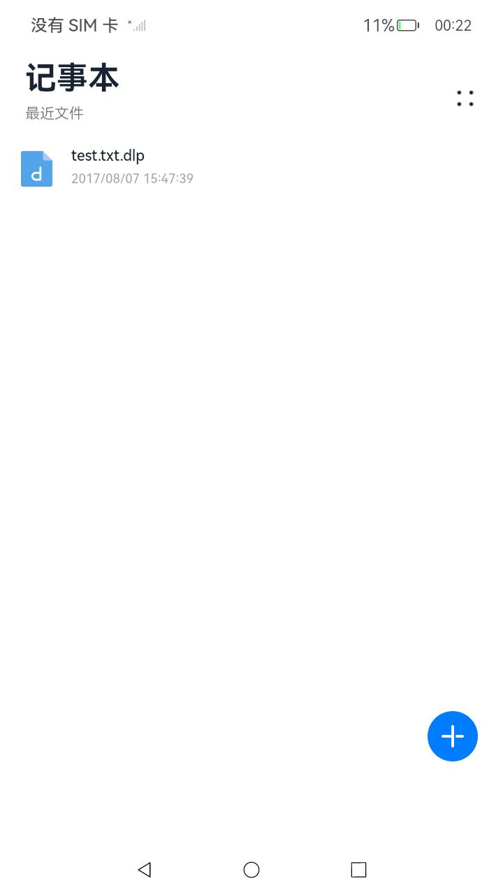
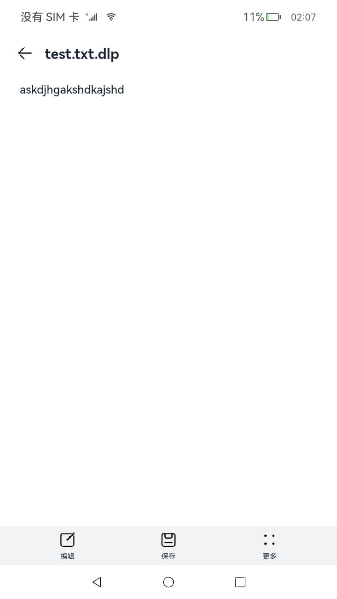

# DLPManager

### 介绍

本示例主要展示了DLP文件管理相关的功能，使用[@ohos.dlpPermission](https://gitee.com/openharmony/docs/blob/master/zh-cn/application-dev/reference/apis-data-protection-kit/js-apis-dlppermission-sys.md)、[@ohos.file.fs](https://gitee.com/openharmony/docs/blob/master/zh-cn/application-dev/reference/apis-core-file-kit/js-apis-file-fs.md)、[@ohos.file.fileAccess](https://gitee.com/openharmony/docs/blob/master/zh-cn/application-dev/reference/apis-core-file-kit/js-apis-fileAccess-sys.md)、[@ohos.file.picker](https://gitee.com/openharmony/docs/blob/master/zh-cn/application-dev/reference/apis-core-file-kit/js-apis-file-picker.md)、[@ohos.app.ability.Want](https://gitee.com/openharmony/docs/blob/master/zh-cn/application-dev/reference/apis-ability-kit/js-apis-app-ability-want.md)等接口，实现了生成和打开DLP文件、查看原始应用沙箱目录的原始文件打开列表、编辑保存文件、拉取文件夹、查看文件权限和监听DLP文件的功能。

### 效果预览

|主页|文件内容页|
|--------------------------------|--------------------------------|
|||

使用说明

1.进入界面，显示原始应用沙箱目录获取原始文件访问列表。

2.点击右上角的图标，可以获取沙箱保留信息。

3.点击右下角的加号图标，可以跳转进入文件夹。

4.点击某个文件，可以显示其文件内容。

5.在文件显示页面，可以点击下面的编辑图标对文件内容进行编辑，编辑后点击保存图标进行保存；点击更多可以文件另存为，查看权限。

6.设置txt文件权限时需输入用户账号点击回车后才能点击确认按钮。

7.点击首页“更多”菜单中的“搜索文件”，可以按文件名、类型、加密状态筛选，并按名称/大小/时间排序；长按列表进入多选后可执行批量授权模板。

8.点击“最近与收藏”，查看最近打开的文件并设置收藏，可在记录上移除或清空最近访问。

9.点击“权限模板”，管理内置的只读/可编辑/可打印/可复制/完全控制模板，也可以创建、修改、删除自定义模板。

10.点击“设置”，调整日志级别、每页数量、主题、默认权限模板和删除确认；从设置进入“错误码中心”可按分类或关键字检索常见文件与 DLP 错误码。

### 工程目录

```
entry/src/main/ets/
|---core                              // 与系统 API 无关的纯函数层
|   |---TextCodecCore.ets             // UTF-8 编解码与文本处理
|   |---UriCore.ets                   // URI 解析、构建与百分号编解码
|   |---FileKindCore.ets              // 文件类型、MIME、魔数识别
|   |---DlpPolicyCore.ets             // DLP 权限位与策略序列化
|   |---FileQueryCore.ets             // 搜索、过滤、排序、分页
|   |---FormatCore.ets                // 大小、时间、百分比等格式化
|   |---ErrorCodeCore.ets             // 错误码到文案与提示的映射
|---feature                           // 业务状态与持久化
|   |---SearchModel.ets               // 搜索与多选状态机
|   |---DetailModel.ets               // 文件详情行构建
|   |---RecentModel.ets               // 最近访问 LRU 与收藏
|   |---TemplateModel.ets             // 权限模板 CRUD 与校验
|   |---SettingsModel.ets             // 设置项校验与序列化
|   |---ErrorCenterModel.ets          // 错误码检索
|   |---PreferenceStore.ets           // Preferences 封装
|---entryability
|   |---EntryAbility.ets               // dlpSample应用的ability
|   |---FuncAbility.ets                // dlp文件显示的ability
|---media
|   |---dlpPage.ets                    // dlp文件内容页
|   |---filePage.ets                   // 原始文件内容页
|   |---MediaFileUri.ts                // 文件读写与文件 URI 处理
|---pages
|   |---Index.ets                      // 首页
|   |---SearchPage.ets                 // 搜索、筛选、多选批量入口
|   |---DetailPage.ets                 // 文件详情
|   |---RecentsPage.ets                // 最近访问与收藏
|   |---TemplatePage.ets               // 权限模板管理
|   |---SettingsPage.ets               // 设置
|   |---ErrorCodePage.ets              // 错误码中心
|---utils
|   |---Logger.ts                      // 日志工具
entry/src/test/                        // 本地单元测试（DevEco Local Test）
entry/src/ohosTest/ets/test/           // 设备端 UI 自动化用例（Hypium + UiTest）
```
### 具体实现

* 本实例获取DLP文件和普通文件列表的功能结主要封装在Index，源码参考：[Index.ets](entry/src/main/ets/pages/Index.ets) 。
    * 获取列表信息：在Index页面中通过onPageShow()调用fs.listFile()、fs.stat()等方法能够应用沙箱路径下的原始文件列表；通过context.startAbility(want)对DLP文件进行生成和打开，通过dlpPermission的接口查看DLP文件的权限。

* 新增能力建立在 core 纯函数层之上，页面只负责状态与布局：
    * 搜索与筛选：SearchModel 组合 FileQueryCore 的过滤、排序与分页结果，SearchPage 渲染关键字、类型与加密筛选，并维护多选集合。
    * 最近与收藏：RecentModel 使用 LRU 顺序保存记录并保留收藏标记，PreferenceStore 将其序列化到 Preferences。
    * 权限模板：TemplateModel 在 DlpPolicyCore 的内置模板之上管理自定义模板，校验名称与权限位后持久化。
    * 设置与错误码中心：SettingsModel 负责取值约束与序列化，ErrorCenterModel 基于 ErrorCodeCore 提供分类与关键字检索。

### 相关权限

| 权限名                                                       | 权限说明                                      | 级别         |
| ------------------------------------------------------------ | --------------------------------------------- | ------------ |
| [ohos.permission.MEDIA_LOCATION](https://gitee.com/openharmony/docs/blob/master/zh-cn/application-dev/security/AccessToken/permissions-for-all.md#ohospermissionmedia_location) | 允许应用访问用户媒体文件中的地理位置信息      | normal       |
| [ohos.permission.FILE_ACCESS_MANAGER](https://gitee.com/openharmony/docs/blob/master/zh-cn/application-dev/security/AccessToken/permissions-for-system-apps.md#ohospermissionfile_access_manager) | 允许文件管理类应用通过FAF框架访问公共数据文件 | system_basic |
| [ohos.permission.GET_BUNDLE_INFO_PRIVILEGED](https://gitee.com/openharmony/docs/blob/master/zh-cn/application-dev/security/AccessToken/permissions-for-system-apps.md#ohospermissionget_bundle_info_privileged) | 允许查询应用的基本信息和敏感信息              | system_basic |
| [ohos.permission.ACCESS_DLP_FILE](https://gitee.com/openharmony/docs/blob/master/zh-cn/application-dev/security/AccessToken/permissions-for-system-apps.md#ohospermissionaccess_dlp_file) | 允许对DLP文件进行权限配置和管理               | system_core  |
| [ohos.permission.START_INVISIBLE_ABILITY](https://gitee.com/openharmony/docs/blob/master/zh-cn/application-dev/security/AccessToken/permissions-for-system-apps.md#ohospermissionstart_invisible_ability) | 无论Ability是否可见，都允许应用进行调用       | system_core  |

### 依赖

不涉及。

### 约束与限制

1.本示例仅支持标准系统上运行。

2.本示例已适配API version 11版本SDK，版本号：4.1.3.3。

3.本示例需要使用DevEco Studio 3.1 Beta2 (Build Version: 3.1.0.400 构建 2023年4月7日)及以上版本才可编译运行。

4.本示例签名时需修改sdk文件夹下`UnsgnedReleasedProfileTemplate.json`文件，如下所示：
```json
{
  "bundle-info": {
    "developer-id": "OpenHarmony",
    "distribution-certificate": "",
    "bundle-name": "com.sample.dlpmanager",
    "apl": "normal",
    "app-feature": "hos_system_app"
  },
  "acls": {
    "allowed-acls": [
      "ohos.permission.MEDIA_LOCATION",
      "ohos.permission.FILE_ACCESS_MANAGER",
      "ohos.permission.GET_BUNDLE_INFO_PRIVILEGED",
      "ohos.permission.ACCESS_DLP_FILE",
      "ohos.permission.START_INVISIBLE_ABILITY",
      "ohos.permission.START_ABILITIES_FROM_BACKGROUND",
      "ohos.permission.ABILITY_BACKGROUND_COMMUNICATION",
      "ohos.permission.MANAGE_DISTRIBUTED_ACCOUNTS",
      "ohos.permission.MANAGE_LOCAL_ACCOUNTS",
      "ohos.permission.PROXY_AUTHORIZATION_URI"
    ]
  }
}
```

### 测试说明

测试分为两层，均基于 @ohos/hypium：

* 本地单元测试（`entry/src/test`）：覆盖 core 纯函数与 feature 状态模型，不依赖设备能力，可在 DevEco Studio 的 Local Test 中直接运行。
* 设备端 UI 用例（`entry/src/ohosTest`）：通过 @ohos.UiTest 校验首页、搜索、详情、最近、模板、设置与错误码中心的页面跳转与关键交互。

编译与测试命令（在工程根目录执行）：

```
hvigorw assembleHap --mode module -p product=default -p module=entry@default -p buildMode=debug --no-daemon
hvigorw assembleHap --mode module -p product=default -p module=entry@ohosTest -p buildMode=debug --no-daemon
hvigorw test --no-daemon
```

### 下载

如需单独下载本工程，执行如下命令：
```
git init
git config core.sparsecheckout true
echo code/SystemFeature/Security/DLPManager > .git/info/sparse-checkout
git remote add origin https://gitee.com/openharmony/applications_app_samples.git
git pull origin master

```
