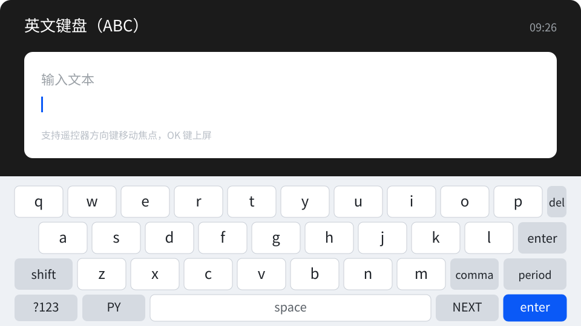
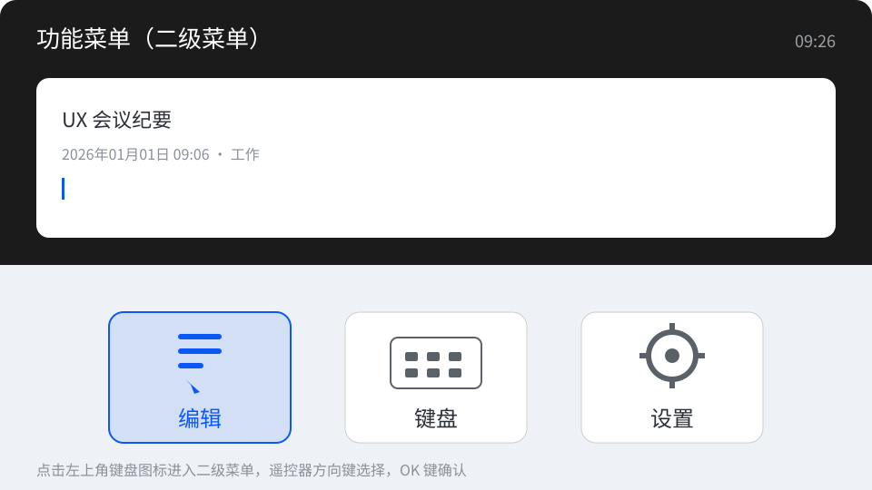
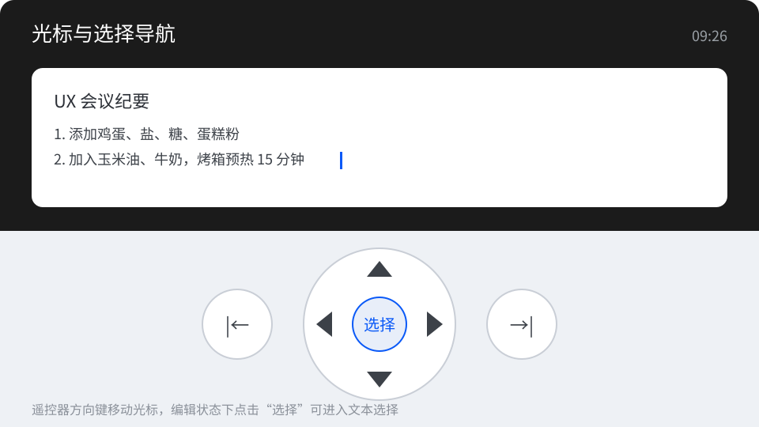
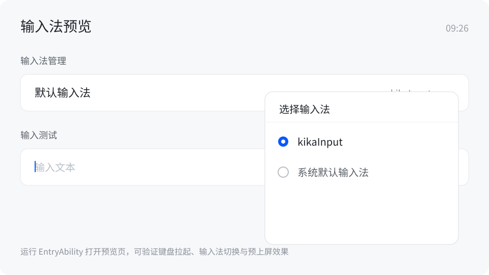

# KikaInput 输入法项目

### 介绍

本示例为 OpenHarmony TV 场景下的输入法应用，基于 Stage 模型实现 `inputMethod` ExtensionAbility、英文/数字/符号/中文拼音（26 键与 9 键）键盘、候选词选词栏、预上屏与遥控器焦点导航等能力。项目主体为 `entry` 模块，拼音解码依托 C++ 引擎 `libime_pinyin` 与 Worker 线程，可用于大屏输入场景的功能参考。

### 效果预览

|                  英文键盘                   |                  二级菜单                   |                 光标/选择导航                  |                  输入法预览页                   |
| :---------------------------------------: | :---------------------------------------: | :---------------------------------------: | :---------------------------------------: |
|  |  |  |  |

使用说明：

1. 安装后在系统输入法列表中将当前输入法切换为 kikaInput。
2. 点击任意输入框拉起软键盘，默认显示英文键盘（ABC），支持遥控器方向键导航与按键操作。
3. 通过 `?12`、`NEXT`、`ABC`/`PY` 等按键切换数字、符号与中文键盘，中文支持拼音 26 键与拼音 9 键（九宫格）。
4. 中文输入时拼音串显示在顶部，候选词在选词栏展示，点击候选词或按确认键上屏。
5. 运行 `EntryAbility` 可打开输入法预览页，用于验证键盘拉起、输入、切换与预上屏效果。

### 工程目录

```text
TVInputMethod/
|---AppScope/app.json5                              // 应用级配置
|---build-profile.json5                             // 工程构建配置（SDK/模块）
|---oh-package.json5                                // 工程依赖配置
|---entry/                                          // 主应用模块
|   |---build-profile.json5
|   |---src/main/
|   |   |---module.json5                            // entry 模块配置（InputMethod 扩展、Ability、权限）
|   |   |---ets/
|   |   |   |---Application/AbilityStage.ets        // AbilityStage 入口
|   |   |   |---ServiceExtAbility/ServiceExtAbility.ets // 输入法扩展能力入口
|   |   |   |---entryability/EntryAbility.ets       // 主 UIAbility，加载输入法预览页
|   |   |   |---pages/                              // 键盘页面与预览页（Index、PrivatePreview）
|   |   |   |---components/                         // 字母/数字/符号/中文/九宫格等键盘组件
|   |   |   |---model/                              // 键盘控制、拼音服务、数据源与按键工具
|   |   |   |---common/                             // 样式配置、事件工具
|   |   |   |---worker/Worker.ets                   // 拼音解码 Worker 线程
|   |   |---cpp/                                    // 拼音引擎（CMake 编译 libime_pinyin）
|   |   |---resources/                              // 中英文资源、键盘图片、拼音词库 rawfile
|   |---src/ohosTest/                               // Hypium + UiTest 自动化测试
|---hvigor/                                         // 构建工具配置
```

### 具体实现

- 输入法入口与生命周期管理见 [ServiceExtAbility.ets](entry/src/main/ets/ServiceExtAbility/ServiceExtAbility.ets)
  - 继承 `InputMethodExtensionAbility`，在 `onCreate` 中创建键盘控制器并初始化面板。
- 键盘面板与输入处理集中在 `model` 与 `pages`：
  - [KeyboardController.ets](entry/src/main/ets/model/KeyboardController.ets) 负责面板创建/销毁、窗口尺寸与横竖屏适配、硬按键分发、文本插入/删除及光标与选中信息回填；
  - [Index.ets](entry/src/main/ets/pages/Index.ets) 按 `menuType` 在英文、数字、符号、中文 26 键与中文 9 键键盘之间切换；
  - [PrivatePreview.ets](entry/src/main/ets/pages/PrivatePreview.ets) 提供输入框与输入法切换入口，用于功能验证。
- 键盘组件封装在 [components](entry/src/main/ets/components)：
  - `KeyMenu`、`NumberMenu`、`SymbolMenu`、`ChineseKeyMenu`、`NineChinaKeyMenu` 为各形态键盘主体，`KeyItem`、`KeyNineItem`、`ShiftItem`、`SpaceItem`、`ReturnItem`、`DeleteItem`、`SelectText`、`TopMenu`、`DownMenu` 等为按键与菜单组件。
- 拼音解码与服务能力封装在 [PinYinService.ets](entry/src/main/ets/model/PinYinService.ets)、[PinyinMessage.ets](entry/src/main/ets/model/PinyinMessage.ets) 与 [Worker.ets](entry/src/main/ets/worker/Worker.ets)，底层调用 `entry/src/main/cpp` 的 `libime_pinyin`，词库 `dict_pinyin.dat` 位于 `resources/rawfile`。
- 键位数据、候选数据源、硬按键映射与焦点定位分别由 [KeyboardKeyData.ets](entry/src/main/ets/model/KeyboardKeyData.ets)、[BasicDataSource.ets](entry/src/main/ets/model/BasicDataSource.ets)、[ChineseDataSource.ets](entry/src/main/ets/model/ChineseDataSource.ets)、[HardKeyUtils.ets](entry/src/main/ets/model/HardKeyUtils.ets)、[FocusInfo.ets](entry/src/main/ets/model/FocusInfo.ets) 提供。

### 相关权限

以下权限声明位于 [entry/src/main/module.json5](entry/src/main/module.json5)：

| 权限名 | 说明 |
|--------|------|
| ohos.permission.CONNECT_IME_ABILITY | 承载输入法扩展能力，创建并显示输入法键盘面板 |

输入法属于系统级能力，部分设备需系统签名或预置配置后才能正常启用。

### 依赖

- 拼音引擎：`libime_pinyin` 由 `entry/src/main/cpp` 通过 CMake 构建，词库 `dict_pinyin.dat` 随 `resources/rawfile` 打包。
- 测试依赖：`@ohos/hypium`（版本 `1.0.6`），声明于 [oh-package.json5](oh-package.json5)。
- 工程 `dependencies` 为空，无额外 HAR/HSP 依赖。

### 约束与限制

1. 本示例面向 TV/大屏输入法场景，需在支持 `inputMethod` ExtensionAbility 的 OpenHarmony 系统上运行。
2. 当前工程配置 `compileSdkVersion` 与 `compatibleSdkVersion` 为 `18`，若设备使用更高版本 SDK，需在 [build-profile.json5](build-profile.json5) 中同步调整后重新 Sync。
3. 需在系统设置中启用 kikaInput 输入法，否则点击输入框不会拉起本输入法键盘。
4. 键盘布局按屏幕尺寸自动适配横竖屏、手机、RK3568、大屏与 4K 场景，非对应分辨率下以实际显示效果为准。

### 下载

如需单独下载本工程，执行如下命令：

```bash
git init
git config core.sparsecheckout true
echo code/SystemFeature/TV/TVInputMethod > .git/info/sparse-checkout
git remote add origin https://gitcode.com/openharmony/applications_app_samples.git
git pull origin master
```
