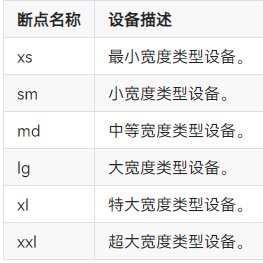
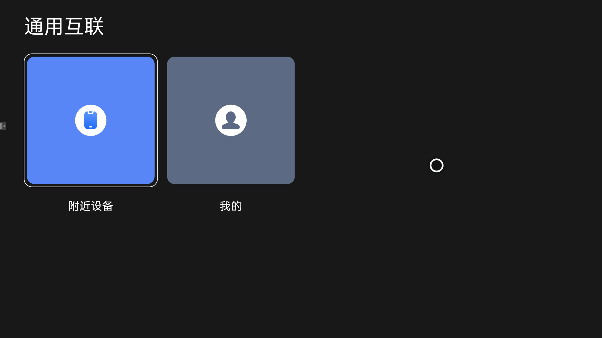

# 通用互联项目

### 介绍

通用互联应用面向 OpenHarmony 生态设备控制场景，基于 BLE、Wi-Fi（coap）与 IoT 协议完成设备的发现、配网、连接与控制，并通过云端接口实现项目、设备库与场景库的管理与同步。

通用互联应用为 TV 形态的设备控制应用，适配电视端遥控器交互和大屏界面展示，支持附近设备、可连接设备（BLE 本地控）与局域网本地控三类使用方式。

使用说明：

1. 初次启动需阅读并勾选同意「通用互联用户协议」与「设备管理服务与隐私的声明」，确认后进入首页。
2. 附近设备，首页选择「附近设备」入口，按项目查看已添加设备，可查看在线/离线状态并进入设备详情。
3. 可连接设备，在「可连接设备(ble本地控)」页签扫描附近蓝牙设备，选择设备完成添加与连接。
4. 局域网本地控，在「局域网本地控」页签点击「coap配网」，按引导完成设备配网并获取 IP，随后对设备进行本地控制。
5. 设备控制，在设备详情页进行开关、重启、休眠、关机、亮屏、熄屏等操作，并查看设备信息与网络信息。
6. 场景与个人中心，在场景库创建并执行/结束场景；「个人中心」页面支持登录、设备库同步、场景库同步、关于与协议查看。
|  |

### 效果预览

| 首页 |
| --- |
|  |

> 说明：首页提供「附近设备」与「我的」两个入口。连接实际设备后，可进一步查看 BLE 扫描、coap 配网引导、设备详情控制与场景库等页面效果。

### 工程目录
```text
TVOhosConnect
├── product/tv/src/main/ets
│   |---entryability
│   |   |---EntryAbility.ets            // 主 Ability（HMRouter 初始化、设备管理创建、网络监听）
│   |---pages
│   |   |---LauncherPage.ets            // 启动页（隐私协议确认与状态持久化）
│   |   |---HomeIndex.ets               // 首页导航容器（HMNavigation）
│   |   |---ScenePage.ets               // 场景统一入口（创建/控制/详情/条件）
│   |   |---ovble
│   |   |   |---CategoryPage.ets        // 首页双入口（附近设备/个人中心）
│   |   |   |---SmartTunnelScene.ets    // 智能隧道场景
│   |   |---login                       // 登录、注册、找回密码、账号安全、用户协议与隐私声明
│   |---hmrouter                        // 路由拦截器与页面生命周期
│   |---common                          // 主模块常量、Bean 与屏幕适配
│   |---view                            // 通用列表与标题组件
├── common/src/main/ets
│   |---constants                       // 公共常量与事件定义
│   |---database                        // 数据库、DAO、Preferences 封装
│   |---http                            // HTTP 请求封装
│   |---inf                             // 设备发现/连接/控制/解析协议抽象接口
│   |---task                            // 异步任务
│   |---utils                           // 网络、登录态、权限、日志、工具类
├── connect
│   |---connect_ble/src/main/ets        // BLE 扫描、连接、控制与 openvalley 隧道协议
│   |---connect_wifi/src/main/ets       // Wi-Fi coap 配网与局域网本地控制
│   |---connect_iot/src/main/ets        // IoTConnect 协议实现
│   |---connect_cloud/src/main/ets      // 云端 HTTP 接口与 MQTT 通道
│   |---device_manager/src/main/ets     // 设备能力统一门面
├── features
│   |---nearbydevice/src/main/ets       // 附近设备页签、扫描添加、配网、设备详情、项目
│   |---devicelibrary/src/main/ets      // 设备库列表、详情与搜索
│   |---scenelibrary/src/main/ets       // 场景库、场景创建与编辑
│   |---mine/src/main/ets               // 个人中心、登录态、设备库/场景库同步、关于
├── signature                           // 签名材料
└── build-profile.json5                 // 工程级构建配置
```

### 具体实现

通用互联的设备控制能力由统一设备管理、多协议接入、云端服务与本地数据四部分组成。
通过 DeviceManager 统一封装设备发现、连接、控制、查询与状态订阅，通过 connect_ble、connect_wifi、connect_iot 分别接入蓝牙、局域网 coap 与 IoT 协议，通过 connect_cloud 提供项目与设备云端接口及 MQTT 通道，通过本地数据库与 Preferences 保存设备、场景、用户与隐私同意状态。

(1) 统一设备管理
以 DeviceManagerFactory 单例创建 DeviceManager，向上提供 startDeviceDiscover、connectDevice、controlDevice、queryDeviceInfo、queryDeviceState、registerConnectStateChanged 等能力，并按子协议分发到对应实现，详见 [DeviceManager.ets](connect/device_manager/src/main/ets/components/device/manager/DeviceManager.ets)。

(2) BLE 协议
基于 @kit.ConnectivityKit 的 ble 能力实现低延迟扫描与设备发现，通过广播数据解析与分包管理完成设备识别与指令收发，并支持 openvalley 隧道场景的设备接入，详见 [BleScanner.ets](connect/connect_ble/src/main/ets/components/connect/ble/BleScanner.ets) 与 [BlePackageManager.ets](connect/connect_ble/src/main/ets/components/connect/ble/protocol/BlePackageManager.ets)。

(3) Wi-Fi coap 协议
基于 @ohos/coap 启动本地 coap 服务（e2eCtrlData，端口 5683），用于局域网设备的配网数据下发与状态上报，详见 [CoapServerManager.ets](connect/connect_wifi/src/main/ets/components/connect/wifi/CoapServerManager.ets)。

(4) IoT 协议
封装 IoTConnectKit 与 IoTManagementKit 能力，实现设备发现、配网、会话订阅、心跳保活与指令重试，详见 [IotDevicesController.ets](connect/connect_iot/src/main/ets/components/connect/iot/IotDevicesController.ets)。

(5) 云端服务
通过 HttpApi 提供项目列表、项目增改、设备与项目绑定、设备控制等接口；通过 MqttEngine 与 MqttMessageDispatcher 建立长连接并分发设备状态消息，详见 [HttpApi.ets](connect/connect_cloud/src/main/ets/components/connect/http/HttpApi.ets) 与 [MqttEngine.ets](connect/connect_cloud/src/main/ets/components/connect/mqtt/MqttEngine.ets)。

(6) 本地数据与隐私状态
通过 ConnectDatabaseHelperImpl 与 DeviceLibraryDao、SceneLibraryDao、UserLibraryDao 完成设备、场景与用户的本地存储；启动页隐私同意状态通过 Preferences（键 isPrivacy）持久化，详见 [LauncherPage.ets](product/tv/src/main/ets/pages/LauncherPage.ets)。

(7) 设备库与场景库同步
通过 LibraryManagerFactory 获取设备库/场景库管理器，按「检查版本 → 下载 → 校验 → 解析入库」流程更新本地库并回调进度，详见 [DeviceSyncComponent.ets](features/mine/src/main/ets/components/DeviceSyncComponent.ets)。

(8) 页面与焦点交互
首页通过 CategoryPage 渲染「附近设备」「个人中心」双入口；附近设备页通过 DevicesMainPage 管理「附近设备」「可连接设备(ble本地控)」「局域网本地控」三页签；设备详情页支持遥控器方向键滚动与指令下发，详见 [CategoryPage.ets](product/tv/src/main/ets/pages/ovble/CategoryPage.ets) 与 [DevicesMainPage.ets](features/nearbydevice/src/main/ets/pages/DevicesMainPage.ets)。

### 相关权限

| 权限名                                   | 权限说明                     |
|---------------------------------------|--------------------------|
| ohos.permission.INTERNET | 允许访问网络                 |
| ohos.permission.GET_NETWORK_INFO | 允许获取网络状态信息             |
| ohos.permission.STORE_PERSISTENT_DATA | 允许持久化存储数据              |
| ohos.permission.INJECT_INPUT_EVENT | 允许注入输入事件               |
| ohos.permission.ACCESS_BLUETOOTH | 允许访问蓝牙设备               |
| ohos.permission.USE_BLUETOOTH | 允许使用蓝牙                 |
| ohos.permission.DISCOVER_BLUETOOTH | 允许发现蓝牙设备               |
| ohos.permission.GET_WIFI_INFO | 允许获取 Wi-Fi 信息            |
| ohos.permission.SET_WIFI_INFO | 允许设置 Wi-Fi 信息            |
| ohos.permission.APPROXIMATELY_LOCATION | 允许获取模糊位置信息             |
| ohos.permission.LOCATION | 允许获取位置信息               |

### 依赖

- 路由框架：@hadss/hmrouter（`1.2.4`）
- 本地 HAR：`connect/connect_wifi/lib/libcoap.har`、`connect/connect_iot/lib/IoTConnectKit.har`、`connect/connect_iot/lib/IoTManagementKit.har`、`features/nearbydevice/lib/library_communication.har`
- 测试框架：Hypium（`@ohos/hypium` `1.0.15`，各模块 `src/ohosTest`）

### 约束与限制

1. 本示例仅支持标准系统上运行，设备类型为 default，支持设备：RK3568、大屏 TV 设备。

2. 蓝牙扫描、设备添加与 BLE 本地控需授予蓝牙相关权限并开启蓝牙；coap 配网需连接无线网并开启蓝牙。

3. 登录、项目列表、设备库同步与场景库同步依赖云端服务，网络不可用时相关功能不可用。

4. 本示例为 Stage 模型，compatibleSdkVersion 与 compileSdkVersion 均为 18，runtimeOS 为 OpenHarmony。

5. 本示例需使用支持 API 18 的 DevEco Studio 版本编译运行。

6. 本示例依赖仓库内的本地 HAR 文件（libcoap、IoTConnectKit、IoTManagementKit、library_communication），需完整拉取工程后再编译。

7. 本示例默认使用 `signature/` 目录下的签名材料，如本地签名环境不同，需在 DevEco Studio 的 `Project Structure > Signing Configs` 中重新配置签名后再编译运行。

### 下载

如需单独下载本工程，执行如下命令：

```bash
git init
git config core.sparsecheckout true
echo code/SystemFeature/TV/TVOhosConnect > .git/info/sparse-checkout
git remote add origin https://gitcode.com/openharmony/applications_app_samples.git
git pull origin master
```
