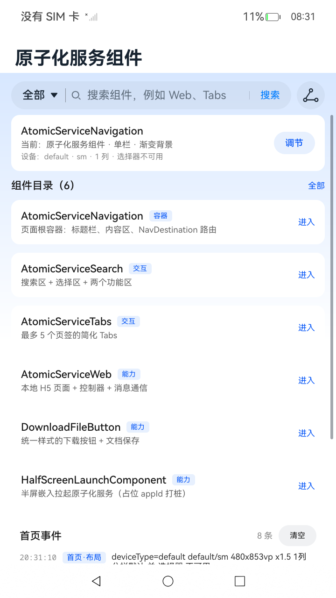

# AtomicServiceComponents

## 介绍

本示例演示 HarmonyOS / OpenHarmony ArkUI 提供的原子化服务高级组件。工程以 `AtomicServiceNavigation` 作为页面根容器，首页提供组件目录与搜索入口，六个组件分别有独立的演示页；所有交互与生命周期事件写入统一日志（hilog + 页面内日志面板），布局按设备形态与断点自适应。

示例使用以下组件（完整包名与文档链接）：

| 组件 | 完整包名 | 起始 API | 文档 |
| --- | --- | --- | --- |
| `AtomicServiceNavigation` | `@ohos.atomicservice.AtomicServiceNavigation` | 12 | [链接](https://gitcode.com/openharmony/docs/blob/master/zh-cn/application-dev/reference/apis-arkui/arkui-ts/ohos-atomicservice-AtomicServiceNavigation.md) |
| `AtomicServiceSearch` | `@ohos.atomicservice.AtomicServiceSearch` | 18 | [链接](https://gitcode.com/openharmony/docs/blob/master/zh-cn/application-dev/reference/apis-arkui/arkui-ts/ohos-atomicservice-AtomicServiceSearch.md) |
| `AtomicServiceTabs` | `@ohos.atomicservice.AtomicServiceTabs` | 12 | [链接](https://gitcode.com/openharmony/docs/blob/master/zh-cn/application-dev/reference/apis-arkui/arkui-ts/ohos-atomicservice-AtomicServiceTabs.md) |
| `AtomicServiceWeb` | `@ohos.atomicservice.AtomicServiceWeb` | 12 | [链接](https://gitcode.com/openharmony/docs/blob/master/zh-cn/application-dev/reference/apis-arkui/arkui-ts/ohos-atomicservice-AtomicServiceWeb.md) |
| `DownloadFileButton` | `@ohos.arkui.advanced.DownloadFileButton` | 12 | [链接](https://gitcode.com/openharmony/docs/blob/master/zh-cn/application-dev/reference/apis-arkui/arkui-ts/ohos-arkui-advanced-DownloadFileButton.md) |
| `HalfScreenLaunchComponent` | `@ohos.atomicservice.HalfScreenLaunchComponent` | 18 | [链接](https://gitcode.com/openharmony/docs/blob/master/zh-cn/application-dev/reference/apis-arkui/arkui-ts/ohos-atomicservice-HalfScreenLaunchComponent.md) |

组件统一从 `@kit.ArkUI` 导入；工程还使用了以下基础能力包：

| Kit | 使用的模块 | 文档 |
| --- | --- | --- |
| `@kit.AbilityKit` | `@ohos.app.ability.UIAbility`、`@ohos.app.ability.common` | [链接](https://gitcode.com/openharmony/docs/blob/master/zh-cn/application-dev/reference/apis-ability-kit/js-apis-app-ability-uiAbility.md) |
| `@kit.CoreFileKit` | `@ohos.file.fs`、`@ohos.file.picker` | [链接](https://gitcode.com/openharmony/docs/blob/master/zh-cn/application-dev/reference/apis-core-file-kit/js-apis-file-fs.md) |
| `@kit.BasicServicesKit` | `@ohos.deviceInfo`、`@ohos.base`（BusinessError） | [链接](https://gitcode.com/openharmony/docs/blob/master/zh-cn/application-dev/reference/apis-basic-services-kit/js-apis-device-info.md) |
| `@kit.PerformanceAnalysisKit` | `@ohos.hilog` | [链接](https://gitcode.com/openharmony/docs/blob/master/zh-cn/application-dev/reference/apis-performance-analysis-kit/js-apis-hilog.md) |

主要功能：

- 六个组件各有独立演示页，覆盖标题栏 / 渐变背景 / 分栏切换、搜索与选择、页签切换守卫、本地 H5 与控制器、文件下载、半屏拉起；
- 首页支持关键字搜索与分类过滤，组件卡片和搜索结果均可点击进入对应演示页；
- 统一日志：同一份事件同时写入 hilog 与页面内日志面板，WARN / ERROR 分级标注；
- 按 `deviceType` 与 display 尺寸构建布局 profile，断点切换时重建布局，Tab / Web 高度随视口推导并夹取；
- 89 个本地纯逻辑用例 + 89 个开发板用例，已在 RK3568 开发板（OpenHarmony 7.0.0.46 / API 26）上验证通过。

## 效果预览

首页（渐变背景、组件目录、设备 profile 与中央日志）：



### 使用说明

1. 安装并启动应用，首页展示当前设备 profile、组件目录与首页事件日志；
2. 在首页搜索区输入关键字或切换分类，组件目录实时过滤；点击组件卡片（或 Search 页中的匹配结果）进入对应演示页；
3. 各演示页的操作方式：
   - **AtomicServiceNavigation**：在调节页切换标题预设、渐变背景、Stack / Split 模式和隐藏标题栏，“恢复默认”按设备 profile 重新计算；
   - **AtomicServiceSearch**：输入关键字、切换类别，点击匹配结果可直接进入对应演示页；
   - **AtomicServiceTabs**：点击页签或按钮切换；开启“锁定”后两种切换均被拦截并记 WARN；
   - **AtomicServiceWeb**：在本地两页之间跳转，使用控制器前进 / 后退 / 刷新，观察按 25% 分档的进度日志；
   - **DownloadFileButton**：点击下载按钮，手机 / 平板 / 2in1 走 `DocumentViewPicker`，开发板直接写入沙箱并显示真实路径；
   - **HalfScreenLaunchComponent**：使用占位 appId，点击后进入 `onError` 打桩路径，页面显示错误码与“属预期”说明；
4. 每个演示页底部的 `LogPanel` 显示本页事件，首页显示全部最近 30 条，支持一键清空；
5. 通过命令行查看全量日志：

   ```bash
   hdc hilog | grep AtomicServiceComponents
   ```

编译、签名与安装（以 DevEco Studio 安装目录为 `<DevEco Studio>`）：

```bash
export DEVECO_SDK_HOME="<DevEco Studio>/sdk"
"<DevEco Studio>/tools/node/node" "<DevEco Studio>/tools/hvigor/bin/hvigorw.js" \
  assembleHap --mode module -p product=default --no-daemon
```

未配置签名时产物为 `entry/build/default/outputs/default/entry-default-unsigned.hap`。安装到设备前需完成签名：在 DevEco Studio 的 `File > Project Structure > Signing Configs` 中启用自动签名后直接运行，或在命令行构建后使用自己的签名材料签名，再执行：

```bash
hdc install -r <已签名 HAP>
hdc shell aa start -a EntryAbility -b com.samples.atomicservicecomponents
```

## 工程目录

```
AtomicServiceComponents
├── AppScope                                  应用级配置（bundleName、图标、名称）
├── entry/src/main
│   ├── ets
│   │   ├── common
│   │   │   ├── AppConstants.ets              AppStorage key、路由 key、页签数、日志容量、超时、hilog domain/tag
│   │   │   └── Theme.ets                     颜色、间距、圆角、字号、固定尺寸常量
│   │   ├── model
│   │   │   ├── DemoLogic.ets                 组件目录、分类、搜索过滤、页签切换守卫
│   │   │   ├── LogStore.ets                  日志条目、追加/查询/计数/清空（纯函数）
│   │   │   ├── DeviceProfile.ets             设备形态、断点、列数与布局参数（纯函数）
│   │   │   └── DownloadFlow.ets              下载目标判定、attempt token、超时降级、状态迁移
│   │   ├── utils
│   │   │   ├── FormatUtil.ets                时间/时长/字节/百分比格式化、进度分档、文件名与内容生成
│   │   │   ├── ErrorUtil.ets                 错误信息格式化、选择器错误码提示
│   │   │   ├── Logger.ets                    hilog 封装 + AppStorage 中央日志
│   │   │   ├── DeviceUtil.ets                deviceInfo/display 读取、display 变化监听
│   │   │   ├── FileUtil.ets                  沙箱文本写入
│   │   │   └── PickerUtil.ets                DocumentViewPicker 封装：attempt token、3 秒超时、dispose
│   │   ├── components                        LogPanel（按 source 过滤）、DemoPageScaffold
│   │   ├── pages
│   │   │   ├── Index.ets                     AtomicServiceNavigation 外壳与首页
│   │   │   └── demos                         六个组件的演示页
│   │   └── entryability / entrybackupability 生命周期与备份扩展
│   └── resources/rawfile                     AtomicServiceWeb 使用的本地 H5 页面
├── entry/src/test                            本地纯逻辑单测（8 个文件，89 个用例）
├── entry/src/ohosTest                        开发板侧测试（8 个套件，89 个用例）
├── docs/screenshots                          效果预览截图
├── ohosTest.md                               设备侧测试用例归档
└── README.md
```

## 具体实现

### 1. 应用入口与导航外壳

- [`EntryAbility.ets`](entry/src/main/ets/entryability/EntryAbility.ets)：应用入口，记录生命周期、窗口阶段与配置变化日志，加载首页；
- [`Index.ets`](entry/src/main/ets/pages/Index.ets)：使用 `AtomicServiceNavigation` 作为根容器，绑定 `NavPathStack`、标题预设、渐变背景参数、Stack / Split 模式与 `hideTitleBar`；`pageMap` 将路由 key 映射为 `NavDestination` 并挂载六个演示页；
- 首页内容区使用 `GridRow` / `GridCol` 按布局 profile 的列数排布组件卡片，顶部嵌入 `AtomicServiceSearch` 实现关键字与分类过滤。

### 2. 六个组件演示页

| 组件 | 演示页 | 关键实现 |
| --- | --- | --- |
| `AtomicServiceNavigation` | [`NavigationDemo.ets`](entry/src/main/ets/pages/demos/NavigationDemo.ets) | 通过 `@StorageLink` 实时修改标题、渐变、分栏、隐藏标题栏；恢复默认按设备 profile 计算 |
| `AtomicServiceSearch` | [`SearchDemo.ets`](entry/src/main/ets/pages/demos/SearchDemo.ets) | 搜索区 + 选择区 + 辅助/独立功能区；结果列表可点击跳转到对应演示页 |
| `AtomicServiceTabs` | [`TabsDemo.ets`](entry/src/main/ets/pages/demos/TabsDemo.ets) | 三个图文页签，演示 `onTabBarClick`、`onChange`、`onContentWillChange` 与布局模式；锁定后切换被拦截 |
| `AtomicServiceWeb` | [`WebDemo.ets`](entry/src/main/ets/pages/demos/WebDemo.ets) | 加载本地 `rawfile/index.html`、`page2.html`，控制器前进/后退/刷新，进度按 25% 分档记录 |
| `DownloadFileButton` | [`DownloadDemo.ets`](entry/src/main/ets/pages/demos/DownloadDemo.ets) | 切换图标与排列方式；按形态选择 `DocumentViewPicker` 或沙箱写入 |
| `HalfScreenLaunchComponent` | [`HalfScreenDemo.ets`](entry/src/main/ets/pages/demos/HalfScreenDemo.ets) | 以占位 appId 挂载组件，展示 `onError` 降级路径与错误码 |

### 3. 设备形态与断点适配

[`DeviceProfile.ets`](entry/src/main/ets/model/DeviceProfile.ets) 以纯函数构建布局 profile：启动时读取 `deviceInfo.deviceType` 与 `display.getDefaultDisplaySync()`（宽高换算为 vp，读取失败回落 360×780vp），断点规则为 `<600vp` 为 sm、`600–839` 为 md、`≥840` 为 lg；[`DeviceUtil.ets`](entry/src/main/ets/utils/DeviceUtil.ets) 通过 `display.on` 监听显示参数变化并重建 profile，写回 `AppStorage('layoutProfile')`。

| 形态 | sm (<600) | md (600–839) | lg (≥840) |
| --- | --- | --- | --- |
| phone | 1 列 | 1 列 | 1 列 |
| default（dayu200） | 1 列 | 2 列 | 2 列，内容限宽 960，分栏默认关，选择器不可用 |
| tablet | 1 列 | 2 列 | 2 列，默认分栏 |
| 2in1 | 2 列 | 2 列 | 3 列，默认分栏 |

Tab / Web 高度随视口推导并夹取：web `clamp(0.55×h, 320, 640)`，tabs `clamp(0.5×h, 300, 520)`。

### 4. 统一日志

[`Logger.ets`](entry/src/main/ets/utils/Logger.ets) 提供 `debug/info/warn/error(source, tag, detail)`：始终写 hilog（domain `0x0000`，tag `AtomicServiceComponents`，格式 `[source][LEVEL] tag: detail`，参数统一 `%{public}s`），同时以新数组整体替换写入 `AppStorage('appLogs')`，容量 200。[`LogPanel.ets`](entry/src/main/ets/components/LogPanel.ets) 按 `source` 过滤展示最近 20 条，首页展示全部最近 30 条，支持一键清空，WARN 橙色、ERROR 红色标注。

`source` 取值为 `首页 / Navigation / Search / Tabs / Web / Download / HalfScreen / Ability`；`build()` 内不记日志，Web 进度按 25% 分档，超时、越界、降级、导航栈为空等异常分支记 WARN / ERROR。

### 5. 下载与选择器

[`DownloadFlow.ets`](entry/src/main/ets/model/DownloadFlow.ets) 以纯函数描述下载目标判定、attempt token、超时降级与状态迁移；[`PickerUtil.ets`](entry/src/main/ets/utils/PickerUtil.ets) 封装 `DocumentViewPicker` 的 `DOWNLOAD` 模式，3 秒无响应时丢弃迟到回调并降级；[`FileUtil.ets`](entry/src/main/ets/utils/FileUtil.ets) 负责向传入的 `filesDir` 写入文本。`DownloadFileButton` 本身只提供统一样式，点击行为由页面 `.onClick` 调用上述逻辑实现。

### 6. 测试与验证

本地单测位于 `entry/src/test/`，按模块拆分为 8 个文件、共 89 个用例，通过 `List.test.ets` 聚合：

```bash
"<DevEco Studio>/tools/node/node" "<DevEco Studio>/tools/hvigor/bin/hvigorw.js" \
  test --mode module -p module=entry@default -p product=default --no-daemon
```

结果文件：`entry/.test/default/intermediates/test/coverage_data/test_result.txt`，本机结果 `Tests run: 89, Failure: 0, Error: 0, Pass: 89`。

开发板测试位于 `entry/src/ohosTest/ets/test/`，8 个套件、共 89 个用例，除纯逻辑覆盖外还包含真实设备集成用例：沙箱写入/读回/删除、`Logger` → `AppStorage` 往返、打包 `rawfile` 资源校验、真实 display profile 与选择器能力判定。

```bash
"<DevEco Studio>/tools/node/node" "<DevEco Studio>/tools/hvigor/bin/hvigorw.js" \
  assembleHap --mode module -p module=entry@ohosTest -p product=default --no-daemon
hdc install -r entry/build/default/outputs/ohosTest/entry-ohosTest-signed.hap
hdc shell aa test -b com.samples.atomicservicecomponents -m entry_test \
  -s unittest OpenHarmonyTestRunner -s timeout 150000
```

本机结果 `Tests run: 89, Failure: 0, Error: 0, Pass: 89`。

### 7. dayu200 实机验证记录

- 首页：设备 profile 行、中央日志聚合（首页 30 条上限）、一键清空；
- Navigation：标题预设切换、隐藏标题栏后的返回（导航栈判空修复）、Split 分栏（手动开启）、恢复默认回落到 `navSplitDefault=false`；
- Search：关键字 `web` 命中 1 项、结果可点击进入对应演示页、返回，全部入中央日志；
- Tabs：锁定后页签与按钮切换均被拦截（WARN `尝试 x → y，被拦截`）、布局 AUTO/VERTICAL、高度 427vp；
- Web：本地页加载、进度分档日志（10%/70%/100%）、控制器刷新、JS SDK 未注入时 H5 状态区提示、高度 469vp；
- Download：`pickerSupported=false` 降级写入沙箱，页面显示真实路径 `/data/storage/el2/base/haps/entry/files/atomic-service-demo-<时间>.txt`（204 B）；
- HalfScreen：占位 appId 触发 `onError`（16000050 Internal error），页面与日志同时给出错误码和“属预期”说明；
- hilog 输出格式 `[Tabs][WARN] 拦截: ...` 与级别（I/W/E）符合预期。

## 相关权限

无。Web 页面为本地 `rawfile` 资源；开发板保存到应用沙箱，手机 / 平板通过系统文件选择器完成下载，均不需要申请存储或网络权限。

## 依赖

无第三方运行时依赖，也不依赖其他 sample。`oh-package.json5` 中仅包含测试框架依赖 `@ohos/hypium` 与 `@ohos/hamock`。

## 约束与限制

| 项目 | 要求 |
| --- | --- |
| 开发环境 | DevEco Studio 6.1.1 |
| SDK | 编译 SDK API 26（`targetSdkVersion 26.0.0`），`compatibleSdkVersion 6.1.1(24)` |
| 系统版本 | OpenHarmony 7.0.0.46（API 26）及以上 |
| 验证设备 | RK3568 开发板（`deviceType=default`）；`module.json5` 声明 `default / phone / tablet / 2in1` |
| 签名 | 使用 DevEco Studio 自动签名；仓库中不包含签名配置、证书与密钥文件 |

其他限制：

- **HalfScreenLaunchComponent**：嵌入式拉起要求目标原子化服务在 AGC 分配了真实 `appId`，且目标 Ability 继承 `EmbeddableUIAbility`。开发板离线环境不具备条件，示例使用占位 appId `576000000000000000`（集中在 [`AppConstants.ets`](entry/src/main/ets/common/AppConstants.ets)），点击后进入 `onError` 降级路径；接入真实服务时替换为真实 appId。
- **DownloadFileButton**：`phone / tablet / 2in1` 调用 `DocumentViewPicker` 获取公共下载目录，超时或出错时降级写入沙箱；RK3568（`default`）的文档选择器没有可见界面且会拦截后续触摸，因此直接写入 `filesDir` 并在页面显示真实路径。
- **渐变背景**：`gradientBackground`（API 18+）在本 ROM 上只渲染标题栏下方一条很窄的淡色带，示例通过 `alpha: GradientAlpha.OPACITY_100`、`mixMode: MixMode.TOWARDS` 以及内容根容器的同色 `linearGradient` 让效果可见，两者共用 `navGradient` 开关。
- **AtomicServiceWeb**：DevEco Previewer 不支持该组件，需在开发板或模拟器上运行；H5 的“向 ArkTS 发送消息”按钮依赖运行环境注入的 JS SDK（`has.asWeb`），未注入时页面状态区会给出提示，不影响加载。
- **AtomicServiceSearch**：从 API 18 开始提供；选择区和功能区最多各两个操作项，示例使用辅助 / 独立各一个。
- **AtomicServiceNavigation 系统日志**：OpenHarmony 7.0.0.46 首次渲染会打印 `State variable 'navPathStack' has changed during render!`，官方最小示例同样复现，属系统组件自身行为，页面功能正常。
- **平板 / 2in1 适配**：无实机验证，适配逻辑由断点单测覆盖边界（599 / 600 / 839 / 840）；实机启动日志会输出真实 profile 便于核对。
- **签名配置**：工程不包含签名配置与证书文件；在本地启用自动签名后，请勿将相关字段提交到仓库。

## 下载

本工程当前以独立目录维护，直接复制 `AtomicServiceComponents` 目录即可使用。合入应用示例仓后，工程位于 `UI/AtomicServiceComponents`，可通过以下命令单独获取：

```bash
git clone https://gitcode.com/openharmony/applications_app_samples.git
cp -r applications_app_samples/UI/AtomicServiceComponents .
```

获取后在 DevEco Studio 中打开 `AtomicServiceComponents` 根目录运行。
