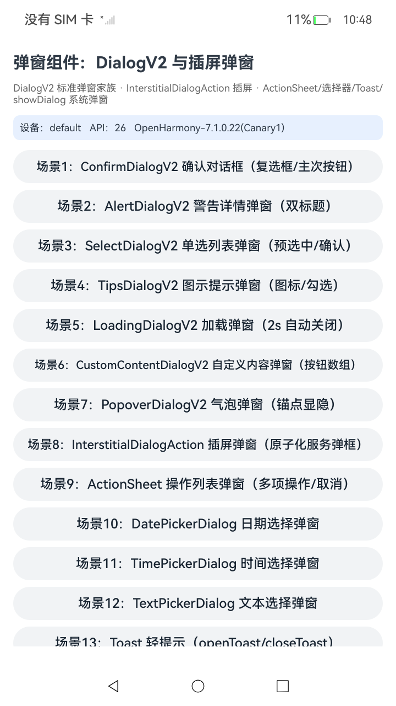
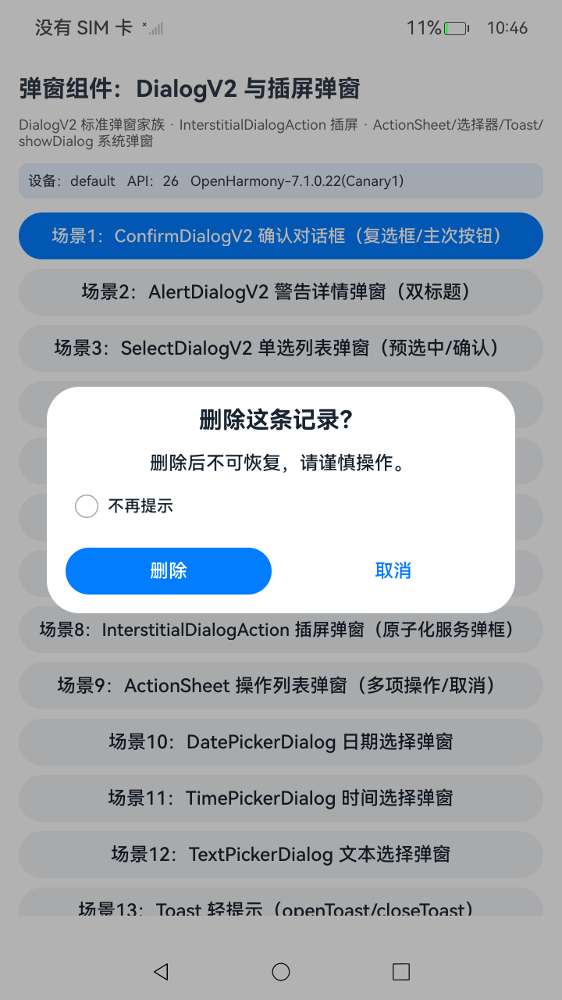
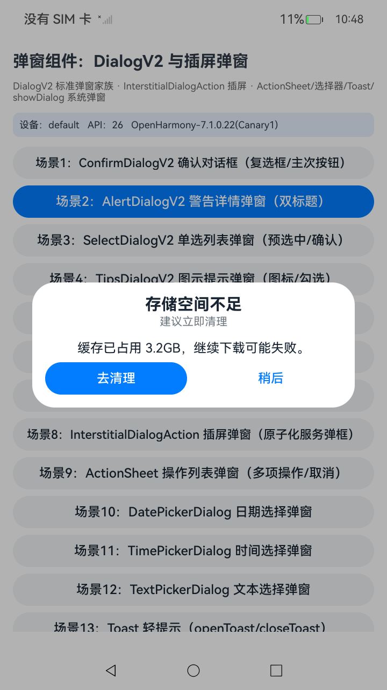
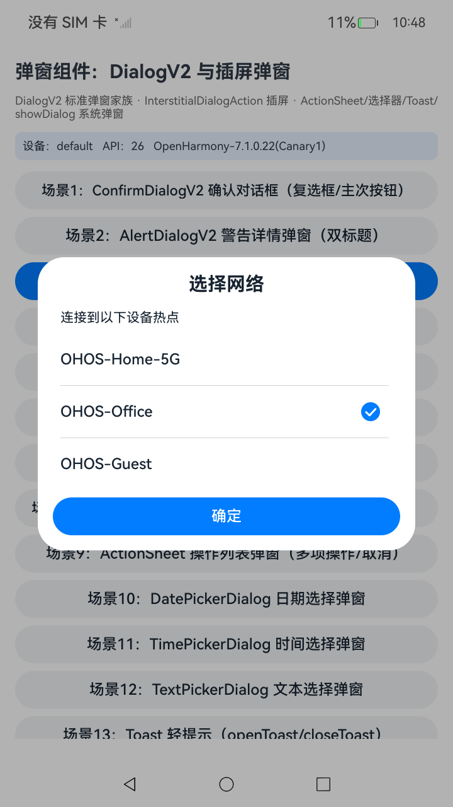
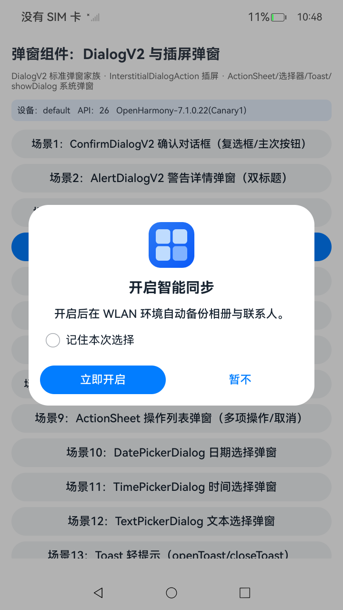
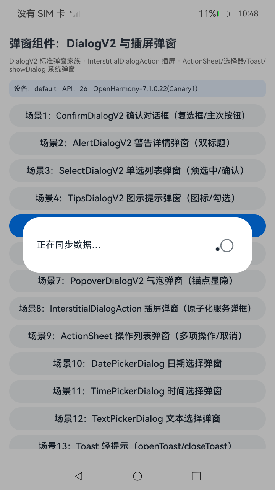
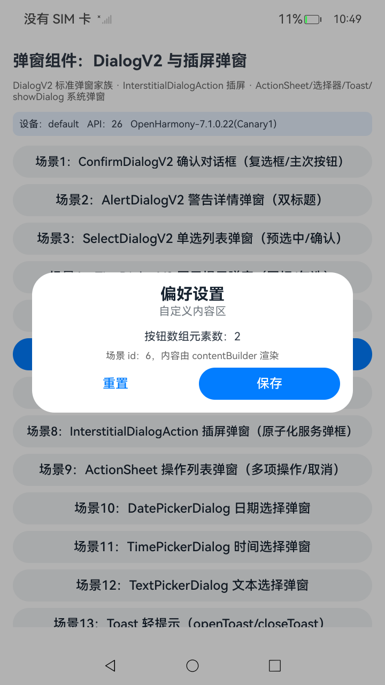
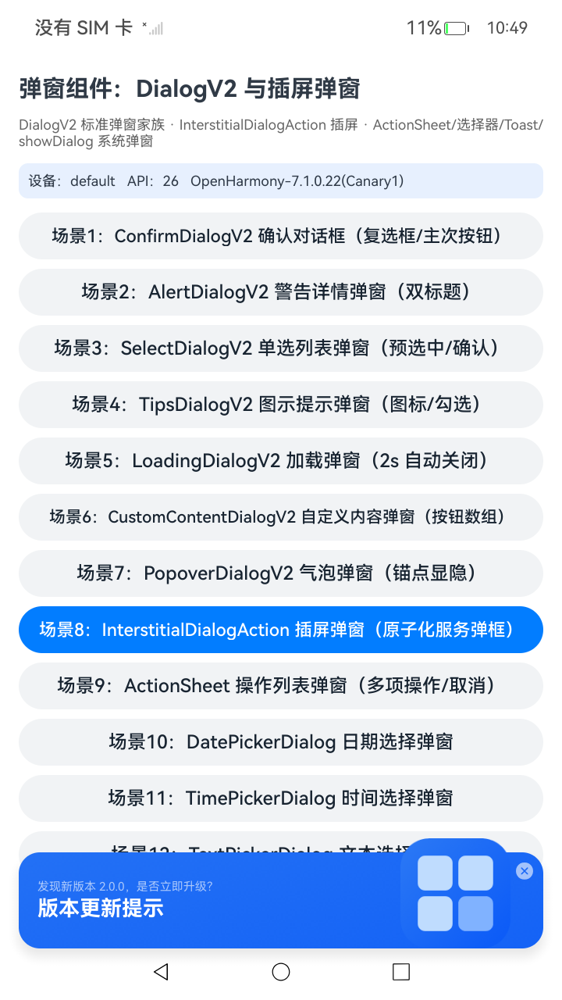
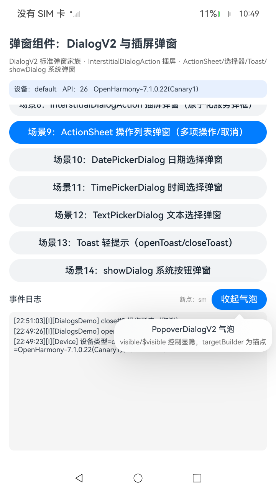

# DialogsDemo (DialogV2 / InterstitialDialogAction)

An ArkUI advanced-components sample project corresponding to the samples catalog entry `UI/AdvancedComponents/Dialogs`: it demonstrates the **DialogV2** family (API 18+) of standard dialogs and the **InterstitialDialogAction** (API 12+) interstitial dialog. Dialogs are modal surfaces that show information or pending actions while keeping the current context.

- Runs as a normal application (verified on RK3568 / OpenHarmony 7.0.0.46 Beta1 and 7.1.0.22 Canary1, including the interstitial dialog).
- All 8 scenes open instantly on tap; every callback is written to the on-screen event log at the bottom.
- Dialogs never stack: scenes 1–7 close any open dialog before showing a new one, and scene 8 ignores repeated taps while the interstitial is open.
- 125 on-device tests: 43 baseline tests pass on device (`Tests run: 43, Failure: 0, Error: 0`); 82 matrix tests are compile-verified with `entry@ohosTest` and pending an on-device rerun.

## Scenes

| # | Scene | Component | Key params / interactions |
| --- | --- | --- | --- |
| 1 | Confirm dialog | `ConfirmDialogV2` | title/content, checkbox (`checkTips` + `onCheckedChange`), primary/secondary `AdvancedDialogV2Button` callbacks logged |
| 2 | Alert dialog | `AlertDialogV2` | `primaryTitle`/`secondaryTitle` + content + two buttons |
| 3 | Select dialog | `SelectDialogV2` | `radioContent: SheetInfo[]` (each `action` required), `selectedIndex`, `confirm` callback records the pick |
| 4 | Tips dialog | `TipsDialogV2` | `imageRes` icon, `checkTips`/`checked`, primary/secondary buttons |
| 5 | Loading dialog | `LoadingDialogV2` | `content` text, auto-closed via `closeCustomDialog` after 2s |
| 6 | Custom content dialog | `CustomContentDialogV2` | `contentBuilder` custom content area, `buttons: AdvancedDialogV2Button[]` |
| 7 | Popover | `PopoverDialogV2` | `visible`/`$visible` show/hide, `targetBuilder` anchor, `popover.builder` bubble content (embedded in the tree, non-modal) |
| 8 | Interstitial | `InterstitialDialogAction` | `title`/`subtitle`, `titlePosition(BOTTOM)`, `iconStyle`, foreground image, `onDialogClick`/`onDialogClose` logged, closed via top-right X |

## Preview

| Home | Confirm | Alert | Select |
| --- | --- | --- | --- |
|  |  |  |  |

| Tips | Loading | Custom | Interstitial | Popover |
| --- | --- | --- | --- | --- |
|  |  |  |  |  |

## Implementation notes

DialogV2 components cannot use the legacy `CustomDialogController`; the standard presentation is "module-level `@Builder` + `ComponentContent` + `PromptAction`":

```ets
@Builder
function confirmBuilder(params: Object) {
  // The ComponentContent path behaves like customStyle=true: the dialog
  // container and DialogV2 itself draw no background, so the builder root
  // renders its own opaque rounded surface.
  Column() {
    ConfirmDialogV2({ /* ... */ })
  }
  .width('90%')
  .constraintSize({ maxWidth: 400 })
  .backgroundColor('#FFFFFF')
  .borderRadius(28)
  .clip(true)
}

const content = new ComponentContent<Object>(
  this.getUIContext(), wrapBuilder(confirmBuilder), params);
this.getUIContext().getPromptAction().openCustomDialog(content, {
  autoCancel: true, alignment: DialogAlignment.Center, maskColor: '#4D000000'
});
this.getUIContext().getPromptAction().closeCustomDialog(content);
```

Two detached-context pitfalls found via on-device jscrash, when builders run outside the page component (`this` no longer points at the page):

1. `CustomContentDialogV2.contentBuilder` must be a **direct reference to a zero-arg global `@Builder`** (an arrow closure that calls a global builder crashes with `Cannot read property observeComponentCreation2 of undefined`); dynamic content is bridged through a module-level variable.
2. `PopoverDialogV2`'s `popover.builder` is invoked **unbound**, so use a **page `@Builder` method wrapped in an arrow that lexically captures `this`**.

Full Chinese documentation with scene tables, build/test commands, the test matrix, and known limitations: see [README_zh.md](README_zh.md).

## Build / install / test

```bash
hvigorw --mode module -p module=entry@default assembleHap
hdc install -r entry/build/default/outputs/default/entry-default-signed.hap
hdc shell aa start -b com.samples.dialogsdemo -a EntryAbility

# on-device tests (signing uses the OpenHarmony default debug signing shipped with the SDK)
hvigorw --mode module -p module=entry@ohosTest -p product=default assembleHap
hdc install -r entry/build/default/outputs/ohosTest/entry-ohosTest-signed.hap
hdc shell aa test -b com.samples.dialogsdemo -m entry_test \
  -s unittest OpenHarmonyTestRunner -s timeout 150000
```

Without a signing config the output is an unsigned HAP: it can be used for compile verification but not installed on a device.
