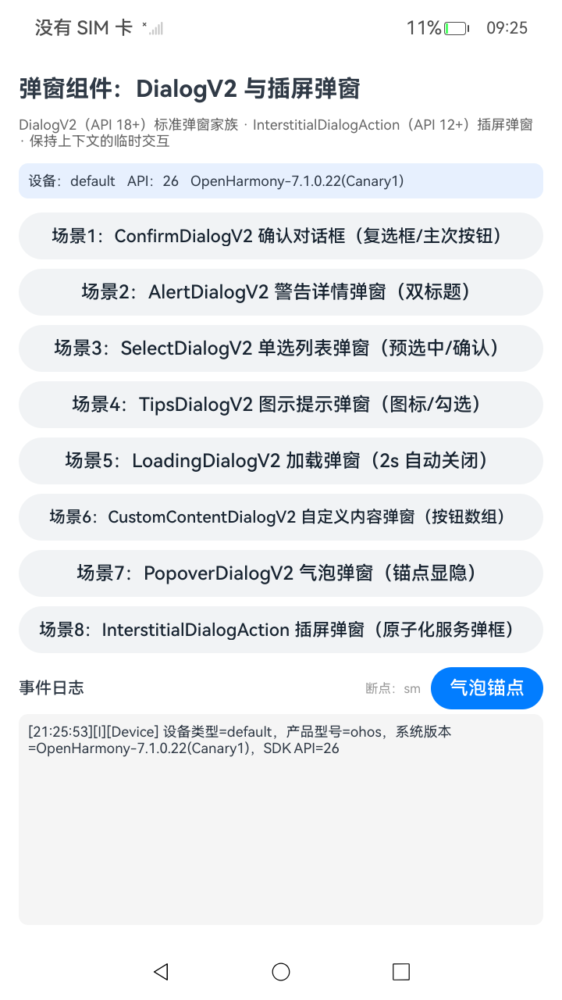
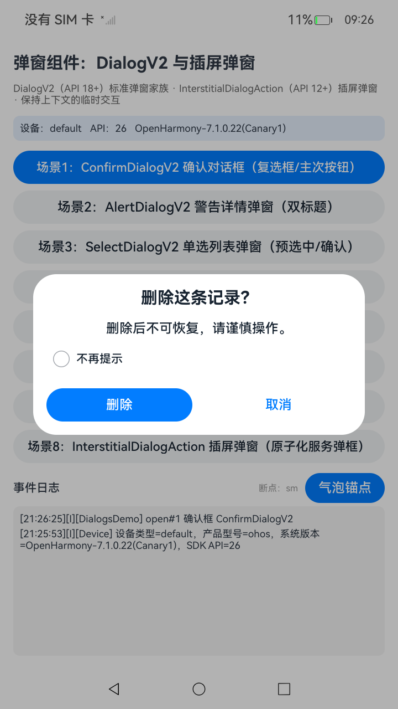
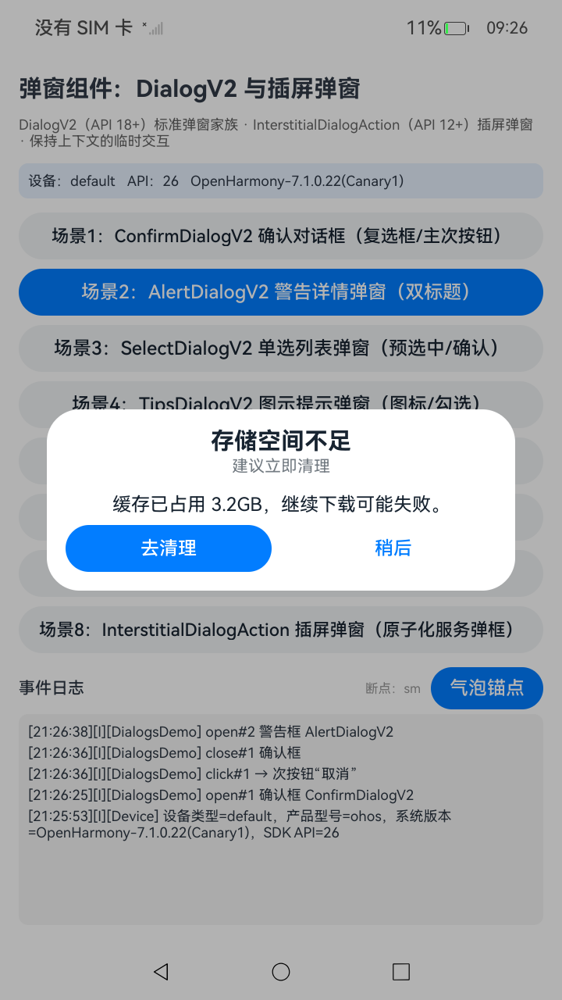
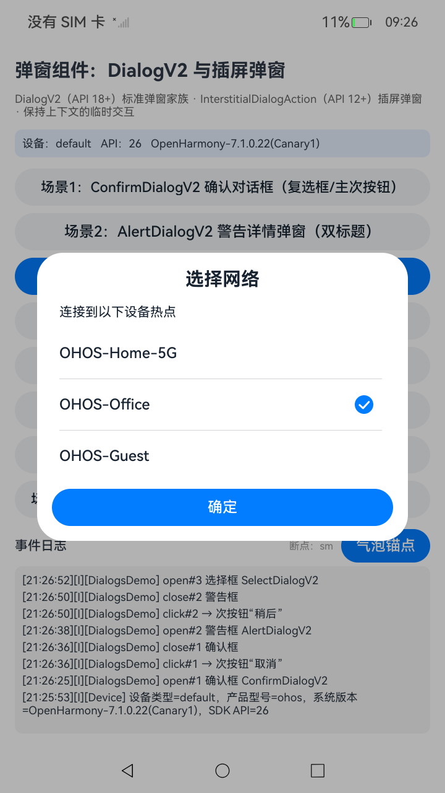
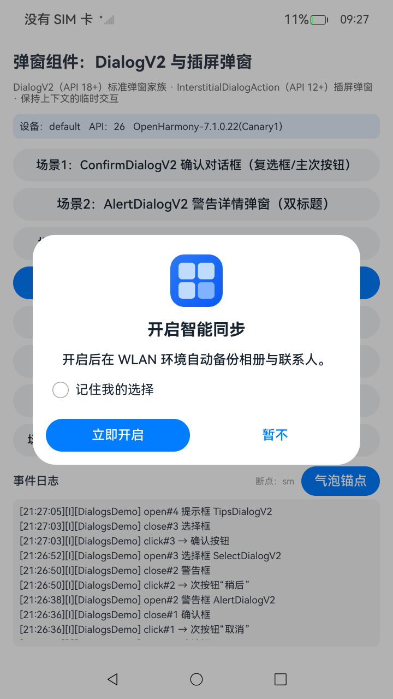
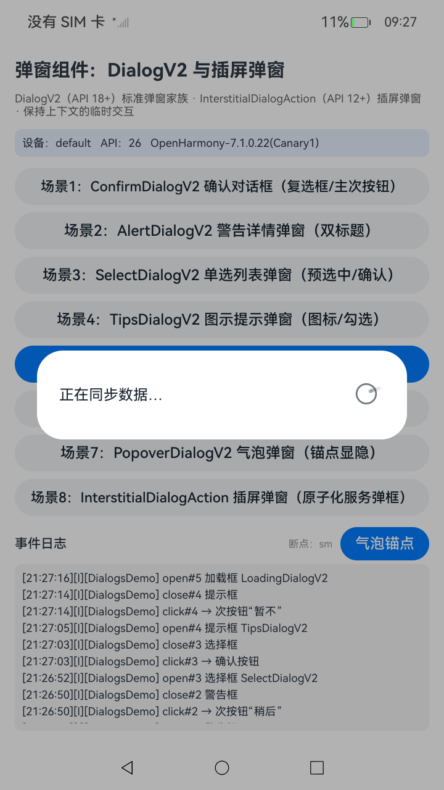
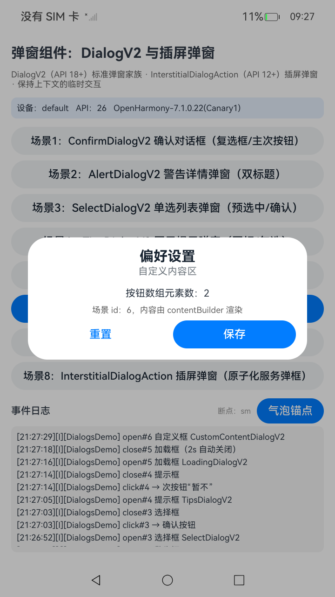
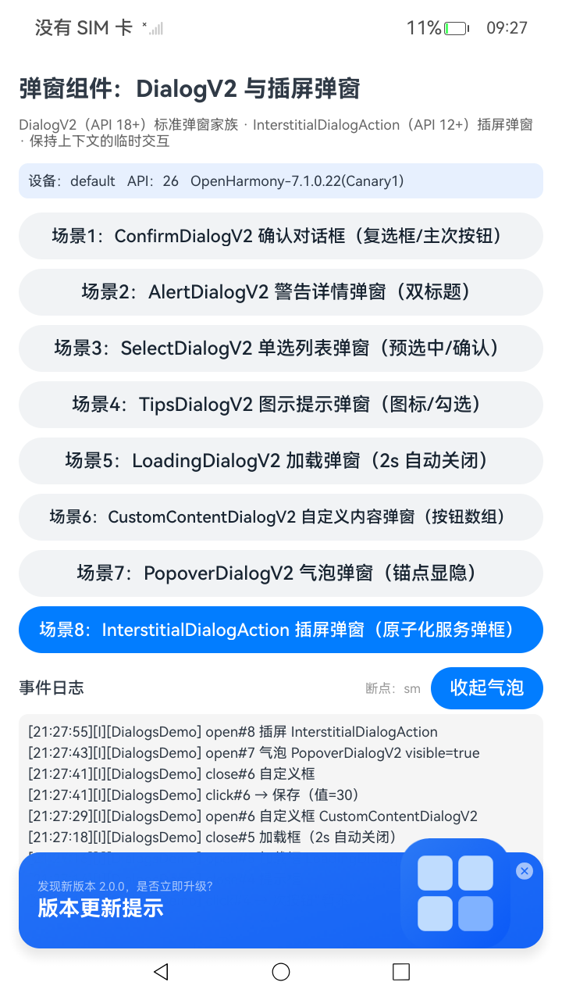
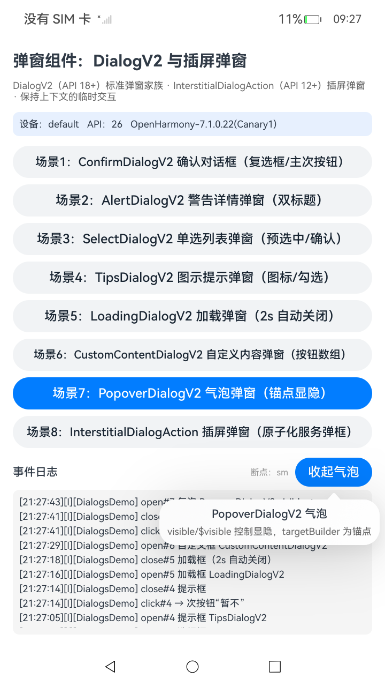

# DialogsDemo 弹窗组件样例（DialogV2 / InterstitialDialogAction）

基于 ArkUI 高级组件的弹窗样例工程，对应样例目录 `UI/AdvancedComponents/Dialogs`：使用 **DialogV2**（API 18+）展示标准弹窗家族，使用 **InterstitialDialogAction**（API 12+）展示插屏弹窗，并覆盖 **ActionSheet / 日期 / 时间 / 文本选择 / Toast / showDialog** 等系统弹窗与轻提示。弹窗用于在保持当前上下文环境时，临时展示用户需关注的信息或待处理的操作，用户在弹窗内完成交互后返回原上下文。

- 普通应用可直接安装运行（真机 RK3568 / OpenHarmony 7.0.0.46 Beta1、7.1.0.22 Canary1 实测通过，含插屏弹窗）。
- 全部 14 个场景同步即点即弹，事件写入页面底部「事件日志」面板，便于核对回调时序。
- 设备侧测试共 144 例，已在 RK3568（API 26）真机全量通过（`Tests run: 144, Failure: 0, Error: 0, Pass: 144`）。

## 环境要求

- DevEco Studio（OpenHarmony SDK API 26，compileSdkVersion / compatibleSdkVersion 26.0.0，runtimeOS: OpenHarmony）
- OpenHarmony 真机或模拟器（本工程在 RK3568 dayu200 真机验证）

## 场景一览

| # | 场景 | 组件 | 关键参数 / 交互 |
| --- | --- | --- | --- |
| 1 | 确认对话框 | `ConfirmDialogV2` | 标题/内容/复选框（`checkTips`+`onCheckedChange`）、主次按钮（`AdvancedDialogV2Button`）回调写日志 |
| 2 | 警告详情弹窗 | `AlertDialogV2` | `primaryTitle`/`secondaryTitle` 双标题 + 内容 + 双按钮 |
| 3 | 单选列表弹窗 | `SelectDialogV2` | `radioContent: SheetInfo[]`（`action` 必填）、`selectedIndex` 预选中、`confirm` 确认回调记录选中项 |
| 4 | 图示提示弹窗 | `TipsDialogV2` | `imageRes` 图标、`checkTips`/`checked`、主次按钮 |
| 5 | 加载中弹窗 | `LoadingDialogV2` | `content` 提示文案，2 秒后 `closeCustomDialog` 自动关闭 |
| 6 | 自定义内容弹窗 | `CustomContentDialogV2` | `contentBuilder` 自定义内容区、`buttons: AdvancedDialogV2Button[]` 按钮数组 |
| 7 | 气泡弹窗 | `PopoverDialogV2` | `visible`/`$visible` 控制显隐、`targetBuilder` 锚点、`popover.builder` 气泡内容（内嵌组件树，非模态） |
| 8 | 插屏弹窗 | `InterstitialDialogAction` | `title`/`subtitle`、`titlePosition(BOTTOM)`、`iconStyle`、前景图、`onDialogClick`/`onDialogClose` 日志，右上角 X 关闭 |
| 9 | 操作列表弹窗 | `UIContext.showActionSheet` | `title`/`subtitle`/`message`、`sheets`（重命名/分享/删除）、`confirm` 取消、`cancel` 遮罩关闭 |
| 10 | 日期选择弹窗 | `UIContext.showDatePickerDialog` | `start`/`end`/`selected`、`onDateAccept`/`onCancel`，结果按 `YYYY-MM-DD` 记日志 |
| 11 | 时间选择弹窗 | `UIContext.showTimePickerDialog` | `selected`、`useMilitaryTime`、`onAccept`/`onCancel`，结果按 `HH:mm` 记日志 |
| 12 | 文本选择弹窗 | `UIContext.showTextPickerDialog` | `range` 数组、`selected`、`onAccept`/`onCancel`，结果按 `index=n value=xxx` 记日志 |
| 13 | 轻提示 | `PromptAction.openToast` / `closeToast` | `message`/`duration`/`bottom`，1 秒后主动 `closeToast`，日志记录 toastId |
| 14 | 系统按钮弹窗 | `PromptAction.showDialog` | 多按钮（不保存/保存），Promise 返回按下按钮 `index` |

## 预览

| 首页 | 确认框 | 警告框 | 单选框 |
| --- | --- | --- | --- |
|  |  |  |  |

| 图示提示 | 加载框 | 自定义内容 | 插屏弹窗 | 气泡 |
| --- | --- | --- | --- | --- |
|  |  |  |  |  |

> 加载框 2 秒自动关闭，截图为出现瞬间；插屏弹窗呈现为屏幕底部横幅样式。

## 工程目录

```
entry/src/main/ets/
├── entryability/EntryAbility.ets       # 入口 Ability
├── model/
│   ├── DialogModels.ets                # 纯逻辑：事件簿记、按钮/SheetInfo 工厂、参数类
│   └── utils/
│       ├── LogUtil.ets                 # 双通道日志（hilog + UI 面板回调）
│       └── DeviceUtil.ets              # 设备信息 / 断点判断
└── pages/Index.ets                     # 14 场景按钮 + 日志面板 + 各弹窗 @Builder
entry/src/ohosTest/ets/test/            # 设备侧测试（hypium，10 套件 144 例）
├── List.test.ets                       # 注册十套件
├── DialogModels.test.ets               # 22 例：事件簿记/按钮工厂/SheetInfo/枚举/参数类
├── LogUtil.test.ets                    # 12 例
├── DeviceUtil.test.ets                 # 8 例
├── Ability.test.ets                    # 1 例
├── DialogEventLogMatrix.test.ets       # 24 例：编号边界/容量淘汰/快照/隔离
├── DialogModelsMatrix.test.ets         # 26 例：按钮边界/百条 SheetInfo/配置与参数类
├── LogUtilMatrix.test.ets              # 16 例：固定时刻/四级格式/消息保真
├── DeviceUtilMatrix.test.ets           # 16 例：分数边界/单调性/重复查询稳定
├── DialogScenarios.test.ets            # 7 例：场景目录完整性/API 映射/结果格式化
└── DialogScenariosMatrix.test.ets      # 12 例：分组/唯一性/独立性/边界/Unicode/两位场景号
```

## 具体实现

**DialogV2 家族的呈现方式**：DialogV2 组件不能配旧 `CustomDialogController`，标准做法是「模块级 `@Builder` + `ComponentContent` + `PromptAction`」：

```ets
@Builder
function confirmBuilder(params: Object) {
  // ComponentContent 呈现等价 customStyle=true：弹窗容器不带背景，
  // DialogV2 自身也是透明排版，故 Builder 根节点需自绘白色圆角表面
  Column() {
    ConfirmDialogV2({
      title: (params as ConfirmParams).title,
      /* ... */
    })
  }
  .width('90%')
  .constraintSize({ maxWidth: 400 })
  .backgroundColor('#FFFFFF')
  .borderRadius(28)
  .clip(true)
}

// 打开：UIContext 上取 PromptAction，openCustomDialog 呈现 ComponentContent
const content = new ComponentContent<Object>(
  this.getUIContext(), wrapBuilder(confirmBuilder), params);
this.getUIContext().getPromptAction().openCustomDialog(content, {
  autoCancel: true, alignment: DialogAlignment.Center, maskColor: '#4D000000'
});
// 关闭：closeCustomDialog(content)（引用相等），场景 5 加载框即用此方式 2s 自动关闭
```

**分离上下文的两个坑（真机 jscrash 定位）**：经 `ComponentContent` 呈现时，@Builder 运行在脱离页面组件的上下文中，`this` 不指向页面：

1. `CustomContentDialogV2.contentBuilder` 不能用箭头闭包间接调用全局 @Builder（`Cannot read property observeComponentCreation2 of undefined` 而崩溃）。正确写法是**零参全局 @Builder 直接引用**，动态内容经模块级变量桥接：
   ```ets
   let gCustomParams: CustomParams | null = null;
   @Builder function customInnerBuilder() { /* 读 gCustomParams 渲染 */ }
   @Builder function customBuilder(params: Object) {
     CustomContentDialogV2({ contentBuilder: customInnerBuilder, /* ... */ })
   }
   ```
2. `PopoverDialogV2` 的 `popover.builder` 被框架**无绑定调用**，全局 @Builder 同样崩溃。改用**页面 @Builder 方法 + 箭头闭包词法捕获 `this`**：
   ```ets
   popover: {
     builder: (): void => { this.popContent() },
     placement: Placement.Bottom
   } as PopoverDialogV2Options
   ```

**事件簿记**：`DialogEventLog`（`DialogModels.ets`）统一产出 `open#n / close#n / click#n / select#n / check#n` 格式事件行，容量 60 行滚动，供日志面板展示与测试断言；弹窗按钮经 `buildPrimaryButton`/`buildSecondaryButton` 工厂创建（主按钮 `EMPHASIZED`、次按钮 `TEXTUAL`）。

**插屏弹窗**：`new InterstitialDialogAction({ uiContext: this.getUIContext(), title, subtitle, titlePosition: TitlePosition.BOTTOM, iconStyle: IconStyle.LIGHT, foregroundImage, onDialogClick, onDialogClose })`，`openDialog()` / `closeDialog()` 控制；调用以 try/catch 包裹，异常写入日志面板。

**系统弹窗与轻提示**：场景 9–14 直接使用 `UIContext` / `PromptAction` 提供的系统能力——`showActionSheet`（操作列表）、`showDatePickerDialog` / `showTimePickerDialog` / `showTextPickerDialog`（选择器）、`openToast` + `closeToast`（轻提示）、`showDialog`（系统按钮弹窗）。外观与按钮样式由系统弹窗自身决定；样例负责组织数据并把回调结果写入事件日志（日期 `YYYY-MM-DD`、时间 `HH:mm`、文本 `index=n value=xxx`、按钮 `index`）。

## 构建 / 安装 / 测试

```bash
# 构建（项目根目录）
hvigorw --mode module -p module=entry@default assembleHap
# 安装
hdc install -r entry/build/default/outputs/default/entry-default-signed.hap
# 启动
hdc shell aa start -b com.samples.dialogsdemo -a EntryAbility

# 设备侧测试（构建 ohosTest HAP 并执行；签名使用 SDK 自带的 OpenHarmony 默认调试签名）
hvigorw --mode module -p module=entry@ohosTest -p product=default assembleHap
hdc install -r entry/build/default/outputs/ohosTest/entry-ohosTest-signed.hap
hdc shell aa test -b com.samples.dialogsdemo -m entry_test \
  -s unittest OpenHarmonyTestRunner -s timeout 150000
```

未配置签名时产物为 unsigned HAP，可用于编译验证，但无法安装到设备。

## 设备侧测试（144 例）

设备侧测试位于 `entry/src/ohosTest/ets/test/`，共 10 个套件、144 条用例，通过 `List.test.ets` 聚合。用例分布如下：

| 类别 | 套件 | 用例 | 状态 |
| --- | --- | --- | --- |
| 纯逻辑与设备集成套件 | `Ability` / `DeviceUtil` / `LogUtil` / `DialogModels` | 43 | 已在 RK3568（API 26）真机全量通过 |
| 组合展开套件 | `DialogEventLogMatrix` / `DialogModelsMatrix` / `LogUtilMatrix` / `DeviceUtilMatrix` | 82 | 已在 RK3568（API 26）真机全量通过 |
| 场景目录与结果格式化 | `DialogScenarios` | 7 | 已在 RK3568（API 26）真机全量通过 |
| 场景目录边界与组合 | `DialogScenariosMatrix` | 12 | 已在 RK3568（API 26）真机全量通过 |
| 手工 UI 用例 | 见 `ohosTest.md` 用例表 | 12 | 需在设备上手工操作 |

| 套件 | 数量 | 覆盖 |
| --- | --- | --- |
| dialogModelsTest | 22 | open/close/click/select/check/error 事件格式化；容量 60 的精确边界（第 60/61 条）、快照隔离、前缀行首匹配、clear；主次按钮工厂默认值与 action（含无回调场景）；SheetInfo 空列表、标题快照、重复标题下标闭包；IconStyle/TitlePosition/BottomOffset 枚举值；各参数类 sceneId 与实例隔离 |
| logUtilTest | 12 | init 注入/替换回调、未传级别保持阈值、行格式、级别过滤与等值边界、setMinLevel 即时生效、levelMark（含未知值）、formatTime 补零 |
| deviceUtilTest | 8 | 设备类型、宽屏与形态精确一致、断点边界与极值、preferTwoColumn 阈值（599/600） |
| abilityTest | 1 | Ability 启动 |
| DialogEventLogMatrix | 24 | scene 编号 0 / 负数 / 大数、空名称与中文 emoji、空串 / 重复 / 1000 字符 / 多行事件；容量淘汰顺序与淘汰后查询、空前缀 / 整行前缀 / 大小写敏感；clear 复用、快照隔离、实例隔离 |
| DialogModelsMatrix | 26 | 按钮内容边界与实例隔离、action 多次触发与主次独立；SheetInfo 单条 / 空串 / 百条 / 回调隔离 / 顺序；插屏配置另一枚举组合、字段可变与实例隔离；五类参数默认值、sceneId 唯一、按钮数组顺序与追加 |
| LogUtilMatrix | 16 | init 不写面板、级别枚举序、固定时刻格式化（03:04:05 / 00:00:00 / 12:00:00 / 23:00:00 / 12:59:59）与时间令牌形状、四级行格式、标签与消息保真、长消息与多行消息 |
| DeviceUtilMatrix | 16 | 480 / 1024 / 1366 宽度、599.9 / 600.1 / 839.9 / 840.1 分数边界、档位单调、双栏结论一致、形态标志精确一致、SDK API 正整数、日志不抛异常、重复查询稳定 |
| dialogScenariosTest | 7 | 场景目录 14 项与 id 连续、9–14 的 API 映射、越界查询、日期/时间/文本结果格式化 |
| dialogScenariosMatrix | 12 | 分组计数、标题/API 唯一、目录返回独立副本、目录与查询一致、分组边界、日期年份/单数字/忽略时间、时间边界、Unicode 与越界下标、两位 sceneId 事件行 |

组合用例逐条显式书写并带完整 `@tc` 头（number / name / desc / size / type / level），只调用 `DialogModels.ets`、`LogUtil.ets`、`DeviceUtil.ets` 中的真实实现，测试内不复制业务逻辑；期望值来自 API 语义（事件行格式、60 行容量、日志行格式、600 / 840vp 断点）。

弹窗的实际呈现与回调时序（open→click→close）由真机点按逐场景验证：14 类弹窗/提示均能弹出/关闭，事件日志与预期一致。

## 已知限制

1. **弹窗表面为固定白色**：`ComponentContent` 呈现路径不提供容器背景，工程在各 `@Builder` 根节点自绘白色圆角表面（90% 宽、最大 400vp），未适配深色模式；如需跟随系统主题，可改用 `$r('sys.color.ohos_id_color_dialog_bg')` 等系统色或按主题切换背景色。
2. **插屏弹窗可用性**：`InterstitialDialogAction` 标注 @atomicservice，本工程在**普通应用**（非原子化服务）真机验证可正常弹出与关闭（底部横幅样式）；在其它 ROM/版本上的行为以实际运行为准。
3. **气泡显隐同步**：气泡被模态弹窗等外层交互打断消失时，锚点按钮文案可能与实际显隐短暂不一致，再次点击锚点即可同步。
4. **SheetInfo**：`SelectDialogV2` 的 `radioContent` 中每项 `action` 回调为必填，本工程在 action 内记录选中下标。
5. **SelectDialogV2 选项点击行为**：本 ROM（OpenHarmony-7.1.0.22 Canary1 / API 26）点击单选项后组件内部会直接关闭弹窗（`autoCancel:false` 与 `onWillDismiss` 均无法拦截，与文档“仅确定按钮关闭”不一致）。示例在 `SheetInfo.action` 中用新选中项重新呈现同一弹窗，并以 `TransitionEffect.IDENTITY` 关闭显隐动画，保持“先选择、再点确定关闭”的交互且不闪动；其它 ROM 若行为不同，可移除该重开逻辑。
6. **弹窗不叠加**：连续点按场景按钮不会叠加多个弹窗——场景 1–7 在打开新弹窗前会关闭已存在的弹窗（`showContent` 预关闭），场景 8 在插屏已打开时忽略重复点击并记录日志；点击插屏本体或应用从后台回到前台时会清空插屏打开状态，因此可随时再次点击场景 8 重新弹出。
7. 加载框 2 秒自动关闭，README 截图为出现瞬间画面。
8. **系统弹窗样式由系统提供**：场景 9–14 使用 `showActionSheet` / 选择器 / `showDialog` / `openToast`，其外观、按钮文案与主题跟随系统，不同 ROM 可能略有差异；样例只保证数据组织与回调/日志时序。
